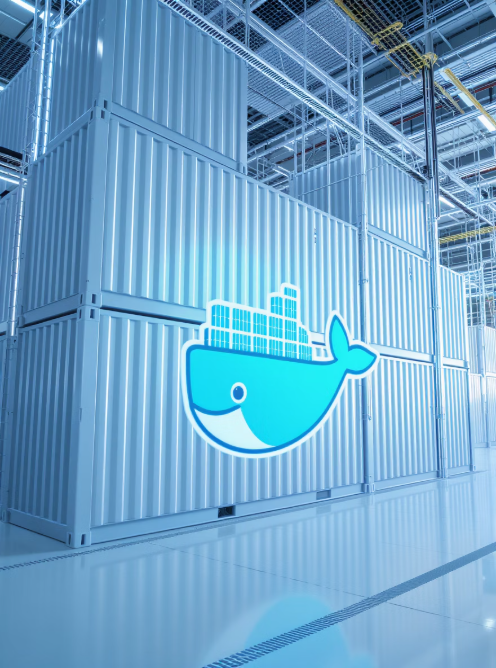
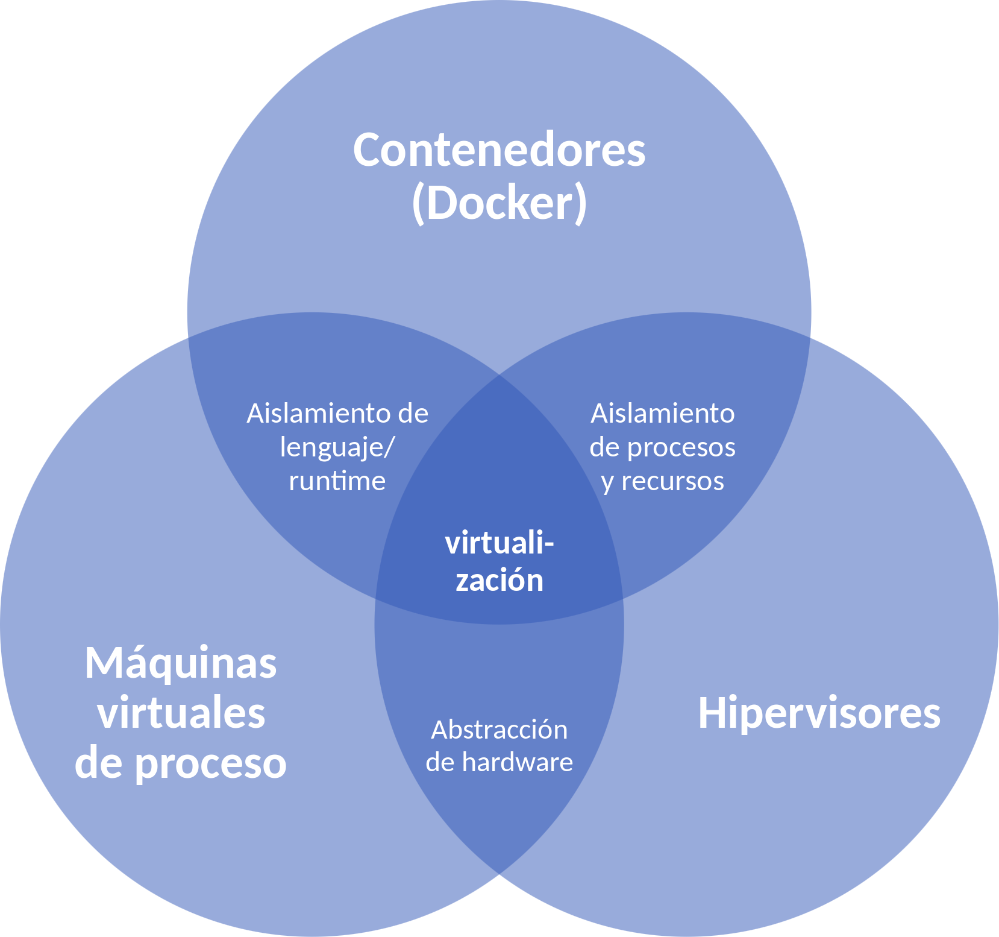
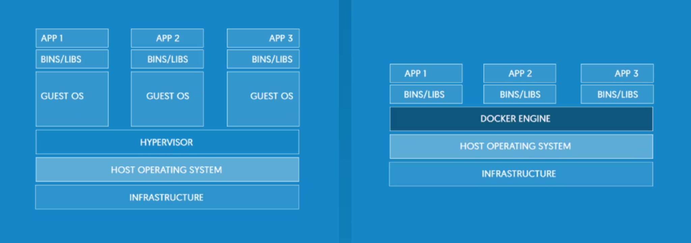
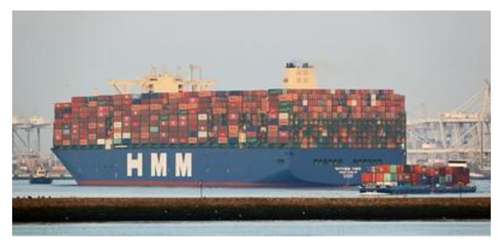
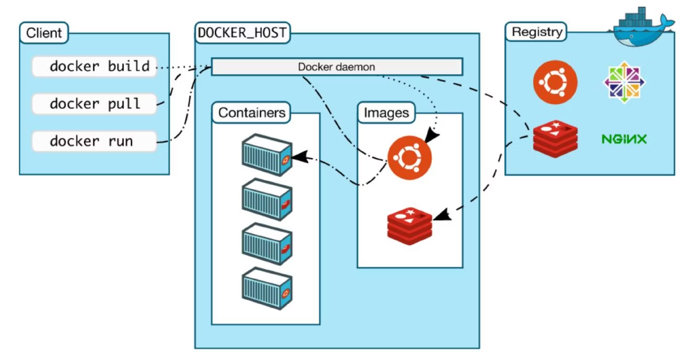

# Cómo usar este dosier {.nobreak}

Esta UT te lleva desde la pregunta «¿qué es un contenedor?» hasta tu primer servidor web funcionando dentro de uno. Primero se explica la **virtualización** y qué aporta cada tecnología, después qué es un contenedor y cómo se apoya en el núcleo de Linux, luego cómo está montado Docker y, por último, cómo **arrancar contenedores**: `docker run`, las opciones más comunes, los registros, el reinicio automático y la publicación de puertos.

Es un dosier para leer con la máquina virtual de clase, `cont-vm`, encendida. Conéctate por SSH y escribe cada comando a medida que lo leas: muchas cosas se entienden mejor cuando las ves pasar en tu propia pantalla. Cuando un apartado te pida **dos terminales**, abre una segunda sesión SSH a la misma VM.

A lo largo del texto encontrarás cuatro tipos de caja:

!!! definicion "Definición"
    Un término que tienes que saber explicar con tus propias palabras. Si te preguntan «¿qué es…?», la respuesta está aquí.

!!! ejemplo "Ejemplo"
    Un caso concreto, casi siempre con el comando y lo que verás en pantalla. Si una idea no te queda clara, empieza por el ejemplo.

!!! ojo "Ojo"
    Un error típico, una confusión frecuente entre conceptos parecidos o un detalle que conviene tener muy claro.

!!! comprueba "Comprueba"
    Preguntas cortas al final de cada bloque. Si no sabes contestarlas sin mirar, vuelve a leer el bloque.

Los bloques están numerados del 1 al 7 y la UT2 continúa en el bloque 8. Al final tienes un **glosario**, un **mapa resumen** y una **autoevaluación** para repasar.

## Qué vas a aprender

Al terminar esta UT deberías ser capaz de:

- **Definir** qué es la virtualización y enumerar sus ventajas y aplicaciones.
- **Distinguir** entre máquina virtual de proceso, hipervisor y contenedor, y explicar qué aísla o abstrae cada uno.
- **Comparar** contenedores y máquinas virtuales en consumo, arranque, rendimiento y sistemas que pueden ejecutar.
- **Explicar** por qué los contenedores resuelven el problema de «en mi máquina funcionaba».
- **Valorar** las ventajas e inconvenientes de los contenedores y decidir cuándo conviene usarlos.
- **Situar** en el tiempo los precursores de los contenedores (chroot, Jail, LXC) y la aparición de Docker.
- **Explicar** el papel de los *namespaces* y los *cgroups* del núcleo Linux.
- **Describir** cómo funcionan los contenedores Linux en Windows y macOS.
- **Identificar** las tres piezas de la arquitectura de Docker: cliente, servidor (*Docker host*) y registro.
- **Explicar** qué hace Docker, paso a paso, cuando ejecutas `docker run`.
- **Listar** los contenedores en ejecución y los detenidos con `docker ps` y `docker ps -a`.
- **Usar** las opciones más comunes de `docker run`: `-d`, `-p`, `-v`, `--name`, `--rm`, `-e` y `--env-file`.
- **Distinguir** entre ejecutar un contenedor en primer plano y en segundo plano (*detached*).
- **Consultar** los registros de un contenedor con `docker logs` y conectarte a él con `docker attach`.
- **Elegir** la política de reinicio adecuada (`no`, `always`, `unless-stopped`, `on-failure`) para cada caso.
- **Publicar** puertos de un contenedor con `-p`, uno, varios o por rangos, y acceder al servicio desde el navegador.

## Índice

| Bloque | Contenido |
|---|---|
| [1](#bloque-1-conceptos-previos-la-virtualizacion) | Conceptos previos: virtualización, máquinas virtuales e hipervisores |
| [2](#bloque-2-contenedores) | Contenedores: qué son, en qué se diferencian de una VM y cuándo usarlos |
| [3](#bloque-3-contenedores-en-sistemas-linux) | Contenedores en sistemas Linux: orígenes, *namespaces* y *cgroups* |
| [4](#bloque-4-docker) | Docker: qué es y cómo es su arquitectura |
| [5](#bloque-5-arrancar-contenedores-el-comando-base) | Arrancar contenedores: el comando base, `docker ps` y las opciones comunes |
| [6](#bloque-6-modo-detached-registros-y-reinicio-automatico) | Modo *detached*, registros y reinicio automático |
| [7](#bloque-7-mapeo-de-puertos-conectar-los-contenedores-con-el-exterior) | Mapeo de puertos: conectar los contenedores con el exterior |
| Anexos | Glosario, mapa resumen y autoevaluación |

# Bloque 1. Conceptos previos: la virtualización

## 1.1 ¿Qué son los contenedores y Docker?

En esta UT empiezas a trabajar con **contenedores**, y en concreto con la tecnología **Docker**.

Docker nació para Linux, pero ha crecido hasta convertirse en una solución multiplataforma: hoy funciona de manera eficiente en **Linux**, **Windows** y **macOS**.

<figure class="small"></figure>

!!! ojo "Ojo"
    «Docker funciona en Windows y macOS» no significa que los contenedores Linux se ejecuten directamente sobre esos sistemas. Por debajo siempre hay un núcleo Linux, normalmente dentro de una máquina virtual ligera que Docker Desktop crea por ti. Lo verás con detalle en el apartado 3.4. En clase trabajamos directamente sobre Linux (Ubuntu Server en VirtualBox), que es donde Docker es nativo.

Para entender qué es un contenedor hay que empezar un paso antes, por la **virtualización**, porque un contenedor es, en el fondo, una forma de virtualizar.

## 1.2 Virtualización

!!! definicion "Definición"
    **Virtualización**: tecnología que **abstrae el hardware**, de modo que podemos administrar recursos virtuales (CPU, memoria, disco, red) como si fueran reales.

La virtualización es fundamental para el despliegue de sistemas, el desarrollo de software y las pruebas, y ofrece ahorros importantes en costes: menos máquinas físicas significa menos energía y menos mantenimiento. Además, es la clave para entender cómo funcionan los contenedores en cualquier sistema operativo.

| Ventajas | Aplicaciones |
|---|---|
| Optimización de recursos | Desarrollo de software |
| Aislamiento de aplicaciones | Operaciones e infraestructura |
| Portabilidad | Entornos de pruebas |
| Fácil gestión y despliegue | Producción distribuida |

!!! ejemplo "Ejemplo"
    Un servidor físico con 64 GB de RAM y 16 núcleos pasa la mayor parte del día al 10 % de uso ejecutando un único servicio. Si lo virtualizamos, en ese mismo equipo pueden convivir el servidor web, la base de datos, el correo y un entorno de pruebas, cada uno aislado de los demás. Se aprovecha mejor el hardware (**optimización de recursos**), un fallo en uno no tumba a los otros (**aislamiento**) y cualquiera de ellos se puede mover a otro servidor copiando unos archivos (**portabilidad**).

## 1.3 ¿Qué es una máquina virtual?

!!! definicion "Definición"
    **Máquina virtual (VM)**: entorno que simula un sistema operativo completo y permite ejecutar software o configuraciones de forma aislada, **sin afectar al sistema principal**.

Es una solución para probar, desarrollar y ejecutar programas de forma independiente. Existen tres tecnologías de virtualización clave:

- **Máquina virtual de proceso**
- **Hipervisor**
- **Contenedores** (aquí es donde se enmarca Docker)

Las tres son formas de **virtualización**, y cada una se caracteriza por **lo que aísla o abstrae**:

<figure class="small"></figure>

| Tecnología | Qué aísla o abstrae | Ejemplo |
|---|---|---|
| Máquina virtual de proceso | El lenguaje o *runtime* | JVM, .NET |
| Contenedor | Los procesos y los recursos | Docker |
| Hipervisor | El hardware | VirtualBox, Hyper-V |

!!! ojo "Ojo"
    En el diagrama, las etiquetas «aislamiento de lenguaje/runtime», «aislamiento de procesos y recursos» y «abstracción de hardware» aparecen en las **zonas de intersección** entre círculos, lo que puede hacer pensar que son rasgos compartidos. No es así: cada etiqueta describe **a una de las tres tecnologías**, como en la tabla de arriba. Lo que de verdad comparten las tres es lo del centro: todas son **virtualización**.

## 1.4 ¿Qué es una máquina virtual de proceso?

!!! definicion "Definición"
    **Máquina virtual de proceso (MVP)**: software que ejecuta programas diseñados para un sistema operativo o una arquitectura concretos **como si fueran nativos**, emulando el entorno que necesitan.

La diferencia con una VM «de sistema» es el alcance: la MVP no arranca un sistema operativo entero. Solo crea el entorno para **un programa** y desaparece cuando el programa termina.

| MVP | Qué hace |
|---|---|
| **Máquina Virtual de Java (JVM)** | Ejecuta *bytecodes* de Java en cualquier sistema con JVM, de modo que el mismo código funciona en Windows, Linux y macOS sin modificaciones |
| **Wine** | Permite ejecutar aplicaciones de Windows en Linux o macOS sin instalar Windows |
| **.NET Runtime** | Parecido a la JVM: ejecuta aplicaciones .NET en varias plataformas (Windows, Linux, macOS) gracias a .NET Core |

!!! ejemplo "Ejemplo"
    Compilas `Hola.java` en tu portátil con Windows y obtienes `Hola.class` (*bytecode*). Copias ese mismo archivo a la VM Ubuntu de clase y ejecutas `java Hola`: funciona igual, sin recompilar. Quien hace la «traducción» a cada sistema es la JVM instalada en cada uno.

!!! ojo "Ojo"
    Wine es un caso especial: su nombre significa *Wine Is Not an Emulator*. No emula un procesador ni arranca Windows, sino que **traduce las llamadas al sistema** de Windows a llamadas equivalentes de Linux o macOS. Por eso se agrupa con las MVP: crea el entorno que el programa espera para que se ejecute como si fuera nativo.

## 1.5 ¿Qué es un hipervisor?

!!! definicion "Definición"
    **Hipervisor**: software que **simula hardware** y permite instalar y ejecutar varios sistemas operativos (máquinas virtuales) sobre un sistema operativo anfitrión.

Es esencial en entornos multiplataforma y en soluciones como Docker Desktop, que lo usa para ofrecer buen rendimiento en Windows y macOS. Para saber más: <https://es.wikipedia.org/wiki/Hipervisor>

| Hipervisor | Característica |
|---|---|
| **VirtualBox** | Multiplataforma y gratuito |
| **VMware** | Solución empresarial |
| **Hyper-V** | Nativo de Windows |
| **Parallels** | Popular en macOS |

### Hipervisores de tipo 1 y de tipo 2

La definición de arriba habla de un hipervisor que funciona «sobre un sistema operativo anfitrión». Eso describe los hipervisores **de tipo 2**, pero existe otro tipo que conviene conocer:

| | Tipo 1 (*bare metal*, nativo) | Tipo 2 (alojado, *hosted*) |
|---|---|---|
| Dónde se ejecuta | Directamente sobre el hardware | Como un programa más dentro de un SO anfitrión |
| Rendimiento | Mayor | Algo menor (hay una capa más) |
| Uso típico | Servidores y centros de datos | Portátiles y equipos de escritorio |
| Ejemplos | Hyper-V, VMware ESXi, Proxmox (KVM) | VirtualBox, VMware Workstation, Parallels |

!!! ojo "Ojo"
    Hyper-V aparece en la tabla anterior como «nativo de Windows», y es cierto que viene con Windows, pero técnicamente es de **tipo 1**: al activarlo, Hyper-V pasa a ejecutarse debajo de Windows y el propio Windows queda como una máquina virtual privilegiada. Por eso, cuando Hyper-V (o WSL2) está activo, VirtualBox tiene que funcionar «encima» de él y va más lento o da problemas. Es lo que pasa con el icono de la tortuga verde que viste al instalar la VM de clase.

!!! comprueba "Comprueba"
    1. Con tus palabras: ¿qué significa que la virtualización «abstrae el hardware»?
    2. Cita dos ventajas de la virtualización y pon un ejemplo de cada una.
    3. ¿Qué diferencia hay entre una máquina virtual de proceso y una máquina virtual gestionada por un hipervisor?
    4. ¿Qué aísla o abstrae cada una de las tres tecnologías de virtualización del diagrama?
    5. VirtualBox, ¿es un hipervisor de tipo 1 o de tipo 2? ¿Por qué?

# Bloque 2. Contenedores

## 2.1 ¿Qué son los contenedores?

!!! definicion "Definición"
    **Contenedor**: entorno de virtualización **ligero** que **comparte el sistema operativo del anfitrión**. No emula un sistema completo, sino que aísla una aplicación y sus dependencias a nivel de **procesos**, **memoria**, **sistema de ficheros** y **red**.

A diferencia de los hipervisores, un contenedor no simula hardware ni arranca un sistema operativo propio. Se limita a «encerrar» unos procesos para que crean que están solos en la máquina. Esto se conoce como **virtualización a nivel de sistema operativo** ([más información](https://en.wikipedia.org/wiki/OS-level_virtualization)) y tiene una consecuencia importante: el contenedor **depende del núcleo del SO anfitrión**.

| Un contenedor aísla… | Qué significa en la práctica |
|---|---|
| Procesos | Desde dentro solo se ven los procesos del propio contenedor |
| Memoria | Se le puede asignar y limitar la memoria que usa |
| Sistema de ficheros | Tiene su propio árbol de directorios (`/`, `/etc`, `/usr`…) |
| Red | Tiene sus propias interfaces, IP y puertos |

!!! ejemplo "Ejemplo"
    En tu VM de clase puedes tener a la vez un contenedor con Nginx y otro con Apache, los dos escuchando en su puerto 80. No chocan porque cada uno tiene **su propia red**. Y si dentro de cada contenedor escribes `ps`, cada uno solo verá sus propios procesos, aunque todos se estén ejecutando en el mismo núcleo Linux de la VM.

!!! ojo "Ojo"
    «Dependencia del núcleo del anfitrión» quiere decir que un contenedor Linux necesita un **núcleo Linux**. Un contenedor no trae su propio núcleo: trae los programas y bibliotecas de una distribución (Ubuntu, Alpine, Debian…), pero todos los contenedores de una máquina comparten el mismo núcleo, el del anfitrión.

## 2.2 Contenedores frente a máquinas virtuales

<figure><figcaption>Máquinas virtuales (izquierda) frente a contenedores (derecha)</figcaption></figure>

Fíjate en las capas del diagrama. A la izquierda, cada aplicación arrastra un **Guest OS** completo encima del hipervisor. A la derecha, las aplicaciones solo llevan sus binarios y bibliotecas (*bins/libs*) y se apoyan todas en el **Docker Engine**, que a su vez usa el **mismo SO anfitrión**.

| | Máquinas virtuales (VM) | Contenedores |
|---|---|---|
| Qué se virtualiza | El hardware | Se comparte el SO anfitrión |
| Sistema operativo | Uno propio por cada VM | Comparten el del anfitrión |
| Consumo de recursos | Alto | Bajo |
| Arranque y ejecución | Lentos | Ligeros y rápidos |
| Rendimiento | Inferior | Cercano al nativo |
| Sistemas que ejecuta | Cualquier SO | Ejecutables en cualquier SO (por ejemplo, con Docker Desktop) |

!!! ejemplo "Ejemplo"
    Cifras orientativas. Una VM con Ubuntu Server ocupa varios GB de disco, reserva 1 o 2 GB de RAM aunque no haga nada y tarda decenas de segundos en arrancar. Un contenedor de Nginx basado en Alpine ocupa unas decenas de MB, consume unos pocos MB de RAM y arranca en menos de un segundo, porque no hay ningún sistema operativo que arrancar: solo se lanza un proceso.

!!! ojo "Ojo"
    «Ejecuta cualquier SO» y «ejecutables en cualquier SO» **no son lo mismo**. Una VM puede ejecutar **cualquier sistema operativo invitado** (Windows dentro de Linux, Linux dentro de Windows…). Un contenedor Linux solo se puede ejecutar sobre un **núcleo Linux**: que se pueda usar desde Windows o macOS es porque Docker Desktop monta por debajo una pequeña VM Linux. Por eso se dice que los contenedores y las VM no compiten, sino que se combinan, como en clase: contenedores dentro de una VM de VirtualBox.

## 2.3 Analogía con los contenedores de transporte marítimo

El nombre «contenedor» no es casual. Se compara con los contenedores de los barcos de mercancías:

<figure class="small"></figure>

| Idea | En el transporte marítimo | En Docker |
|---|---|---|
| **Estandarización** | Todos los contenedores tienen medidas estándar: cualquier barco, grúa o camión los puede mover | Los contenedores siguen estándares y se ejecutan en cualquier sistema (Windows, Linux, macOS) |
| **Contenido independiente** | Da igual lo que haya dentro (muebles, fruta, coches): el contenedor se maneja igual | Docker encapsula la aplicación **y sus dependencias** y funciona en cualquier entorno compatible |

!!! ejemplo "Ejemplo"
    Antes de los contenedores estándar, cargar un barco implicaba manipular miles de sacos y cajas de formas distintas, uno a uno. Con el contenedor, al puerto le da igual qué transporta: solo mueve cajas de metal iguales. En informática pasa lo mismo: al servidor le da igual si dentro del contenedor hay una aplicación en PHP, Java o Python, solo sabe **arrancar contenedores**.

## 2.4 Desarrollo y despliegue consistentes

Los contenedores simplifican el **ciclo de vida** de las aplicaciones, porque ofrecen entornos estandarizados para desarrollo, pruebas y producción que funcionan de forma idéntica en cualquier sistema con Docker.

| Fase | Qué aporta el contenedor |
|---|---|
| **Desarrollo estandarizado** | Elimina el «funciona en mi máquina» al dar el mismo entorno a todo el equipo (Windows, Linux, macOS) |
| **Pruebas fiables** | Permite crear muchos entornos de prueba con distintas configuraciones, para probar a fondo y simular producción |
| **Producción predecible** | La aplicación se comporta igual que en desarrollo y pruebas, sea cual sea la infraestructura |

## 2.5 Contenedores para el despliegue de servicios

Los contenedores son clave para desplegar **todo tipo de servidores**: web, correo, bases de datos, DNS, etc. Aportan dos cosas:

- **Unificación y consistencia**: las aplicaciones funcionan igual en cualquier entorno (local o en la nube) y las configuraciones quedan estandarizadas.
- **Escalado horizontal**: facilitan ejecutar más copias de un servicio cuando hace falta, sobre todo combinados con herramientas de **orquestación**. Para saber más: [Escalabilidad horizontal en Wikipedia](https://es.wikipedia.org/wiki/Escalabilidad#Escalabilidad_horizontal).

!!! definicion "Definición"
    **Escalado horizontal**: aumentar la capacidad de un servicio **añadiendo más copias** (más contenedores o más servidores) en lugar de hacer más potente una sola máquina, que sería el escalado **vertical**.

!!! ejemplo "Ejemplo"
    Una tienda online atiende sin problemas 200 visitas por minuto con un contenedor web. En el *Black Friday* llegan 2000. Con escalado vertical habría que comprar un servidor diez veces más potente: caro, lento y con una parada. Con escalado horizontal se lanzan nueve contenedores más, idénticos al primero, y se reparten las visitas entre los diez. Al acabar la campaña se paran los nueve sobrantes.

!!! ojo "Ojo"
    El uso de contenedores elimina el problema de «en mi máquina funcionaba, pero falla en el servidor», porque garantiza la consistencia sea cual sea el sistema operativo en el que se desarrolló. Si lo que se despliega es el mismo contenedor que se probó, no hay sorpresas por versiones distintas de PHP, de bibliotecas o de configuración.

## 2.6 Ventajas e inconvenientes de los contenedores

| Ventajas | Inconvenientes |
|---|---|
| **Eficiencia de espacio**: comparten el SO del anfitrión, lo que reduce el tamaño | **Rendimiento**: inferior al *bare metal*, aunque superior al de las VM tradicionales |
| **Alto rendimiento**: ejecución cercana a la nativa, al evitar la virtualización de hardware | **Persistencia de datos**: su gestión entre contenedores es más compleja |
| **Compatibilidad**: consistencia en Windows, Linux y macOS (con Docker Desktop) | **Interfaz**: principalmente línea de comandos (CLI) |
| **Soporte amplio**: empresas como Microsoft, Apache o MySQL ofrecen imágenes oficiales | |

!!! definicion "Definición"
    ***Bare metal*** («metal desnudo»): ejecutar un programa directamente sobre el sistema operativo instalado en la máquina física, sin ninguna capa de virtualización. Es la referencia de máximo rendimiento.

!!! ojo "Ojo"
    La persistencia de datos es el inconveniente que más te va a afectar en el día a día: si borras un contenedor, **se borra todo lo que se escribió dentro de él**. Una base de datos en un contenedor sin volumen pierde sus datos al eliminar el contenedor. La solución, los **volúmenes**, la verás en la unidad de redes y volúmenes.

## 2.7 ¿Cuándo es adecuado usar contenedores?

| Perfil | Para qué | Referencia |
|---|---|---|
| **Como usuario** | Probar servicios en local o aprender, sin configuraciones complejas | Imágenes públicas en Docker Hub: [hub.docker.com](https://hub.docker.com/) |
| **Como desarrollador** | Crear y distribuir aplicaciones fácilmente (en local o en la nube), con entornos consistentes e independientes del SO | |
| **Para testear** | Probar aplicaciones con distintas configuraciones, límites y juegos de prueba | Facilita entornos de prueba y despliegue CI/CD: [CI/CD](https://es.wikipedia.org/wiki/CI/CD) |
| **Para escalar** | Escalado horizontal: ejecutar varias copias de una aplicación como un clúster | [Escalabilidad horizontal](https://es.wikipedia.org/wiki/Escalabilidad#Escalabilidad_horizontal) |

!!! definicion "Definición"
    **CI/CD** (*integración continua y entrega o despliegue continuo*): práctica en la que cada cambio en el código se compila, se prueba y se despliega de forma automática. Los contenedores encajan muy bien porque cada prueba puede ejecutarse en un entorno limpio e idéntico.

!!! comprueba "Comprueba"
    1. ¿Por qué se dice que un contenedor es «virtualización a nivel de SO»?
    2. Nombra las cuatro cosas que aísla un contenedor.
    3. Explica, con el diagrama de capas, por qué un contenedor consume menos que una VM.
    4. ¿Puede un contenedor Linux ejecutarse directamente sobre un núcleo de Windows? Razónalo.
    5. ¿Qué es el escalado horizontal y en qué se diferencia del vertical?

# Bloque 3. Contenedores en sistemas Linux

## 3.1 Los orígenes: ¿es nuevo el concepto de entornos privados en Unix?

No. La idea de «encerrar» un proceso en un entorno privado es muy anterior a Docker:

| Año | Tecnología | Qué aportó |
|---|---|---|
| **1982** | **chroot** (sistemas Unix) | Aísla un proceso **cambiando su directorio raíz aparente**. [Más información](https://es.wikipedia.org/wiki/Chroot) |
| **1999** | **Jail** (FreeBSD) | Extensión de chroot con **más aislamiento**: procesos, red, usuarios. [Más información](https://es.wikipedia.org/wiki/FreeBSD_jail) |

Estos sistemas fueron los **precursores** de los contenedores modernos en Unix.

!!! ejemplo "Ejemplo"
    Si ejecutas un programa con `chroot /srv/jaula programa`, para ese programa la carpeta `/srv/jaula` pasa a ser `/`. Si intenta leer `/etc/passwd`, en realidad leerá `/srv/jaula/etc/passwd`: no puede ver el resto del disco. Pero **sí** puede ver todos los procesos de la máquina y usar su red, porque chroot solo aísla el sistema de ficheros. Jail dio el paso siguiente y aisló también procesos, red y usuarios.

!!! ojo "Ojo"
    Las fechas corresponden a hitos concretos: la llamada `chroot` ya existía en Unix Version 7 (1979) y se incorporó a BSD en 1982. Jail se desarrolló en 1999 y se publicó con FreeBSD 4.0 en el año 2000. Lo importante es el orden: **chroot, Jail, LXC, Docker**.

## 3.2 Contenedores modernos en Linux

| Año | Tecnología | Qué supuso |
|---|---|---|
| **2008** | **Linux Containers (LXC)** | Inició los contenedores modernos en Linux, aprovechando nuevas capacidades del núcleo |
| **2013** | **Docker** | Simplificó drásticamente la creación, distribución y ejecución de contenedores. Docker Desktop extendió el soporte a Windows y macOS |

Aunque nos centraremos en Docker, existen otras opciones como LXD y LXCFS. Puedes explorar más en [linuxcontainers.org](https://linuxcontainers.org/).

!!! ojo "Ojo"
    LXD y LXCFS no son del mismo tipo. **LXD** (y su derivado comunitario, Incus) es un gestor de contenedores, comparable en ese sentido a Docker. **LXCFS** es otra cosa: un pequeño sistema de ficheros que hace que, dentro de un contenedor, archivos como `/proc/meminfo` muestren los límites del contenedor y no los de la máquina entera. Otra alternativa muy usada hoy es **Podman**, que acepta casi los mismos comandos que Docker.

!!! ojo "Ojo"
    Docker no inventó los contenedores: los **hizo fáciles**. Antes de 2013, montar un contenedor con LXC exigía bastantes conocimientos del núcleo. Docker añadió las **imágenes** (plantillas listas para usar), un **registro** público para compartirlas y una línea de comandos sencilla.

## 3.3 ¿Cómo funcionan los contenedores modernos en Linux?

Los contenedores se apoyan en dos funciones del núcleo Linux: los **namespaces**, que deciden **qué ve** un proceso, y los **cgroups**, que deciden **cuánto puede usar**.

!!! definicion "Definición"
    **Linux namespaces** (espacios de nombres): proporcionan **aislamiento a nivel de proceso**, de modo que cada contenedor tiene su propia vista del sistema.

| Namespace | Qué ve el contenedor |
|---|---|
| **Procesos (PID)** | Su propio árbol de procesos |
| **Red (NET)** | Su propia interfaz de red y su tabla de rutas |
| **Montajes (MNT)** | Su propio sistema de archivos aislado |
| **Usuarios (USER)** | Sus propios ID de usuario y de grupo (mapeables) |

Esto asegura que los procesos del contenedor son independientes. Más información: [Linux namespaces en Wikipedia](https://en.wikipedia.org/wiki/Linux_namespaces).

!!! definicion "Definición"
    **Cgroups** (*control groups*): gestionan y **limitan el uso de recursos** del sistema por parte de los procesos del contenedor.

| Recurso | Qué controla el cgroup |
|---|---|
| **CPU** | Asigna tiempo de procesador |
| **Memoria** | Establece límites de RAM |
| **E/S de disco** | Controla el acceso al almacenamiento |
| **Red** | Restringe el ancho de banda |

Así se evita que un contenedor acapare todos los recursos y se pueden establecer prioridades entre ellos. Más información: [Cgroups en Wikipedia](https://en.wikipedia.org/wiki/Cgroups).

En resumen, los *namespaces* **aíslan** el sistema y los *cgroups* **gestionan y limitan** los recursos de cada contenedor. Estas tecnologías, nativas de Linux, son la base que permite a Docker y a otras soluciones ofrecer contenedores en cualquier sistema operativo mediante capas de compatibilidad, como Docker Desktop.

!!! ejemplo "Ejemplo"
    Piensa en un edificio de oficinas. Los ***namespaces*** son las **paredes**: cada empresa tiene su despacho y no ve lo que hacen las demás. Los ***cgroups*** son los **contadores**: cada empresa tiene un límite de luz y de agua, y si una se pasa no deja sin suministro a las otras. Sin paredes no hay intimidad, y sin contadores una empresa podría gastarse toda la electricidad del edificio.

!!! ojo "Ojo"
    Se suele decir que un `root` dentro del contenedor no tiene privilegios de `root` en el anfitrión, pero eso **solo es del todo cierto si se usa el namespace de usuarios** (modo *rootless* o `userns-remap`). En una instalación estándar de Docker, como la de clase, ese namespace **no está activado por defecto**: el `root` del contenedor es el UID 0 también en el anfitrión, aunque con permisos recortados por otras protecciones del núcleo. Por eso **no** hay que tratar un contenedor como una caja fuerte: no ejecutes imágenes de origen desconocido ni montes carpetas sensibles del anfitrión dentro de un contenedor.

!!! ojo "Ojo"
    No confundas **aislar** con **limitar**. Un contenedor sin límites de cgroup está aislado (no ve a los demás), pero puede comerse toda la RAM de la máquina. Y al revés: los límites no le impiden ver nada. Son dos mecanismos distintos que se usan juntos.

### Míralo en tu máquina

Con Docker ya instalado en `cont-vm`, puedes ver los dos mecanismos en acción:

```bash
# Namespace PID: dentro del contenedor, el primer proceso es el PID 1
docker run --rm alpine ps

# Cgroup de memoria: limitamos el contenedor a 128 MB y lo comprobamos desde dentro
docker run --rm -m 128m alpine cat /sys/fs/cgroup/memory.max
# 134217728   (128 × 1024 × 1024 bytes)
```

En el primer comando verás solo uno o dos procesos, aunque en la VM haya decenas: eso es el namespace PID. En el segundo, el número que aparece es exactamente el límite que has puesto: eso es el cgroup. No te preocupes aún por las opciones de `docker run`, las verás en el bloque 5.

## 3.4 ¿Pueden funcionar los contenedores Linux en Windows o macOS?

Sí, pero siempre hay un núcleo Linux por debajo. La forma de conseguirlo ha cambiado con el tiempo:

| | Estrategia tradicional | Estrategia moderna |
|---|---|---|
| Cómo | Se virtualizaba un sistema Linux (por ejemplo, con VirtualBox) para ejecutar contenedores. Docker Toolbox (hoy discontinuado) facilitaba este proceso | **Docker Desktop** (Windows y macOS). En Windows usa **WSL2 o Hyper-V**; en macOS usa el *framework* de virtualización del propio sistema |
| Experiencia | Manual y más lenta | Casi nativa y de alto rendimiento, con integración fluida en el escritorio |

Actualmente, los contenedores Linux funcionan con alto rendimiento en cualquier SO moderno, gracias a optimizaciones específicas de cada plataforma.

!!! ojo "Ojo"
    En las versiones antiguas de Docker Desktop para Mac se usaba HyperKit, que ya está obsoleto. La idea de fondo no cambia: **hay una VM Linux ligera escondida** que ejecuta los contenedores.

!!! ojo "Ojo"
    En clase usamos, a propósito, la **estrategia tradicional**: una VM de Ubuntu Server en VirtualBox con Docker Engine instalado dentro. Así el demonio de Docker queda a la vista y se puede administrar, que es justo lo que se trabaja en este módulo. Docker Desktop lo esconde, y además su licencia gratuita no cubre a todas las organizaciones: las grandes empresas y las administraciones públicas necesitan una suscripción de pago.

!!! comprueba "Comprueba"
    1. Ordena cronológicamente: Docker, chroot, LXC, Jail.
    2. ¿Qué aislaba chroot y qué añadió Jail?
    3. ¿Qué diferencia hay entre un *namespace* y un *cgroup*? Pon un ejemplo de cada uno.
    4. ¿Qué pasaría si un contenedor no tuviera límite de memoria y tuviera un fallo que consumiera RAM sin parar?
    5. ¿Cómo consigue Docker Desktop ejecutar contenedores Linux en Windows?

# Bloque 4. Docker

## 4.1 ¿Qué es Docker?

!!! definicion "Definición"
    **Docker**: plataforma de contenedores **de código abierto** que usa características del núcleo Linux para **empaquetar y ejecutar aplicaciones de forma aislada**, y que funciona en cualquier sistema operativo moderno. Web oficial: <https://www.docker.com/>

Se integra con servicios en la nube como Google Cloud, AWS, Azure, DigitalOcean y OVH.

<figure class="small"></figure>

| Instala Docker | Docker Hub | Desarrolla y despliega |
|---|---|---|
| Disponible para Windows, macOS y Linux, con una experiencia unificada | Repositorio de imágenes oficiales y de la comunidad | Crea aplicaciones que funcionarán igual en cualquier entorno |

El motor de código abierto se llama **Docker Engine** (o Docker CE, *Community Edition*). Es exactamente lo que has instalado en la VM: los paquetes se llaman `docker-ce` y `docker-ce-cli`. Docker vendió en 2019 su producto empresarial (Docker EE) a la empresa Mirantis, que hoy lo comercializa con otro nombre. Las ediciones de pago actuales de Docker (*Pro*, *Team*, *Business*) son suscripciones a Docker Desktop y a sus servicios, no un motor distinto.

## 4.2 La arquitectura de Docker

Docker sigue un modelo **cliente-servidor**, con una tercera pieza donde se guardan las imágenes:

<figure><figcaption>Arquitectura de Docker: cliente, Docker host y registro</figcaption></figure>

| Pieza | Qué es y qué hace |
|---|---|
| **Cliente** | Software (la CLI `docker` o Docker Desktop) que se comunica con el servidor para enviarle órdenes |
| **Servidor (Docker host)** | El **demonio de Docker** (`dockerd`) atiende las peticiones del cliente y gestiona los contenedores y las imágenes. Nativo en Linux, optimizado en Windows y macOS |
| **Registro (*registry*)** | Almacén centralizado, público o privado, de imágenes Docker. **Docker Hub** (<https://hub.docker.com/>) es el registro por defecto |

!!! ejemplo "Ejemplo"
    Sigue las flechas del diagrama con la orden `docker run`:

    1. Escribes `docker run nginx` en el **cliente**. El cliente no hace nada por sí mismo: solo se lo pide al demonio.
    2. El **demonio** (`dockerd`) busca la imagen `nginx` entre sus imágenes locales.
    3. Si no la tiene, la descarga del **registro** (Docker Hub), que es la flecha discontinua de la derecha.
    4. Con la imagen ya en local, crea y arranca un **contenedor**, que es la flecha hacia la columna *Containers*.

    `docker pull` solo hace el paso 3, y `docker build` fabrica una imagen nueva en lugar de descargarla.

!!! definicion "Definición"
    **Imagen**: plantilla de solo lectura con todo lo que necesita una aplicación (programas, bibliotecas, configuración). **Contenedor**: una imagen **en ejecución**, con una capa propia donde puede escribir. De una misma imagen se pueden arrancar muchos contenedores, igual que de un mismo instalador se pueden hacer muchas instalaciones.

!!! ojo "Ojo"
    Cliente y servidor **no tienen por qué estar en la misma máquina**. En tu VM están juntos, y por eso a veces parecen lo mismo. Compruébalo con `docker version`: la salida tiene dos apartados, **Client** y **Server**. Si paras el demonio (`sudo systemctl stop docker`) y vuelves a ejecutar `docker version`, el cliente seguirá respondiendo, pero dirá que no puede conectarse al demonio.

### Míralo en tu máquina

```bash
docker version
sudo systemctl stop docker
docker version
sudo systemctl start docker
```

La primera vez ves los dos apartados, **Client** y **Server**. Con el demonio parado, solo responde el cliente y aparece un error de conexión. Acuérdate de volver a arrancar el servicio.

!!! comprueba "Comprueba"
    1. ¿Qué es Docker y en qué funciones del núcleo se apoya?
    2. Nombra las tres piezas de la arquitectura de Docker y di qué hace cada una.
    3. ¿Qué diferencia hay entre una imagen y un contenedor?
    4. Describe el recorrido de `docker run nginx` cuando la imagen no está en local.
    5. ¿Por qué `docker version` muestra dos bloques de información?

# Bloque 5. Arrancar contenedores: el comando base

Dominar el arranque de contenedores es fundamental para trabajar con Docker de manera efectiva. En este bloque y en los dos siguientes verás cómo lanzar contenedores, gestionar su ciclo de vida y aprovechar las opciones más importantes para el trabajo diario.

<figure class="small"></figure>

## 5.1 El comando base de ejecución

El comando fundamental para lanzar un contenedor es simple pero potente:

```bash
docker run nginx
```

Cuando lo ejecutas, Docker realiza automáticamente varias acciones **en secuencia**:

| Paso | Qué hace Docker |
|---|---|
| 1 | **Busca la imagen** `nginx` en local |
| 2 | Si no la encuentra, **la descarga de Docker Hub** mediante un *pull* implícito |
| 3 | Con la imagen disponible, **crea un contenedor nuevo** |
| 4 | **Ejecuta el proceso principal** definido en la imagen (en este caso, el servidor Nginx) |

!!! ejemplo "Ejemplo"
    La primera vez que lo ejecutas en tu VM verás algo así:
    ```
    Unable to find image 'nginx:latest' locally
    latest: Pulling from library/nginx
    ...
    Status: Downloaded newer image for nginx:latest
    /docker-entrypoint.sh: Configuration complete; ready for start up
    ```
    Las primeras líneas son los pasos 1 y 2 (no está en local, así que la descarga). Las últimas ya son **Nginx hablando**: el contenedor está en marcha. Si lo ejecutas una segunda vez, las líneas de descarga no aparecen, porque la imagen ya está en local.

!!! ojo "Ojo"
    Fíjate en que Docker ha escrito `nginx:latest` aunque tú solo pusiste `nginx`. Si no indicas una **etiqueta** (*tag*), Docker usa `latest`. `latest` no significa «la más nueva comprobada», sino «la que el autor de la imagen ha marcado con esa etiqueta». En un servidor real conviene fijar la versión: `nginx:1.27`. Lo verás a fondo en la unidad de imágenes.

!!! ojo "Ojo"
    Recuerda la arquitectura del bloque 4: quien hace los cuatro pasos es el **demonio** (`dockerd`), no el comando `docker`. El cliente solo le pasa la orden.

## 5.2 Ver los contenedores activos

Para comprobar qué contenedores se están ejecutando en este momento:

```bash
docker ps
```

Muestra la información esencial de cada contenedor: **ID**, **nombre** asignado, **puertos** mapeados y **comando** en ejecución, además de la imagen, cuándo se creó y su estado.

!!! ejemplo "Ejemplo"
    Con el Nginx del apartado anterior en marcha, abre **otra** terminal (otra sesión SSH a la VM) y ejecuta `docker ps`:
    ```
    CONTAINER ID   IMAGE   COMMAND                  STATUS         PORTS    NAMES
    3f2a9c1b7d4e   nginx   "/docker-entrypoint.…"   Up 2 minutes   80/tcp   sharp_einstein
    ```
    Se ha quitado la columna `CREATED` para que quepa. `3f2a9c1b7d4e` es el ID abreviado. `sharp_einstein` es un nombre que Docker ha inventado porque no le diste ninguno. `80/tcp` indica que Nginx escucha en el puerto 80 **dentro** del contenedor, pero sin la flecha `->`: todavía no está publicado hacia fuera (bloque 7).

Si en la terminal donde se está ejecutando Nginx pulsas **Ctrl + C**, detendrás el proceso, pero **el contenedor seguirá existiendo**, en estado detenido.

Usa `docker ps -a` para ver **todos** los contenedores, incluidos los detenidos. Es útil para gestionar recursos y limpiar contenedores antiguos.

!!! ojo "Ojo"
    Parar no es borrar. Cada vez que haces `docker run` se crea un contenedor **nuevo**. Si has lanzado `docker run nginx` y lo has parado con Ctrl + C diez veces, `docker ps` no muestra nada, pero `docker ps -a` muestra **diez** contenedores en estado `Exited`, ocupando disco. Es el error más común de las primeras semanas.

### El ciclo de vida de un contenedor

Para entender lo anterior, y para poder limpiar lo que vayas creando, ten a mano estos estados y los comandos que pasan de uno a otro:

| Estado | Qué significa | Cómo se llega |
|---|---|---|
| `Created` | Creado, pero nunca arrancado | `docker create` (o un `docker run` que falla al arrancar) |
| `Up` (*running*) | En ejecución | `docker run`, `docker start <contenedor>` |
| `Exited` | Detenido; conserva sus datos y configuración | Ctrl + C, `docker stop <contenedor>`, o el proceso termina solo |
| (no existe) | Borrado | `docker rm <contenedor>` (si está parado) |

```bash
docker stop sharp_einstein     # detener
docker start sharp_einstein    # volver a arrancar el MISMO contenedor
docker rm sharp_einstein       # borrarlo (tiene que estar detenido)
```

## 5.3 Opciones comunes al arrancar contenedores

Docker ofrece muchas opciones para personalizar el comportamiento de los contenedores. Estas son las que más vas a usar:

| Opción | Nombre | Qué hace |
|---|---|---|
| `-d` | *Detached* | Arranca el contenedor **en segundo plano** y te devuelve la terminal para otros comandos |
| `-p` | *Port* | **Mapea un puerto** del contenedor a un puerto del *host* para acceder desde fuera |
| `-v` | *Volume* | **Monta un volumen** del *host* en el contenedor para que los datos persistan |
| `--name` | Nombre | Asigna un **nombre personalizado** al contenedor para identificarlo fácilmente |
| `--rm` | *Remove* | **Elimina automáticamente** el contenedor cuando se detiene, para mantener limpio el sistema |
| `-e` / `--env-file` | *Environment* | Define **variables de entorno**, directamente o mediante un archivo de configuración |

!!! ejemplo "Ejemplo"
    `docker run --rm alpine echo hola` escribe «hola», termina y el contenedor desaparece solo: no quedará en `docker ps -a`.

    `docker run -d -e MARIADB_ROOT_PASSWORD=secreta mariadb`: las imágenes de bases de datos leen su configuración de variables de entorno. Sin esa variable, el contenedor de MariaDB se niega a arrancar.

    `docker run -d --env-file bd.env mariadb` hace lo mismo, pero leyendo las variables (una `CLAVE=valor` por línea) del archivo `bd.env`.

!!! ojo "Ojo"
    El orden importa: **las opciones van entre `run` y el nombre de la imagen**. Todo lo que escribas **después** de la imagen se interpreta como el comando que se ejecutará **dentro** del contenedor. `docker run nginx -d` no arranca Nginx en segundo plano: le pasa `-d` al propio Nginx.

!!! ojo "Ojo"
    Aunque se hable de «montar un volumen del host», `-v` sirve para dos cosas distintas que verás en la unidad de volúmenes: montar una **carpeta concreta del anfitrión** (`-v /home/alumno/web:/usr/share/nginx/html`, un *bind mount*) o un **volumen gestionado por Docker** (`-v datos:/var/lib/mysql`).

## 5.4 Ejemplo práctico completo

Combinando varias opciones, se crea un servidor web listo para usar:

```bash
docker run -d --name miweb -p 8080:80 nginx
```

Este comando crea un servidor Nginx **en segundo plano**, con el nombre personalizado **«miweb»**, accesible desde el **puerto 8080** del *host*.

| Trozo | Qué significa |
|---|---|
| `docker run` | Crea y arranca un contenedor |
| `-d` | En segundo plano |
| `--name miweb` | Se llamará `miweb` (y no `sharp_einstein`) |
| `-p 8080:80` | El puerto 8080 del *host* lleva al puerto 80 del contenedor |
| `nginx` | A partir de la imagen `nginx` |

!!! ojo "Ojo"
    Los nombres son **únicos**. Si vuelves a ejecutar el mismo comando, Docker dará un error del tipo `Conflict. The container name "/miweb" is already in use`. Antes tienes que borrar el anterior: `docker rm -f miweb` (`-f` lo para y lo borra de una vez).

!!! comprueba "Comprueba"
    1. Enumera, en orden, los cuatro pasos que da Docker al ejecutar `docker run nginx`.
    2. ¿Qué diferencia hay entre `docker ps` y `docker ps -a`?
    3. Si pulsas Ctrl + C en un `docker run nginx`, ¿el contenedor desaparece? ¿Cómo lo compruebas?
    4. ¿Qué opción usarías para que un contenedor de pruebas se borre solo al terminar?
    5. ¿Qué pasa si escribes `docker run nginx --name web`? ¿Por qué?

# Bloque 6. Modo *detached*, registros y reinicio automático

## 6.1 El problema del primer plano

Al ejecutar `docker run nginx` sin opciones, tu terminal queda **«atada»** al proceso principal del contenedor. No puedes escribir otros comandos y el contenedor depende de esa sesión: si la cierras o pulsas Ctrl + C, el servicio se para.

!!! ojo "Ojo"
    A esto se le suele llamar «modo interactivo», pero es más exacto llamarlo **primer plano** (*foreground*) o modo **adjunto** (*attached*), porque en Docker «interactivo» es otra cosa: las opciones `-it`, que te dan una terminal **dentro** del contenedor (`docker run -it ubuntu bash`). Resumen:

| Forma | Qué pasa con tu terminal | Para qué |
|---|---|---|
| `docker run nginx` | Muestra la salida del contenedor y queda bloqueada | Probar algo rápido y ver qué dice |
| `docker run -d nginx` | Se libera al momento | Servicios que tienen que seguir funcionando |
| `docker run -it ubuntu bash` | Te mete dentro del contenedor | Explorar o depurar por dentro |

## 6.2 La solución: el modo *detached*

```bash
docker run -d nginx
```

!!! definicion "Definición"
    **Modo *detached*** (desacoplado, en segundo plano): con `-d`, Docker arranca el contenedor, **libera la terminal de inmediato** y el contenedor sigue funcionando de forma independiente. Es la forma recomendada para servicios y aplicaciones de larga duración.

!!! ejemplo "Ejemplo"
    Con `-d`, lo único que ves es una línea larga como `a1b2c3d4e5f6...`: es el **ID completo** del contenedor que se acaba de crear. Nada más. Nginx está funcionando, pero ya no ves lo que escribe. Para eso están los registros (*logs*).

## 6.3 Ver los registros y adjuntarse al proceso

Cuando un contenedor está en segundo plano, hay tres comandos para saber qué está pasando dentro:

| Comando | Para qué |
|---|---|
| `docker logs <container_id>` | **Ver los registros**: muestra todos los generados hasta el momento |
| `docker logs -f <container_id>` | **Seguir los registros en tiempo real**: los va mostrando a medida que se generan |
| `docker attach <container_id>` | **Adjuntarse al proceso**: conecta tu terminal al proceso principal del contenedor en ejecución |

!!! ejemplo "Ejemplo"
    Con `miweb` en marcha (apartado 5.4):
    ```bash
    docker logs -f miweb
    ```
    Deja esa terminal abierta y, desde otra, ejecuta `curl http://localhost:8080`. En la primera aparecerá al instante una línea nueva con la petición: `172.17.0.1 - - [29/Sep/2026:10:15:02 +0000] "GET / HTTP/1.1" 200 615 ...`. Para dejar de seguir los registros pulsa Ctrl + C: **eso solo cierra el `logs -f`**, el contenedor sigue funcionando.

!!! ojo "Ojo"
    Donde pone `<container_id>` puedes escribir el **nombre** del contenedor (`miweb`) o **solo los primeros caracteres del ID** (`3f2a`), siempre que no coincidan con los de otro.

!!! ojo "Ojo"
    `docker logs -f` y `docker attach` se parecen, pero no son iguales. Con `logs -f`, Ctrl + C solo deja de mirar. Con `attach` estás **conectado al proceso principal**, así que Ctrl + C le llega a ese proceso y **para el contenedor**. Si quieres mirar, usa `logs -f`, y usa `attach` solo cuando necesites interactuar con el proceso. Para soltarte de un `attach` sin pararlo existe la combinación Ctrl + P, Ctrl + Q, pero solo funciona si el contenedor se arrancó con `-it`.

!!! ojo "Ojo"
    `docker logs` muestra lo que el proceso principal escribe en su **salida estándar y de errores**. Si una aplicación escribe sus registros en un archivo dentro del contenedor, `docker logs` no los verá. Las imágenes oficiales, como la de Nginx, están preparadas para escribir en la salida estándar precisamente por eso.

## 6.4 Políticas de reinicio automático

Las **políticas de reinicio** deciden cómo debe comportarse Docker cuando un contenedor se detiene o falla. Elegir la adecuada es clave para la estabilidad y la disponibilidad de los servicios en producción.

| Política | Comportamiento | Uso recomendado |
|---|---|---|
| **`no`** | No reinicia el contenedor bajo ninguna circunstancia. **Es la política por defecto** | Contenedores de tarea única o *scripts* que deben ejecutarse una sola vez |
| **`always`** | Reinicia siempre el contenedor, incluso si lo detienes manualmente. Se reiniciará tras un reinicio del demonio de Docker | Servicios críticos que deben estar siempre disponibles, como bases de datos o servidores web |
| **`unless-stopped`** | Como `always`, pero **respeta las detenciones manuales**: no se reinicia si lo detienes explícitamente con `docker stop` | Servicios que necesitan alta disponibilidad, pero con control manual cuando haga falta |
| **`on-failure`** | Reinicia **solo** cuando el contenedor termina con un **código de salida distinto de cero** (error). Acepta un límite opcional de reintentos | Aplicaciones que pueden fallar temporalmente pero no necesitan disponibilidad continua |

Un ejemplo práctico:

```bash
docker run -d --restart=always --name servidor-web nginx
```

Este comando asegura que el servidor Nginx se reinicie automáticamente ante cualquier fallo o reinicio del sistema.

!!! definicion "Definición"
    **Código de salida**: número que devuelve un proceso al terminar. `0` significa «todo bien», y cualquier otro valor significa «ha habido un error». Lo ves en `docker ps -a`: `Exited (0)` o `Exited (1)`.

!!! ojo "Ojo"
    La frase «reinicia siempre el contenedor, **incluso si lo detienes manualmente**» hay que leerla con cuidado. Si haces `docker stop servidor-web`, el contenedor **sí se para** y se queda parado: Docker no lo vuelve a arrancar al momento. Lo que hace `always` es volver a arrancarlo **cuando se reinicia el demonio de Docker** (por ejemplo, al reiniciar la VM), aunque lo hubieras parado a mano. Esa es justo la diferencia con `unless-stopped`: tras un reinicio, `unless-stopped` **deja parado** lo que tú paraste.

!!! ejemplo "Ejemplo"
    Qué pasa en cada caso tras hacer `docker stop` y luego `sudo reboot` de la VM:

    | Política | Tras el reinicio |
    |---|---|
    | `--restart=no` | El contenedor sigue parado |
    | `--restart=always` | El contenedor **vuelve a estar arrancado** |
    | `--restart=unless-stopped` | Sigue parado, porque lo paraste tú |
    | `--restart=on-failure` | Sigue parado: lo paraste tú, no fue un error |

    El límite de reintentos de `on-failure` se escribe así: `--restart=on-failure:5` (como mucho, cinco intentos).

!!! ojo "Ojo"
    La política se fija **al crear** el contenedor. Si ya tienes uno creado sin ella, no hace falta borrarlo: `docker update --restart=unless-stopped miweb` la cambia.

!!! comprueba "Comprueba"
    1. ¿Qué hace exactamente la opción `-d`? ¿Qué ves en pantalla al usarla?
    2. ¿Qué diferencia hay entre `docker logs` y `docker logs -f`?
    3. ¿Por qué es peligroso pulsar Ctrl + C después de un `docker attach`?
    4. Tienes un *script* que hace una copia de seguridad y termina. ¿Qué política de reinicio le pondrías? ¿Y a una base de datos que quieres poder parar a mano para hacer mantenimiento?
    5. Un contenedor con `on-failure` termina con `Exited (0)`. ¿Se reiniciará? ¿Por qué?

# Bloque 7. Mapeo de puertos: conectar los contenedores con el exterior

## 7.1 ¿Por qué mapear puertos?

Los servicios que se ejecutan dentro de un contenedor están **aislados por defecto** (recuerda el *namespace* de red del bloque 3). El **mapeo de puertos** crea un puente entre el contenedor y el *host* que permite acceder a las aplicaciones desde fuera.

Los servicios web suelen usar:

| Puerto | Tráfico |
|---|---|
| **80** | HTTP estándar |
| **443** | HTTPS seguro |

!!! definicion "Definición"
    **Mapeo de puertos** (publicar un puerto): regla que hace que lo que llegue a un puerto del **host** se reenvíe a un puerto del **contenedor**. Se indica con `-p puerto_host:puerto_contenedor`.

!!! ojo "Ojo"
    En Docker Desktop (Windows y macOS) un contenedor sin puertos publicados no es accesible ni desde el propio *host*, pero en Linux hay que matizarlo. En tu VM, cada contenedor tiene una IP interna (normalmente `172.17.0.x`) y **desde la propia VM** puedes llegar a ella sin mapear nada: `curl http://172.17.0.2`. Lo que no funciona sin `-p` es entrar **desde otra máquina**, que es lo que de verdad importa en un servidor.

## 7.2 Mapeo básico de un solo puerto

```bash
docker run -d -p 8080:80 nginx
```

El formato es **`puerto_host:puerto_contenedor`**. Este ejemplo mapea el puerto **80 del contenedor** al **8080 del *host***. La aplicación será accesible en <http://localhost:8080>.

!!! ejemplo "Ejemplo"
    Imagina un edificio (el *host*) con una puerta a la calle por cada número. El contenedor es una oficina interior que atiende en su ventanilla 80. `-p 8080:80` significa: «quien llame a la puerta 8080 del edificio, que lo pasen a la ventanilla 80 de esa oficina». Por eso puedes tener **varios** Nginx a la vez, todos en su 80 interno, publicados en 8080, 8081, 8082… del *host*:
    ```bash
    docker run -d -p 8080:80 --name web1 nginx
    docker run -d -p 8081:80 --name web2 nginx
    ```

!!! ojo "Ojo"
    El orden es **host primero, contenedor después**. Es la confusión más frecuente. Truco: se lee de fuera hacia dentro, igual que viaja la petición. Y un mismo puerto del *host* solo lo puede usar **un** contenedor: si repites `-p 8080:…` con otro contenedor, Docker dará un error de `port is already allocated`.

## 7.3 Mapeo de varios puertos

```bash
docker run -d -p 8080:80 -p 443:443 nginx
```

Se pueden poner **varias opciones `-p`** para mapear varios puertos a la vez, lo que resulta ideal para servicios que necesitan HTTP y HTTPS.

!!! ojo "Ojo"
    Mapear el 443 abre el camino, pero no configura HTTPS. La imagen oficial de Nginx, tal como viene, **solo sirve HTTP en el 80**: para que responda en el 443 hay que darle un certificado y una configuración, cosa que verás más adelante en el módulo.

## 7.4 Mapeo de rangos de puertos

Los rangos permiten mapear varios puertos consecutivos de una sola vez. Es útil para aplicaciones que usan muchos puertos o para microservicios.

```bash
docker run -d -p 8080-8100:80-100 nginx
```

Aquí `8080` va al `80`, `8081` al `81` y así hasta `8100` al `100`: 21 puertos a cada lado.

!!! ojo "Ojo"
    Cuando se mapea un rango a otro rango, **los dos tienen que tener el mismo número de puertos**, porque se emparejan uno a uno (el primero con el primero, el segundo con el segundo…). Si escribes `-p 8080-9000:80-100`, hay 921 puertos a un lado y 21 al otro, y Docker responde con un error de rangos no válidos.

## 7.5 Acceder desde el navegador de tu ordenador

En clase hay **dos** anfitriones encadenados: tu Windows aloja la VM, y la VM aloja los contenedores. Por eso, después de `docker run -d -p 8080:80 nginx`:

| Desde dónde | Dirección | ¿Funciona? |
|---|---|---|
| Dentro de la VM | `curl http://localhost:8080` | Sí |
| Navegador de Windows | `http://localhost:8080` | **Solo si** VirtualBox también reenvía el 8080 |

La red NAT de VirtualBox hace con la VM lo mismo que `-p` hace con el contenedor. Igual que ya tienes la regla `2222` a `22` para entrar por SSH, añade otra en **Configuración, Red, Avanzadas, Reenvío de puertos**: anfitrión `8080` e invitado `8080`. La petición recorre entonces: navegador, Windows:8080, VM:8080 y contenedor:80.

!!! ojo "Ojo"
    Por defecto, `-p 8080:80` publica el puerto **en todas las interfaces de red del *host***, no solo en `localhost`. En un servidor con IP pública eso significa que el servicio queda abierto a Internet (y Docker crea sus propias reglas de cortafuegos, que pueden saltarse las de `ufw`). Si un servicio solo debe verse desde la propia máquina, indica la IP: `-p 127.0.0.1:8080:80`.

### Míralo en tu máquina

```bash
docker run -d --name web1 -p 8080:80 nginx
curl -I http://localhost:8080
docker ps
docker logs web1
docker rm -f web1
```

Con `curl -I` deberías ver una respuesta `HTTP/1.1 200 OK`. En `docker ps`, la columna `PORTS` muestra `0.0.0.0:8080->80/tcp`, que es el mapeo que has pedido. En los registros aparece la petición del `curl`.

!!! comprueba "Comprueba"
    1. En `-p 3000:80`, ¿cuál es el puerto del *host* y cuál el del contenedor?
    2. ¿Pueden dos contenedores Nginx escuchar los dos en su puerto 80? ¿Y publicarse los dos en el 8080 del *host*?
    3. ¿Por qué falla `-p 8080-9000:80-100`? Escribe una versión que funcione.
    4. Has lanzado `docker run -d -p 8080:80 nginx` en la VM, `curl localhost:8080` funciona dentro de la VM, pero el navegador de Windows no carga la página. ¿Qué falta?
    5. ¿Cómo publicarías un puerto para que solo sea accesible desde la propia máquina?

# Glosario

| Término | Significado |
|---|---|
| ***Bare metal*** | Ejecución directa sobre la máquina física, sin capa de virtualización |
| **Cgroups** | Función del núcleo Linux que limita y reparte los recursos (CPU, RAM, disco, red) entre procesos |
| **chroot** | Mecanismo de Unix (1982 en BSD) que cambia el directorio raíz aparente de un proceso |
| **CI/CD** | Integración y entrega o despliegue continuos: compilar, probar y desplegar automáticamente cada cambio |
| **Cliente Docker** | Programa (`docker` o Docker Desktop) que envía órdenes al demonio |
| **Código de salida** | Número que devuelve un proceso al terminar: `0` es correcto y otro valor es un error |
| **Contenedor** | Entorno de virtualización ligero que comparte el núcleo del anfitrión y aísla procesos, memoria, ficheros y red |
| **`dockerd`** | El demonio (servidor) de Docker |
| **`docker attach`** | Conecta tu terminal al proceso principal de un contenedor en ejecución |
| **`docker logs`** | Muestra los registros (salida estándar y de errores) de un contenedor; con `-f`, en tiempo real |
| **`docker ps`** | Lista los contenedores en ejecución; con `-a`, también los detenidos |
| **`docker run`** | Busca (o descarga) una imagen, crea un contenedor y ejecuta su proceso principal |
| **Docker** | Plataforma de contenedores de código abierto (2013) |
| **Docker Desktop** | Aplicación para Windows y macOS que ejecuta Docker dentro de una VM Linux ligera |
| **Docker Engine** | El motor de código abierto de Docker (antes, Docker CE) |
| **Docker Hub** | Registro público por defecto de imágenes Docker |
| **Escalado horizontal** | Aumentar capacidad añadiendo más copias de un servicio |
| **Escalado vertical** | Aumentar capacidad haciendo más potente una sola máquina |
| **Etiqueta (*tag*)** | Versión de una imagen (`nginx:1.27`). Si no se indica, se usa `latest` |
| **Host o anfitrión** | La máquina donde se ejecuta Docker (en clase, la VM `cont-vm`) |
| **Hipervisor** | Software que simula hardware para ejecutar varias máquinas virtuales |
| **Hipervisor de tipo 1** | Se ejecuta directamente sobre el hardware (Hyper-V, ESXi) |
| **Hipervisor de tipo 2** | Se ejecuta como programa dentro de un SO anfitrión (VirtualBox) |
| **Imagen** | Plantilla de solo lectura a partir de la cual se crean contenedores |
| **Jail** | Evolución de chroot en FreeBSD (1999) que aísla también procesos, red y usuarios |
| **LXC** | *Linux Containers* (2008), primeros contenedores modernos en Linux |
| **Mapeo de puertos** | Regla que reenvía un puerto del *host* a un puerto del contenedor (`-p host:contenedor`) |
| **Máquina virtual (VM)** | Entorno que simula un sistema operativo completo de forma aislada |
| **Máquina virtual de proceso (MVP)** | Entorno que ejecuta un programa concreto como si fuera nativo (JVM, .NET, Wine) |
| **Modo *detached*** | Ejecución en segundo plano (`-d`): la terminal queda libre |
| **Modo interactivo** | Ejecución con `-it`: terminal dentro del contenedor |
| **Namespaces** | Función del núcleo Linux que da a cada contenedor su propia vista de procesos, red, montajes y usuarios |
| **Orquestación** | Gestión automática de muchos contenedores en varias máquinas |
| **Política de reinicio** | Regla que decide si Docker vuelve a arrancar un contenedor: `no`, `always`, `unless-stopped`, `on-failure` |
| **Primer plano** | Ejecución por defecto: la terminal queda atada al proceso del contenedor |
| ***Pull* implícito** | Descarga automática de una imagen que hace `docker run` cuando no la encuentra en local |
| **Registro (*registry*)** | Almacén de imágenes Docker, público o privado |
| **Variable de entorno** | Par `CLAVE=valor` que se pasa al contenedor (`-e`, `--env-file`) para configurarlo |
| **Virtualización** | Tecnología que abstrae el hardware para gestionar recursos virtuales como si fueran reales |
| **Virtualización a nivel de SO** | Virtualización en la que los entornos comparten el núcleo del anfitrión: los contenedores |
| **Volumen** | Almacenamiento que sobrevive al contenedor (`-v`) |

# Mapa resumen

```text
VIRTUALIZACIÓN  (abstraer el hardware)
│
├── Máquina virtual de proceso: aísla lenguaje o runtime (JVM, .NET, Wine)
├── Hipervisor: abstrae el hardware (VirtualBox, VMware, Hyper-V, Parallels)
│      ├── Tipo 1: sobre el hardware (Hyper-V, ESXi)
│      └── Tipo 2: sobre un SO anfitrión (VirtualBox)
└── Contenedores: aíslan procesos y recursos (Docker)
       │
       ├── Comparten el NÚCLEO del anfitrión: ligeros, rápidos, casi nativos
       ├── VM: SO propio, pesada, lenta, cualquier SO invitado
       ├── Historia: chroot (1982), Jail (1999), LXC (2008), Docker (2013)
       ├── Base en Linux
       │     ├── Namespaces: QUÉ VE    (PID, NET, MNT, USER)
       │     └── Cgroups:    CUÁNTO USA (CPU, RAM, E/S, red)
       ├── En Windows y macOS: VM Linux ligera (Docker Desktop)
       │
       └── DOCKER
             ├── Cliente (docker) envía órdenes al servidor (dockerd)
             │      dockerd descarga imágenes del Registro (Docker Hub)
             └── Imagen = plantilla      Contenedor = imagen en ejecución

docker run [OPCIONES] IMAGEN [COMANDO]
│
├── Qué hace: buscar imagen, pull implícito de Docker Hub si no está,
│             crear contenedor, ejecutar el proceso principal
│
├── Opciones comunes
│     -d                segundo plano
│     -p H:C            puerto del host H al puerto del contenedor C
│     -v                volumen (persistencia)
│     --name            nombre propio (único)
│     --rm              borrar al detenerse
│     -e / --env-file   variables de entorno
│     --restart         política de reinicio
│
├── Ver y seguir
│     docker ps / docker ps -a      en marcha / todos (también Exited)
│     docker logs [-f] <id|nombre>  registros (-f: en tiempo real; Ctrl+C solo deja de mirar)
│     docker attach <id|nombre>     conectarse al proceso (Ctrl+C lo PARA)
│
├── Primer plano   |   -d (detached)   |   -it (interactivo)
│
├── Reinicio (--restart=)
│     no              nunca (por defecto): tareas únicas
│     always          siempre, también tras reiniciar el demonio: servicios críticos
│     unless-stopped  como always, pero respeta docker stop: servicios con mantenimiento
│     on-failure[:N]  solo si sale con código distinto de 0: fallos temporales
│
└── Puertos (-p host:contenedor)
      -p 8080:80                un puerto
      -p 8080:80 -p 443:443     varios
      -p 8080-8100:80-100       rango (mismo número de puertos a cada lado)
      -p 127.0.0.1:8080:80      solo accesible desde la propia máquina
      En clase: Windows, reenvío de VirtualBox, VM, -p, contenedor
```

# Autoevaluación

## Preguntas cortas

1. Define virtualización con tus propias palabras.
2. ¿Cuáles son las tres tecnologías de virtualización que presenta la unidad?
3. ¿Qué hace la JVM y por qué se considera una máquina virtual de proceso?
4. ¿Qué es un hipervisor? Nombra dos.
5. ¿Qué cuatro cosas aísla un contenedor?
6. ¿Qué significa que un contenedor «comparte el SO del anfitrión»?
7. Explica la analogía de los contenedores marítimos con sus dos ideas clave.
8. ¿Qué problema resume la frase «en mi máquina funcionaba»? ¿Cómo lo resuelven los contenedores?
9. Cita dos ventajas y dos inconvenientes de los contenedores.
10. ¿Qué hacen los *namespaces*? ¿Y los *cgroups*?
11. ¿Qué es `dockerd`?
12. ¿Cuál es el registro por defecto de Docker?
13. ¿Qué es el *pull* implícito?
14. ¿Qué información muestra `docker ps`?
15. ¿Qué hace la opción `--rm`?
16. ¿Qué diferencia hay entre primer plano, modo *detached* y modo interactivo?
17. ¿Cómo sigues en tiempo real los registros de un contenedor llamado `api`?
18. ¿Cuál es la política de reinicio por defecto?
19. ¿Qué política elegirías para un servidor web que debe estar siempre disponible, pero que a veces paras a mano para mantenimiento?
20. ¿Qué formato tiene la opción `-p`?
21. ¿Para qué sirven las opciones `-e` y `--env-file`?
22. ¿Qué significa `Exited (137)` en `docker ps -a`: que el contenedor terminó bien o mal?

## Tipo test

1. Un contenedor, frente a una máquina virtual…
   a) tiene su propio núcleo del sistema operativo.
   b) comparte el núcleo del anfitrión.
   c) necesita siempre un hipervisor de tipo 1.
   d) puede ejecutar cualquier SO invitado.
2. ¿Qué mecanismo del núcleo **limita** la memoria que puede usar un contenedor?
   a) Namespace PID  b) chroot  c) Cgroups  d) Namespace NET
3. ¿Cuál de estas tecnologías es la más antigua?
   a) LXC  b) Jail  c) Docker  d) chroot
4. En la arquitectura de Docker, ¿quién crea y gestiona realmente los contenedores?
   a) El cliente `docker`  b) Docker Hub  c) El demonio `dockerd`  d) El registro
5. VirtualBox es…
   a) un hipervisor de tipo 1  b) un hipervisor de tipo 2  c) una máquina virtual de proceso  d) un motor de contenedores
6. ¿Qué inconveniente de los contenedores está relacionado con que los datos desaparezcan al borrar el contenedor?
   a) Interfaz CLI  b) Rendimiento  c) Persistencia de datos  d) Compatibilidad
7. ¿Qué comando muestra también los contenedores detenidos?
   a) `docker ps`  b) `docker ps -a`  c) `docker logs`  d) `docker run -a`
8. En `docker run -d -p 9090:80 nginx`, el navegador de la propia máquina debe abrir…
   a) `http://localhost:80`  b) `http://localhost:9090`  c) `http://nginx:9090`  d) `http://localhost:9090:80`
9. ¿Qué política reinicia un contenedor solo si termina con error?
   a) `always`  b) `unless-stopped`  c) `on-failure`  d) `no`
10. ¿Cuál de estos mapeos de rango es válido?
    a) `-p 8000-8010:80-90`  b) `-p 8000-9000:80-100`  c) `-p 80-100:8000-9000`  d) Ninguno
11. Estás viendo `docker logs -f web` y pulsas Ctrl + C. ¿Qué ocurre?
    a) Se para el contenedor  b) Se borra el contenedor  c) Dejas de ver los registros y el contenedor sigue  d) Se reinicia el contenedor
12. ¿Dónde se colocan las opciones de `docker run`?
    a) Después del nombre de la imagen  b) Entre `run` y el nombre de la imagen  c) Al final del comando  d) Es indiferente

## Razona

1. Una empresa quiere ejecutar en el mismo servidor Linux una aplicación que solo funciona en Windows Server y otras veinte aplicaciones web pequeñas en Linux. ¿Qué usarías para cada cosa, máquinas virtuales o contenedores? Justifícalo.
2. Un compañero dice: «Como Docker funciona en Windows, los contenedores no necesitan Linux». ¿Tiene razón? Explícalo.
3. Un contenedor está aislado con todos los *namespaces*, pero sin ningún límite de cgroups. Describe qué podría pasar en el servidor y cómo lo evitarías.
4. Un compañero ha ejecutado cinco veces `docker run nginx` y ha parado cada uno con Ctrl + C. Dice que «no ha dejado nada» porque `docker ps` sale vacío. ¿Tiene razón? ¿Cómo lo comprobarías y cómo lo limpiarías?
5. Tienes que dejar funcionando en la VM un Nginx llamado `portal`, en segundo plano, accesible en el puerto 8088 del *host*, que vuelva a arrancar solo si se reinicia la VM, salvo que lo hayas parado tú. Escribe el comando y explica cada parte.
6. Has creado un contenedor con `--restart=always`, lo has parado con `docker stop` y, al reiniciar la VM, vuelve a estar en marcha. Tu compañero dice que Docker «no ha respetado» el `stop`. Explica qué ha pasado y qué política deberías haber usado.
