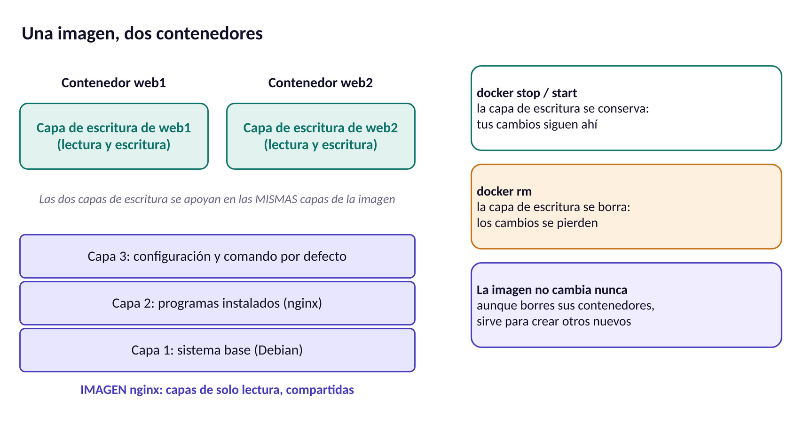
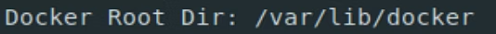
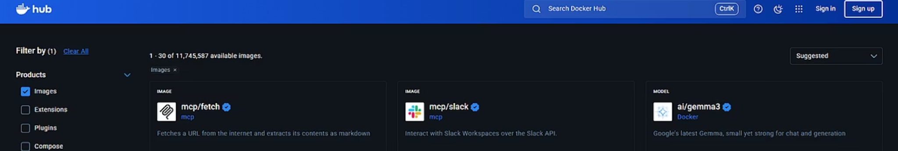
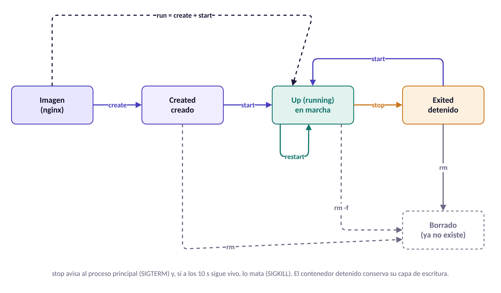
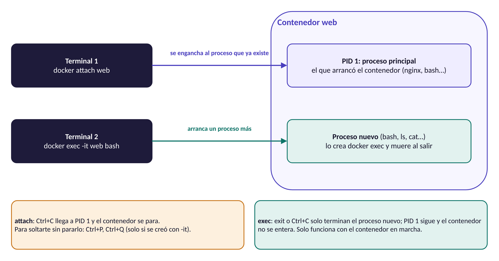
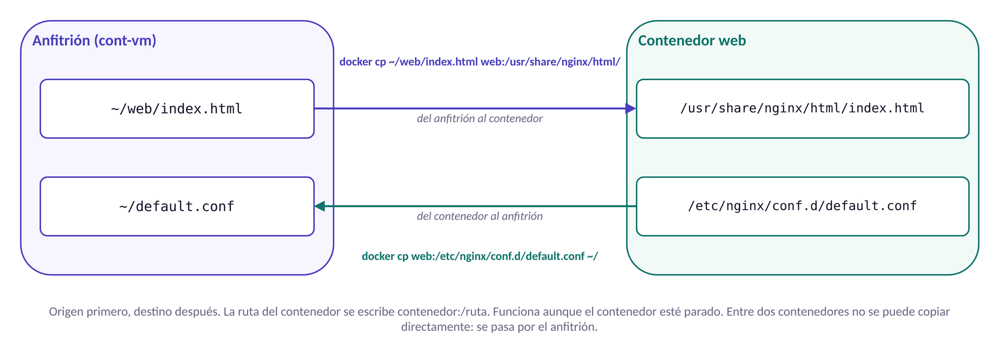

# Cómo usar este dosier {.nobreak}

En la UT1 aprendiste a **arrancar** contenedores: `docker run` con sus opciones más comunes, `docker ps`, los registros y las políticas de reinicio. En esta UT vas a **manejarlos**: entender qué hay dentro de una imagen y de un contenedor, crearlos sin arrancarlos, pararlos y volver a arrancarlos, mirar su configuración, entrar en ellos, copiar archivos de un lado a otro y tocar un servidor web en marcha sin tener que recrearlo.

Es un dosier para leer con la terminal abierta. Conéctate por SSH desde Windows a tu máquina virtual de clase, `cont-vm`, y escribe cada comando a medida que lo leas. Muchas cosas se entienden mejor cuando las ves pasar en tu propia pantalla. Cuando un apartado te pida **dos terminales**, abre una segunda sesión SSH a la misma VM.

A lo largo del texto encontrarás cuatro tipos de caja:

!!! definicion "Definición"
    Un término que tienes que saber explicar con tus propias palabras.

!!! ejemplo "Ejemplo"
    Un caso concreto, casi siempre con el comando y lo que verás en pantalla.

!!! ojo "Ojo"
    Un error típico, una confusión frecuente o un detalle que conviene tener muy claro.

!!! comprueba "Comprueba"
    Preguntas cortas al final de cada bloque. Si no sabes contestarlas sin mirar, vuelve a leer el bloque.

Cada bloque termina con un apartado **«Míralo en tu máquina»**: una serie corta de comandos para que veas con tus ojos lo que acabas de leer. Los bloques continúan la numeración de la UT1, que terminó en el bloque 7.

## Qué vas a aprender

Al terminar esta UT deberías ser capaz de:

- **Distinguir** una imagen de un contenedor y explicar qué papel tienen las capas de solo lectura y la capa de escritura.
- **Localizar** dónde guarda Docker sus datos en `cont-vm` con `docker info`.
- **Explicar** qué es un registro, qué es Docker Hub y cómo se nombra una imagen con su etiqueta.
- **Crear** contenedores sin arrancarlos con `docker create` y relacionarlo con `docker run`.
- **Identificar** un contenedor por su ID completo, su ID corto o su nombre, y **renombrarlo** con `docker rename`.
- **Gestionar** el ciclo de vida con `docker start`, `docker stop` y `docker restart`.
- **Trabajar** con contenedores interactivos (`-it`, `docker start -ai`) y de usar y tirar con una versión concreta de imagen.
- **Consultar** la configuración y el estado de un contenedor con `docker inspect --format`.
- **Ejecutar** procesos dentro de un contenedor con `docker exec` y **diferenciarlo** de `docker attach`.
- **Copiar** archivos entre el anfitrión y un contenedor con `docker cp`.
- **Filtrar** los registros con `docker logs -n`, `--since` y `--until`.
- **Modificar** la página de un servidor web en marcha y **averiguar** con `docker port` qué puerto le ha tocado.

## Índice

| Bloque | Contenido |
|---|---|
| [8](#bloque-8-imagenes-contenedores-y-donde-vive-todo) | Imágenes, contenedores y dónde vive todo: capas, almacenamiento y registro |
| [9](#bloque-9-crear-arrancar-y-parar) | Crear, arrancar y parar: `create`, ID y nombres, `start`/`stop`/`restart`, contenedores interactivos |
| [10](#bloque-10-mirar-y-trabajar-dentro-de-un-contenedor) | Mirar y trabajar dentro: `inspect`, `exec`, `attach`, `cp`, `logs` a fondo, IP y nombres en la red por defecto |
| [11](#bloque-11-caso-practico-un-servidor-web-que-se-toca-en-caliente) | Caso práctico: un servidor web que se toca en caliente |
| Anexos | Glosario, mapa resumen, autoevaluación y soluciones |

# Bloque 8. Imágenes, contenedores y dónde vive todo

Antes de tocar más comandos conviene tener muy clara la diferencia entre **imagen** y **contenedor**, porque casi todos los errores de las primeras semanas vienen de mezclarlas. En este bloque verás qué es cada cosa, cómo se relacionan, dónde las guarda Docker en tu VM y de dónde salen las imágenes.

<figure class="small"></figure>

## 8.1 Todo por la línea de comandos

Existen herramientas gráficas para gestionar Docker (paneles web, extensiones de editores, Docker Desktop). Son cómodas, pero esconden lo que pasa por debajo, y lo que pasa por debajo es justo lo que tienes que aprender en este módulo.

Por eso en clase **todo se hace con la línea de comandos** (CLI). Te da un control más preciso, te obliga a entender qué hace cada orden y, sobre todo, es lo que tendrás en un servidor real: una conexión SSH y una terminal, sin escritorio. Es exactamente tu situación con `cont-vm`.

!!! ojo "Ojo"
    Que no uses un panel gráfico no significa que no existan. Cuando administres servidores podrás usar uno si te ayuda, pero sabrás qué comandos está ejecutando por ti y podrás arreglar las cosas cuando el panel no llegue.

## 8.2 La imagen: una plantilla de solo lectura

<figure class="small"></figure>

!!! definicion "Definición"
    **Imagen** (*image*): plantilla de **solo lectura** a partir de la cual se crean contenedores. Contiene un sistema de archivos (programas, bibliotecas, configuración) y unos **parámetros predefinidos**: el comando que se ejecuta por defecto, variables de entorno, puertos que usa la aplicación…

Tres ideas sobre las imágenes:

| Característica | Qué significa |
|---|---|
| **Solo lectura** | Una imagen no cambia nunca. De una misma imagen puedes crear tantos contenedores como quieras |
| **Parámetros predefinidos** | La imagen trae valores por defecto (comando, variables…) que puedes cambiar al crear el contenedor, como ya hiciste con `-e` en la UT1 |
| **Sistema de capas** | Una imagen se construye a partir de otra: se parte de una **imagen base** y cada cambio añade una **capa** (*layer*) encima |

!!! definicion "Definición"
    **Capa**: cada uno de los «pisos» de solo lectura que forman una imagen. Una capa guarda solo **las diferencias** respecto a la capa de debajo: los archivos que se añaden, se cambian o se borran.

!!! ejemplo "Ejemplo"
    La imagen oficial `nginx` parte de una imagen base de Debian. Encima lleva una capa con Nginx instalado y otras con su configuración y su comando por defecto (`nginx -g "daemon off;"`). Si otra imagen también parte de esa misma Debian, las dos **comparten** esas capas en disco: Docker no las guarda dos veces.

Cómo se construyen imágenes nuevas capa a capa lo verás en la unidad de gestión de imágenes. Aquí basta con la idea: **una imagen es una pila de capas de solo lectura**.

## 8.3 El contenedor: la imagen más una capa de escritura

!!! definicion "Definición"
    **Contenedor** (*container*): instancia en ejecución (o lista para ejecutarse) de una imagen. Encapsula una aplicación con todo su entorno, aislada del resto del sistema. Cada contenedor tiene su propio ciclo de vida, independiente del de los demás.

Si la imagen es de solo lectura, ¿dónde se guardan los archivos que crea o modifica el contenedor? Docker pone encima de las capas de la imagen una capa más, **solo para ese contenedor**: la **capa de escritura**.

!!! definicion "Definición"
    **Capa de escritura** (*writable layer*, también llamada capa del contenedor): capa de lectura y escritura que Docker crea encima de la imagen cuando crea un contenedor. Todo lo que el contenedor escribe, cambia o borra va a esa capa. La imagen de debajo no se toca.

<figure><figcaption>Una imagen, dos contenedores: cada uno con su capa de escritura</figcaption></figure>

Esto explica tres comportamientos que vas a ver una y otra vez:

| Haces… | Qué pasa con tus cambios | Por qué |
|---|---|---|
| `docker stop` y luego `docker start` | **Siguen ahí** | Parar no borra la capa de escritura |
| `docker rm` | **Se pierden** | La capa de escritura se borra con el contenedor |
| Creas otro contenedor de la misma imagen | **No los ve** | Cada contenedor tiene su propia capa de escritura; la imagen no ha cambiado |

!!! ojo "Ojo"
    Los cambios que haces dentro de un contenedor **no van a ninguna imagen**, ni temporal ni definitiva: van a la capa de escritura de ese contenedor y viven lo que vive el contenedor. Si necesitas que unos datos sobrevivan a `docker rm`, la herramienta son los **volúmenes** (unidad de redes y volúmenes), no la capa de escritura.

Para probar el ejemplo en tu máquina, crea antes un Nginx llamado web (lo volverás a usar en los bloques 10 y 11):

```bash
docker run -d --name web -p 1200:80 nginx
```

!!! ejemplo "Ejemplo"
    Con `docker diff` ves qué ha cambiado un contenedor en su capa de escritura respecto a la imagen. Las letras son `A` (nuevo, *added*), `C` (cambiado) y `D` (borrado):
    ```
    docker diff web
    C /usr/share/nginx/html/index.html
    A /root/notas
    A /root/notas/a.txt
    ```

## 8.4 Una analogía: el DVD de instalación

<figure class="small"></figure>

Piensa en una distribución de Linux grabada en un DVD. El DVD es la **imagen**; el sistema ya instalado en un ordenador es el **contenedor**.

| DVD de instalación | Imagen | Sistema instalado | Contenedor |
|---|---|---|---|
| Trae todos los archivos y la configuración inicial | Igual | Es una copia que funciona y se puede tocar | Igual |
| No cambia al instalar | Solo lectura | Cada ordenador tiene su configuración | Cada contenedor tiene su capa de escritura |
| Con un DVD instalas muchos equipos | Muchos contenedores por imagen | Instalar lleva minutos | Crear y arrancar lleva segundos |

!!! ojo "Ojo"
    La analogía falla en un punto importante: un sistema instalado copia **todo** el DVD al disco, mientras que un contenedor **no copia** las capas de la imagen; las usa directamente y solo guarda aparte lo que cambia. Por eso crear un contenedor es tan rápido y ocupa tan poco.

## 8.5 Dónde guarda Docker todo esto

Dónde se almacenan las imágenes y los contenedores depende de la distribución, de la versión de Docker y del **controlador de almacenamiento** (*storage driver*). La forma segura de saberlo en tu máquina es preguntarle al demonio:

```bash
docker info
```

Es una salida larga. Para el almacenamiento hay dos datos clave: el **controlador de almacenamiento** y el **directorio raíz de Docker**.

!!! definicion "Definición"
    **Controlador de almacenamiento**: la pieza de Docker que sabe apilar las capas de la imagen y la capa de escritura y presentarlas al contenedor como un único sistema de archivos. En Linux, el habitual es `overlay2`.

<div class="g2">
<figure><figcaption>Controlador de almacenamiento en <code>docker info</code></figcaption></figure>
<figure><figcaption>Directorio raíz de Docker</figcaption></figure>
</div>

En esa salida, `Storage Driver: overlay2` es el controlador y `Backing Filesystem: extfs` es el sistema de archivos del disco donde está `/var/lib/docker`. Docker llama `extfs` a toda la familia ext; en tu VM, en concreto, es **ext4** (lo puedes confirmar con `df -T /var/lib/docker`).

Con `overlay2`, el reparto en el directorio raíz es este:

| Ruta | Qué guarda |
|---|---|
| `/var/lib/docker/overlay2/` | Las capas de las imágenes y la capa de escritura de cada contenedor |
| `/var/lib/docker/containers/` | La configuración de cada contenedor y su archivo de registros |
| `/var/lib/docker/volumes/` | Los volúmenes (unidad de redes y volúmenes) |

!!! ojo "Ojo"
    Desde Docker Engine 29, una **instalación nueva** usa por defecto el almacén de imágenes de containerd. En ese caso `docker info` muestra `Storage Driver: overlayfs` y `driver-type: io.containerd.snapshotter.v1`, y las capas pasan a `/var/lib/containerd/`; en `/var/lib/docker/` siguen la configuración de los contenedores, los registros y los volúmenes. La idea de capas de solo lectura más capa de escritura **es la misma**. Mira qué te sale a ti antes de buscar carpetas.

!!! ojo "Ojo"
    Mirar no es tocar. `/var/lib/docker` solo lo puede leer `root` y es de Docker: nunca borres ni edites nada ahí a mano. Para limpiar se usan los comandos de Docker (`docker rm` y los que verás en la unidad de imágenes).

## 8.6 El registro: Docker Hub y registros privados

<figure></figure>

!!! definicion "Definición"
    **Registro** (*registry*): servicio que almacena imágenes y las sirve a quien las pide. **Docker Hub** es el registro que Docker usa por defecto: cuando una imagen no está en local, `docker run` la busca allí.

Docker Hub ofrece repositorios públicos y privados y un buscador (<https://hub.docker.com/search>) para localizar imágenes. Cada imagen tiene una página con su documentación: qué hace, qué puertos usa, qué variables de entorno acepta y dónde guarda sus datos. **Leer esa página es lo primero que hay que hacer antes de usar una imagen nueva.**

Docker Hub no es el único registro. Hay otros públicos (GitHub Container Registry, Quay…) y puedes montar uno **privado** en tu empresa con la imagen oficial `registry` (<https://hub.docker.com/_/registry>), basada en el proyecto Distribution (<https://distribution.github.io/distribution/>).

### Cómo se nombra una imagen

| Escribes | Docker entiende | Comentario |
|---|---|---|
| `nginx` | `docker.io/library/nginx:latest` | Registro por defecto, imagen oficial, etiqueta `latest` |
| `ubuntu:24.04` | `docker.io/library/ubuntu:24.04` | Una versión concreta |
| `httpd:2.4` | `docker.io/library/httpd:2.4` | El servidor Apache oficial se llama `httpd` |
| `ghcr.io/usuario/app:1.0` | Registro de GitHub | Si el nombre empieza por un dominio, ese es el registro |

!!! definicion "Definición"
    **Etiqueta** (*tag*): nombre de una versión concreta de una imagen. Se escribe detrás de dos puntos: `imagen:etiqueta`. Si no la escribes, Docker usa `latest`.

!!! ojo "Ojo"
    `latest` es solo una etiqueta más: la que el autor ha decidido poner. No significa «la última comprobada» ni es siempre la misma: hoy `ubuntu:latest` es Ubuntu 26.04 y hace unos meses era la 24.04. En un servidor, fija la versión (`nginx:1.29`, `ubuntu:24.04`) para que mañana se despliegue lo mismo que hoy.

!!! ejemplo "Ejemplo"
    Para elegir etiqueta, abre la pestaña **Tags** de la página de la imagen en Docker Hub: lista todas las etiquetas publicadas, con la fecha de su última subida y su tamaño. En las imágenes oficiales, la pestaña principal (**Overview**) empieza además con la sección **«Supported tags»**, las etiquetas que se mantienen. Varias etiquetas pueden señalar la misma imagen: una de versión exacta, otra de versión mayor y `latest`, por ejemplo.

!!! ojo "Ojo"
    No existe ninguna imagen oficial llamada `apache2` (ese es el nombre del paquete en Debian y Ubuntu). La imagen oficial del servidor Apache es **`httpd`**, y sirve sus páginas desde `/usr/local/apache2/htdocs/`.

Buscar, descargar, listar y borrar imágenes (`docker search`, `docker pull`, `docker images`, `docker rmi`…) se trabaja en la unidad de gestión de imágenes. En esta UT las imágenes llegan solas, con el *pull* implícito de `docker run`.

## Míralo en tu máquina

```bash
docker info | grep -E "Storage Driver|Backing Filesystem|driver-type|Docker Root Dir"
df -T /var/lib/docker              # ¿ext4?
sudo ls /var/lib/docker            # las carpetas de la tabla
docker run -d --name capas nginx
docker exec capas sh -c 'echo prueba > /tmp/nota.txt'
docker diff capas                  # entre otras: A /tmp/nota.txt
docker stop capas && docker start capas
docker exec capas cat /tmp/nota.txt  # sigue ahí
docker rm -f capas                 # y ahora ya no existe
```

!!! comprueba "Comprueba"
    1. ¿Por qué se dice que una imagen es de «solo lectura» si los contenedores escriben archivos?
    2. Paras un contenedor y lo vuelves a arrancar. ¿Conserva los archivos que creaste dentro? ¿Y si lo borras y creas otro de la misma imagen?
    3. ¿Qué comando te dice qué controlador de almacenamiento usa tu Docker? ¿Qué dos valores puede mostrar según cómo se instaló?
    4. ¿Qué significa `extfs` en `docker info`?
    5. ¿A qué imagen exacta se refiere Docker si escribes solo `nginx`?

# Bloque 9. Crear, arrancar y parar

En la UT1 viste `docker run`, `docker ps` y `docker ps -a`, y que parar no es borrar. Aquí se desmonta `docker run` en sus dos piezas y se trabaja el ciclo de vida completo de un contenedor.

## 9.1 `docker run` = `docker create` + `docker start`

`docker run` es probablemente el comando más utilizado de Docker. Hace dos cosas seguidas: **crea** un contenedor a partir de una imagen y lo **arranca**.

!!! ojo "Ojo"
    Cada `docker run` crea un contenedor **nuevo**. Si lo ejecutas cinco veces, tienes cinco contenedores, no uno arrancado cinco veces. Para volver a arrancar uno que ya existe se usa `docker start`.

Para crear un contenedor **sin arrancarlo** existe `docker create`. Su sintaxis es la misma que la de `docker run`:

```bash
docker create [OPCIONES] IMAGEN [COMANDO] [ARGUMENTOS...]
```

Sirve para dejar preparado un contenedor con una configuración concreta y arrancarlo más tarde:

```bash
docker create --name webserver nginx   # 1. lo crea: muestra su ID completo
docker ps -a                           # 2. aparece en estado Created
docker start webserver                 # 3. ahora sí, en marcha
```

!!! ejemplo "Ejemplo"
    Después del paso 1, `docker ps` no muestra nada y `docker ps -a` muestra:
    ```
    CONTAINER ID   IMAGE   COMMAND                  CREATED         STATUS    PORTS   NAMES
    b562409fea5a   nginx   "/docker-entrypoint.…"   5 seconds ago   Created           webserver
    ```
    Un contenedor en `Created` tiene ya su capa de escritura y su configuración, pero ningún proceso en marcha.

!!! ojo "Ojo"
    Las opciones que fijan cómo es el contenedor (`--name`, `-p`, `-e`, `--restart`…) se ponen en `docker create` o en `docker run`, **nunca** en `docker start`. `start` solo arranca lo que ya existe, tal como se creó.

Toda la referencia está en la documentación oficial: <https://docs.docker.com/reference/cli/docker/container/run/> y <https://docs.docker.com/reference/cli/docker/container/create/>.

<figure><figcaption>Ciclo de vida de un contenedor y los comandos que lo mueven</figcaption></figure>

## 9.2 `hello-world`, otra vez

En la UT1 usaste `docker run hello-world` para comprobar la instalación. Ahora puedes leer toda su salida.

**Primera parte: conseguir la imagen.** La primera vez verás:

```
Unable to find image 'hello-world:latest' locally
latest: Pulling from library/hello-world
4f55086f7dd0: Pull complete
Digest: sha256:11a3eb1597e8…
Status: Downloaded newer image for hello-world:latest
```

Docker no tenía la imagen en local, así que la descarga del registro por defecto (Docker Hub) y la guarda. La segunda vez esas líneas ya no salen. Fíjate en que tú escribiste `hello-world` y Docker entendió `hello-world:latest`: es la etiqueta por defecto del apartado 8.6. Su página en Docker Hub es <https://hub.docker.com/_/hello-world>.

**Segunda parte: crear y ejecutar.** Con la imagen ya en local, Docker crea el contenedor y lo arranca. El proceso que ejecuta puede indicarse en el propio `docker run` (detrás del nombre de la imagen) o, si no indicas nada, es el **comando por defecto** de la imagen. En `hello-world` es un pequeño programa, `/hello`, que escribe el mensaje y termina. Su código está en <https://github.com/docker-library/hello-world>.

!!! ejemplo "Ejemplo"
    Compruébalo en `docker ps -a`: la columna `COMMAND` muestra `"/hello"` y el estado es `Exited (0)`. El contenedor sigue existiendo, parado, porque su proceso principal terminó.

!!! definicion "Definición"
    **Comando por defecto**: el proceso que la imagen ejecuta si no le pasas otro. Un contenedor vive **lo que vive ese proceso principal**: cuando termina, el contenedor pasa a `Exited`.

## 9.3 ID y nombres

Cada contenedor tiene un **ID único de 64 caracteres** hexadecimales. `docker ps` muestra solo los **12 primeros** para que quepa; `docker ps --no-trunc` o `docker inspect` muestran el completo.

```
b562409fea5a                                                       ← ID corto (docker ps)
b562409fea5a9dbd844c9a174306abb91cbeabce265a878015a752ac1b904903   ← ID completo
```

Los comandos de Docker aceptan cualquiera de estas formas para referirse a un contenedor:

| Forma | Ejemplo | Condición |
|---|---|---|
| ID completo | `docker stop b562409fea5a9dbd…` | Siempre funciona |
| ID corto | `docker stop b562409fea5a` | Siempre funciona |
| Prefijo del ID | `docker stop b56` | Que ningún otro contenedor empiece igual |
| Nombre | `docker stop webserver` | Los nombres son únicos |

!!! definicion "Definición"
    **Nombre del contenedor**: alias único y legible. Si no lo indicas con `--name`, Docker inventa uno combinando un adjetivo y el apellido de una figura de la ciencia (`stupefied_colden`, `sharp_einstein`).

### Cambiar el nombre: `docker rename`

```bash
docker rename nombre_actual nombre_nuevo
```

Funciona con el contenedor parado **o en marcha**, y no cambia nada más: ni el ID, ni la capa de escritura, ni los puertos. Es útil cuando Docker ha puesto un nombre aleatorio, cuando hay que seguir una nomenclatura (`web-prod`, `web-test`…) o cuando el nombre se ha quedado desfasado.

!!! ojo "Ojo"
    Si el nombre nuevo ya lo usa otro contenedor, Docker da el mismo error de conflicto que viste en la UT1 (`Conflict. The container name "/…" is already in use`). Los nombres son únicos en toda la máquina, estén los contenedores en marcha o parados.

## 9.4 Arrancar, parar y reiniciar: `start`, `stop` y `restart`

Estos tres comandos trabajan con contenedores **que ya existen**:

| Comando | Qué hace |
|---|---|
| `docker start <contenedor>` | Arranca un contenedor en estado `Created` o `Exited`, con el comando y la configuración con que se creó |
| `docker stop <contenedor>` | Pide al proceso principal que termine y, si no lo hace a tiempo, lo mata |
| `docker restart <contenedor>` | Hace un `stop` y un `start` seguidos |

Los tres aceptan **varios** contenedores a la vez: `docker stop web1 web2 web3`.

!!! definicion "Definición"
    **Parada ordenada**: `docker stop` envía al proceso principal la señal `SIGTERM` («termina cuando puedas»). Si a los **10 segundos** sigue vivo, envía `SIGKILL`, que lo mata sin contemplaciones. El plazo se cambia con `-t`: `docker stop -t 30 bd`.

!!! ejemplo "Ejemplo"
    Un contenedor `busybox` que ejecuta un bucle de `sh` tarda **10 segundos** en pararse y queda como `Exited (137)`. El proceso `sh` que hace de proceso principal ignora `SIGTERM`, así que Docker espera el plazo completo y lo mata con `SIGKILL` (137 = 128 + 9, el número de esa señal). Nginx, en cambio, sabe atender `SIGTERM` y se para en menos de un segundo con `Exited (0)`.

!!! ojo "Ojo"
    `docker restart` no es lo mismo que la política `--restart` de la UT1. El comando reinicia **ahora y una vez**; la política decide si Docker lo vuelve a arrancar **solo** cuando se para o cuando se reinicia el demonio.

Referencias: <https://docs.docker.com/reference/cli/docker/container/start/>, <https://docs.docker.com/reference/cli/docker/container/stop/> y <https://docs.docker.com/reference/cli/docker/container/restart/>.

## 9.5 Contenedores interactivos

Hasta ahora casi todos tus contenedores ejecutaban un servicio (Nginx). Con una imagen de sistema, como `ubuntu`, puedes pedir una terminal **dentro** del contenedor:

```bash
docker run -it --name miubuntu ubuntu bash
```

| Opción | Qué hace |
|---|---|
| `-i` (*interactive*) | Mantiene abierta la entrada estándar: lo que escribes le llega al proceso |
| `-t` (*tty*) | Asigna una **pseudoterminal** (*pseudo-TTY*): el *prompt*, los colores, las teclas de edición |

Casi siempre se usan juntas, `-it`. El *prompt* cambia a algo como `root@e72718a5dd1a:/#`: el texto después de la arroba es el ID corto del contenedor, que hace de nombre de máquina.

Dentro puedes trabajar como en cualquier Linux: crear carpetas, editar archivos, ejecutar programas. Todo va a la **capa de escritura** de `miubuntu` (apartado 8.3).

**¿Qué pasa al salir?** Con `exit`, `bash` termina. Como `bash` era el proceso principal, **el contenedor se detiene**. No se borra: los cambios siguen en su capa de escritura.

### Volver a entrar en un contenedor detenido: `docker start -ai`

```bash
docker ps -a                   # localiza el contenedor: miubuntu, Exited (0)
docker start -ai miubuntu      # lo arranca y te engancha a su terminal
```

| Opción de `start` | Qué hace |
|---|---|
| `-a` (*attach*) | Conecta la salida estándar y de errores del contenedor a tu terminal |
| `-i` (*interactive*) | Conecta tu entrada estándar a la del contenedor |

No se escribe ningún comando: `start` ejecuta el que se fijó al crearlo (aquí, `bash`). Verás tus carpetas y archivos de antes. Para salir, `exit` de nuevo (y el contenedor se vuelve a detener).

!!! ojo "Ojo"
    `docker start miubuntu` sin `-ai` también lo arranca, pero en segundo plano: `bash` queda esperando en una terminal a la que no estás conectado. Para entrar después tendrías que usar `docker attach` o `docker exec` (bloque 10).

## 9.6 Usar y tirar con una versión concreta

```bash
docker run -it --rm ubuntu:24.04 bash
```

Este comando junta dos ideas:

- `ubuntu:24.04` pide una **etiqueta concreta**. Otras etiquetas de Ubuntu son `22.04`, `24.04`, `26.04` y `latest`.
- `--rm` (UT1) borra el contenedor en cuanto se detiene. Al salir con `exit`, no queda ni en `docker ps -a`.

Viene bien para tareas temporales, pruebas rápidas («¿qué versión de `bash` trae Ubuntu 24.04?»), *scripts* que crean contenedores de un solo uso o, simplemente, para no ir acumulando contenedores parados.

!!! ojo "Ojo"
    Con `--rm`, la capa de escritura se borra con el contenedor: **todo lo que hayas hecho dentro se pierde al salir**. Si necesitas conservar algo, no uses `--rm` o guarda los datos fuera con un volumen.

## Míralo en tu máquina

```bash
docker create --name prueba busybox echo hola
docker ps -a --filter name=prueba          # Created
docker start -a prueba                     # escribe hola y termina
docker ps -a --filter name=prueba          # Exited (0)
docker rename prueba prueba-vieja
docker inspect --format '{{.Id}}' prueba-vieja   # 64 caracteres
docker rm prueba-vieja

docker run -d --name reloj busybox sh -c 'while true; do date; sleep 1; done'
time docker stop reloj                     # ¿cuánto tarda?
docker ps -a --filter name=reloj           # ¿con qué código ha salido?
docker rm reloj
```

!!! comprueba "Comprueba"
    1. ¿Qué dos acciones hace `docker run`? ¿Qué comando hace solo la primera?
    2. ¿En qué estado queda un contenedor recién creado con `docker create`? ¿Tiene algún proceso en marcha?
    3. Escribe tres formas distintas de referirte al mismo contenedor en `docker stop`.
    4. ¿Por qué un contenedor puede tardar 10 segundos en pararse? ¿Qué significa `Exited (137)`?
    5. Sales de `docker run -it ubuntu bash` con `exit`. ¿Qué le pasa al contenedor y por qué? ¿Cómo vuelves a entrar?

# Bloque 10. Mirar y trabajar dentro de un contenedor

Un contenedor en marcha no es una caja negra. En este bloque aprenderás a leer su configuración y su estado, a ejecutar órdenes dentro, a engancharte a su proceso principal, a copiar archivos y a leer sus registros con precisión.

Para los ejemplos de este bloque usamos el Nginx llamado web que creaste en la 8.3. Compruébalo con `docker ps -a --filter name=web`: si aparece parado, arráncalo con `docker start web`; si no aparece, créalo:

```bash
docker run -d --name web -p 1200:80 nginx
```

## 10.1 `docker inspect`: toda la ficha del contenedor

```bash
docker inspect <contenedor>
```

Devuelve, en formato **JSON**, todo lo que Docker sabe de un contenedor: el ID completo, el estado, la imagen, el comando, la configuración de red y de puertos, el almacenamiento, la política de reinicio… Es la herramienta principal para **depurar**: cuando algo no funciona, aquí está la verdad sobre cómo se creó el contenedor.

La salida completa ocupa cientos de líneas. Para quedarte solo con lo que te interesa se usa `--format` (o `-f`) con una **plantilla** de Go: entre llaves dobles escribes la ruta del dato, empezando por un punto.

```bash
docker inspect --format '{{.State.Status}}' web
docker inspect -f '{{.Name}} {{.State.Status}} {{.State.StartedAt}}' web
```

| Quieres saber… | Plantilla |
|---|---|
| Estado (`created`, `running`, `exited`) | `{{.State.Status}}` |
| Código de salida | `{{.State.ExitCode}}` |
| Cuándo arrancó por última vez | `{{.State.StartedAt}}` |
| ID completo | `{{.Id}}` |
| Imagen con la que se creó | `{{.Config.Image}}` |
| Comando que ejecuta | `{{json .Config.Cmd}}` |
| Variables de entorno | `{{json .Config.Env}}` |
| Política de reinicio | `{{.HostConfig.RestartPolicy.Name}}` |
| Puertos publicados | `{{json .HostConfig.PortBindings}}` |
| IP en la red por defecto | `{{range .NetworkSettings.Networks}}{{.IPAddress}}{{end}}` |
| Archivo de registros | `{{.LogPath}}` |

!!! definicion "Definición"
    **JSON**: formato de texto para datos estructurados con pares `"clave": valor`, que se pueden anidar. `.State.Status` se lee «dentro de `State`, el campo `Status`». El prefijo `json` delante de un dato (`{{json .Config.Env}}`) lo imprime como JSON, útil para listas.

!!! ojo "Ojo"
    Las mayúsculas cuentan: `{{.state.status}}` da error. Copia la ruta tal como aparece en la salida completa de `docker inspect`. Un truco: `docker inspect web | less` y busca con `/` el campo que quieres.

!!! ejemplo "Ejemplo"
    ¿Qué IP tiene ahora mismo el contenedor `web`?
    ```bash
    docker inspect -f '{{range .NetworkSettings.Networks}}{{.IPAddress}}{{end}}' web
    172.17.0.2
    ```
    Si el contenedor está parado, la respuesta sale **vacía**: un contenedor detenido no tiene IP. Al arrancarlo, Docker le da una libre, que puede no ser la misma de antes.

### Lo que trae la imagen: `Entrypoint`, `Cmd` y compañía

La sección `Config` de la ficha recoge cómo está pensada la imagen, más lo que añadiste al crear el contenedor (por ejemplo, las variables de `-e`). Estos campos te lo cuentan sin tener que buscar cómo se construyó la imagen:

| Campo | Plantilla | Qué te dice |
|---|---|---|
| `Entrypoint` | `{{json .Config.Entrypoint}}` | El programa que se ejecuta **siempre** al arrancar |
| `Cmd` | `{{json .Config.Cmd}}` | La orden por defecto o, si hay `Entrypoint`, sus argumentos por defecto |
| `ExposedPorts` | `{{json .Config.ExposedPorts}}` | Los puertos en los que la imagen **dice** que escucha |
| `User` | `{{.Config.User}}` | El usuario del proceso principal; vacío significa `root` |
| `WorkingDir` | `{{.Config.WorkingDir}}` | La carpeta de trabajo del proceso; vacío significa `/` |
| `Volumes` | `{{json .Config.Volumes}}` | Las carpetas que la imagen declara para guardar datos |

!!! definicion "Definición"
    **`Entrypoint` y `Cmd`**: juntos forman la orden que arranca el proceso principal. Si la imagen tiene `Entrypoint`, ese programa se ejecuta siempre y `Cmd` son los argumentos que recibe por defecto. Si `Entrypoint` es `null`, `Cmd` es la orden entera. Lo que escribes detrás del nombre de la imagen en `docker run` **sustituye a `Cmd`**, no al `Entrypoint`.

!!! ejemplo "Ejemplo"
    `ubuntu:24.04` no tiene `Entrypoint` y su `Cmd` es `["/bin/bash"]`: por eso `docker run -it ubuntu:24.04` abre `bash`. Con `docker run --rm ubuntu:24.04 ls /`, `ls /` sustituye a `bash`: el contenedor lista la raíz y termina.

!!! ojo "Ojo"
    `ExposedPorts` solo **documenta** en qué puerto escucha la aplicación: no publica nada. Si creas el contenedor sin `-p`, desde fuera no se llega aunque el puerto aparezca ahí. Lo que está publicado de verdad lo muestra `docker port` (apartado 11.1).

!!! ojo "Ojo"
    Si una carpeta aparece en `Volumes`, sus datos no van a la capa de escritura: al crear el contenedor, Docker monta ahí un **volumen anónimo**, uno nuevo para cada contenedor. Si borras el contenedor y creas otro igual, el nuevo no ve lo que guardó el anterior. Los volúmenes se trabajan en la unidad de almacenamiento.

### Cuántas veces lo ha reiniciado Docker: `RestartCount`

!!! definicion "Definición"
    **`RestartCount`** (`{{.RestartCount}}`, fuera de `State`): número de veces que **Docker** ha vuelto a arrancar el contenedor por su política de reinicio (`--restart`, UT1). Los reinicios que haces tú con `docker restart`, o con `docker stop` y `docker start`, **no** lo suben.

!!! ejemplo "Ejemplo"
    Para saber si un contenedor ha arrancado a mano o lo ha levantado su política, mira dos datos juntos: `docker inspect -f '{{.State.StartedAt}} {{.RestartCount}}' web`. `StartedAt` cambia con cualquier arranque; `RestartCount` solo con los automáticos. Un contenedor con `--restart always` cuyo proceso termina una y otra vez aparece en `docker ps` como `Restarting` y su `RestartCount` va subiendo.

Referencia: <https://docs.docker.com/reference/cli/docker/inspect/>.

## 10.2 `docker exec`: ejecutar una orden dentro

`docker exec` ejecuta un **proceso nuevo** dentro de un contenedor **en marcha**:

```bash
docker exec [OPCIONES] <contenedor> COMANDO [ARGUMENTOS...]
```

| Ejemplo | Qué hace |
|---|---|
| `docker exec web ls /usr/share/nginx/html` | Ejecuta `ls` dentro y te muestra la salida |
| `docker exec -it web bash` | Abre una terminal interactiva dentro del contenedor |
| `docker exec -d web touch /tmp/prueba` | Lanza la orden en segundo plano y te devuelve la terminal al momento |
| `docker exec -it -e VAR1=1 web bash` | Abre una terminal en la que existe la variable `VAR1=1` (compruébalo con `echo $VAR1`) |

!!! ojo "Ojo"
    No todas las imágenes traen `bash`. Las muy ligeras (`busybox`, `alpine`) solo tienen `sh`. Si `docker exec -it web bash` responde `executable file not found in $PATH`, prueba `docker exec -it web sh`.

!!! ojo "Ojo"
    La variable de `docker exec -e` solo existe **en ese proceso nuevo**. El proceso principal no la ve, y un segundo `docker exec` sin `-e` tampoco. Para que todo el contenedor tenga una variable hay que ponerla al crearlo (`docker run -e`, UT1).

!!! ojo "Ojo"
    `docker exec` solo funciona con el contenedor **en marcha**. Con uno parado responde `container … is not running`: primero `docker start`.

Cuando sales de un `docker exec -it … bash` con `exit`, termina **ese** `bash`, no el contenedor: el proceso principal sigue como si nada. Referencia: <https://docs.docker.com/reference/cli/docker/container/exec/>.

### Órdenes con `>`, `|`, `&&` o `$( )`: `sh -c`

!!! ojo "Ojo"
    En `docker exec web echo hola > /tmp/a.txt`, el `>` **no** llega al contenedor: lo interpreta antes la shell de la VM, que intenta crear `/tmp/a.txt` en la VM con lo que escriba `docker exec`. Para que la redirección (`>`, `>>`), las tuberías (`|`), `&&` o `$( )` se hagan **dentro**, pasa la orden entera entre comillas simples a una shell del contenedor: `docker exec web sh -c 'echo hola > /tmp/a.txt'`. Lo volverás a usar en el apartado 11.3.

!!! ejemplo "Ejemplo"
    `$(orden)` es la **sustitución de órdenes** de la shell: se cambia por lo que escribe esa orden. `docker exec web sh -c 'echo "Creado: $(date)" > /tmp/hora.txt'` ejecuta `date` una sola vez, al lanzar el `exec`, y guarda el texto ya hecho: el archivo conserva esa hora aunque lo leas más tarde. Con comillas simples, el `$(date)` lo resuelve la shell del contenedor; con comillas dobles lo resolvería antes la de la VM.

### Instalar un programa dentro: `apt-get`

Las imágenes de Debian y Ubuntu traen lo justo: `ubuntu:24.04` no trae `curl`, `ping` ni `nano`. Se instalan con `apt-get` como en cualquier Ubuntu, con dos diferencias: dentro ya eres `root` (no hace falta `sudo`) y la imagen viene sin la lista de paquetes, así que primero hay que hacer `apt-get update`. La opción `-y` contesta «sí» a la confirmación:

```bash
docker run -dit --name caja ubuntu:24.04
docker exec caja sh -c 'apt-get update && apt-get install -y curl'
docker exec caja curl -s -I https://www.docker.com
```

!!! ojo "Ojo"
    Lo que instalas va a la **capa de escritura** de ese contenedor: se conserva con `stop` y `start`, pero un contenedor nuevo de la misma imagen sale sin ello. Instalar a mano dentro sirve para probar o depurar; en un servicio real, el programa tiene que venir ya en la imagen (unidad de gestión de imágenes). Hace falta Internet en la VM.

## 10.3 `docker attach` frente a `docker exec`

```bash
docker attach <contenedor>
```

`docker attach` conecta tu terminal a la entrada y la salida del **proceso principal** de un contenedor en marcha. No crea nada nuevo: te engancha al proceso que ya existe.

<figure><figcaption>attach se engancha al proceso principal; exec crea un proceso nuevo</figcaption></figure>

| | `docker attach` | `docker exec` |
|---|---|---|
| Con qué proceso trabajas | El **principal** (PID 1), el que ya existe | Uno **nuevo**, que crea el propio comando |
| Puedes elegir el comando | No | Sí |
| Al pulsar Ctrl + C | La señal llega al proceso principal: **normalmente el contenedor se para** | Termina solo el proceso nuevo |
| Uso típico | Ver la salida de un proceso en primer plano o hablar con un programa interactivo | Revisar, depurar, administrar |

!!! ejemplo "Ejemplo"
    Un contenedor que escribe la hora cada segundo:
    ```bash
    docker run -dit --name muchotexto busybox sh -c 'while true; do date; sleep 1; done'
    docker attach muchotexto
    ```
    Al engancharte verás aparecer una fecha por segundo: es la salida del proceso principal. El bucle es `while true; do date; sleep 1; done`: `date` escribe la fecha y `sleep 1` espera un segundo.

## 10.4 Soltarse sin parar: Ctrl + P, Ctrl + Q

Para salir de un `attach` **sin parar** el contenedor existe la secuencia de desenganche (*detach keys*): **Ctrl + P y, sin soltar Ctrl, Q**. Pero solo funciona en un caso:

| El contenedor se creó con… | Ctrl + P, Ctrl + Q en un `attach` | Ctrl + C en un `attach` |
|---|---|---|
| `-it` (o `-dit`) | Te sueltas; el contenedor **sigue** | Le llega al proceso principal; el contenedor **se para** |
| Sin `-it` (solo `-d`) | **No hace nada**: no hay terminal que reciba las teclas | Le llega al proceso principal; el contenedor **se para** |

!!! ojo "Ojo"
    Por eso el ejemplo de `muchotexto` usa `-dit` y no solo `-d`. Con un Nginx lanzado con `-d`, como los de la UT1, no hay forma limpia de soltarse de un `attach`: si lo que quieres es **mirar**, usa `docker logs -f`, y si quieres **trabajar dentro**, `docker exec`.

!!! ejemplo "Ejemplo"
    Lo mismo vale para `docker start -ai miubuntu` y `docker run -it ubuntu bash`: Ctrl + P, Ctrl + Q te devuelve a la VM y deja el `bash` del contenedor esperando. `docker ps` lo mostrará `Up`.

Referencia: <https://docs.docker.com/reference/cli/docker/container/attach/>.

## 10.5 `docker cp`: copiar entre el anfitrión y un contenedor

```bash
docker cp ORIGEN DESTINO
```

Uno de los dos lados es una ruta del anfitrión y el otro, una ruta del contenedor escrita como `contenedor:/ruta`.

```bash
docker cp web:/tmp/prueba ./               # del contenedor al directorio actual de la VM
docker cp ./miFichero web:/tmp             # de la VM al /tmp del contenedor
```

<figure><figcaption>docker cp en los dos sentidos</figcaption></figure>

!!! ojo "Ojo"
    Tres detalles que suelen sorprender:
    1. `docker cp` **funciona con el contenedor parado**: copia de y hacia su capa de escritura. Es una forma de rescatar un archivo de un contenedor que no arranca.
    2. No se puede copiar **directamente entre dos contenedores**: hay que hacerlo en dos pasos, pasando por el anfitrión.
    3. Copia también carpetas enteras, con todo su contenido.

Referencia: <https://docs.docker.com/reference/cli/docker/container/cp/>.

## 10.6 `docker logs` a fondo

En la UT1 usaste `docker logs` y `docker logs -f`. Con muchos registros (*logs*) hace falta filtrar:

| Opción | Qué muestra | Ejemplo |
|---|---|---|
| `-n N` (`--tail`) | Solo las **últimas N líneas** | `docker logs -n 10 web` |
| `--since` | Lo escrito **desde** un momento | `docker logs --since 5m web` |
| `--until` | Lo escrito **hasta** un momento | `docker logs --until 2s web` |
| `-t` | Añade a cada línea la marca de tiempo de Docker | `docker logs -t -n 3 web` |
| `-f` | Sigue en tiempo real (UT1) | `docker logs -f -n 0 web` |

El momento se puede escribir de forma **relativa** (`30s`, `5m`, `2h`) o **absoluta** (`2026-11-10T09:30:00`). Las opciones se combinan: `docker logs --since 10m --until 5m web` muestra lo que pasó entre hace diez minutos y hace cinco.

!!! ojo "Ojo"
    Las duraciones relativas cuentan **hacia atrás desde ahora**. `--until 2s` no significa «durante dos segundos»: significa «hasta hace dos segundos». `docker logs -f --until 2s muchotexto` muestra el historial hasta hace dos segundos y **termina**; no se queda siguiendo nada. Para seguir en tiempo real un rato y que pare solo, `--until` necesita un momento **futuro** en formato absoluto.

!!! ejemplo "Ejemplo"
    `docker logs -f -n 0 web` es muy práctico: no muestra el historial (cero líneas) y se queda esperando solo lo nuevo. Recarga la página en el navegador y verás aparecer únicamente tu petición.

Referencia: <https://docs.docker.com/reference/cli/docker/container/logs/>.

## 10.7 Direcciones IP y nombres en la red por defecto

Si no indicas otra cosa, cada contenedor se conecta a la **red por defecto** de Docker, llamada `bridge`. En ella, cada contenedor en marcha recibe una dirección IP privada, normalmente del rango `172.17.0.0/16`: la `172.17.0.1` es la de la VM y los contenedores reciben otras (`172.17.0.2`, `172.17.0.3`…). La VM y los demás contenedores de esa red llegan a un contenedor por su IP. Ya sabes sacarla con `inspect` (apartado 10.1).

!!! definicion "Definición"
    **Red `bridge` por defecto**: red privada que Docker crea al instalarse y a la que conecta todo contenedor nuevo si no se indica otra. En ella los contenedores se comunican entre sí **solo por su dirección IP**.

!!! ojo "Ojo"
    La IP **no es fija**. Un contenedor parado no tiene IP y, al arrancarlo, Docker le da una dirección libre de la red. Si mientras estaba parado otro contenedor ha ocupado su dirección antigua, recibirá otra distinta. Cualquier configuración que apunte a la IP de un contenedor puede dejar de funcionar después de un `stop` y un `start`.

!!! definicion "Definición"
    **`/etc/hosts`**: archivo que asocia nombres con direcciones IP; el sistema lo consulta antes de preguntar a un servidor DNS. Docker escribe el de cada contenedor al arrancarlo, y en la red por defecto solo trae `localhost` y el propio contenedor (con su nombre de máquina, que es su ID corto), **no** a los demás contenedores.

!!! ejemplo "Ejemplo"
    Con dos contenedores en marcha, `uno` y `dos`:
    ```
    docker exec dos cat /etc/hosts
    127.0.0.1       localhost
    …
    172.17.0.3      5f0c2b1e9a7d
    ```
    No hay ninguna línea para `uno`, así que desde `dos` el nombre `uno` no se resuelve: hay que usar su IP.

!!! ojo "Ojo"
    En las **redes definidas por el usuario** los contenedores sí se encuentran por su nombre. Las verás más adelante en el módulo; en esta UT todo va en la red por defecto.

Referencia: <https://docs.docker.com/engine/network/drivers/bridge/>.

## Míralo en tu máquina

Abre **dos** terminales SSH a `cont-vm`.

```bash
# Terminal 1
docker run -dit --name muchotexto busybox sh -c 'while true; do date; sleep 1; done'
docker inspect -f '{{.State.Status}} {{.State.StartedAt}}' muchotexto
docker logs -n 3 muchotexto
docker logs --since 5s muchotexto
docker attach muchotexto           # ves la hora; suéltate con Ctrl+P, Ctrl+Q
docker exec -it muchotexto sh      # dentro: ps   (¿qué es el PID 1?)  y luego exit

# Terminal 2, mientras tanto
docker ps                          # muchotexto sigue Up

# Terminal 1 otra vez
docker cp muchotexto:/etc/hostname .
cat hostname                       # ¿te suena ese texto?
docker rm -f muchotexto
```

!!! comprueba "Comprueba"
    1. ¿Qué plantilla de `--format` usarías para saber si un contenedor está en marcha? ¿Y la imagen con la que se creó?
    2. ¿Por qué `docker exec -it web bash` puede fallar en un contenedor y `docker exec -it web sh` no?
    3. Explica con tus palabras la diferencia entre `attach` y `exec`. ¿Con cuál es peligroso pulsar Ctrl + C?
    4. ¿En qué caso funciona Ctrl + P, Ctrl + Q?
    5. ¿Qué muestra `docker logs --until 2s web`? ¿Y `docker logs --since 2m web`?
    6. ¿Qué relación hay entre `Entrypoint` y `Cmd`? ¿Qué cuenta `RestartCount`?
    7. ¿Por qué `docker exec web echo hola > /tmp/a.txt` no crea el archivo dentro del contenedor?
    8. Paras un contenedor y arrancas otro. ¿Tendrá el primero la misma IP cuando vuelva a arrancar? ¿Puede el segundo llegar a él por su nombre?

# Bloque 11. Caso práctico: un servidor web que se toca en caliente

Toca juntar todo en un caso real: un servidor web en segundo plano, accesible desde fuera, al que le cambias la página y le miras los registros sin pararlo nunca.

## 11.1 Un Nginx en segundo plano y su puerto

Si todavía tienes el `web` de la 8.3 y del bloque 10, puedes reutilizarlo y saltarte este `docker run`. Si prefieres empezar de cero, bórralo antes con `docker rm -f web`: dos contenedores no pueden llamarse igual ni publicar el mismo puerto 1200.

```bash
docker run -d --name web -p 1200:80 nginx
```

Ya conoces todas las piezas de la UT1: `-d` lo deja en segundo plano y solo muestra el ID; `-p 1200:80` publica el 80 del contenedor en el 1200 del anfitrión. Desde la VM, `curl http://localhost:1200` devuelve la página de bienvenida de Nginx (y desde el navegador de Windows, si VirtualBox reenvía ese puerto, como en la UT1). La documentación de la imagen está en <https://hub.docker.com/_/nginx>.

### Puertos aleatorios y `docker port`

Si en `-p` escribes **solo el puerto del contenedor**, Docker elige por ti un puerto libre del anfitrión:

```bash
docker run -d --name web-azar -p 80 nginx
docker port web-azar
80/tcp -> 0.0.0.0:32768
80/tcp -> [::]:32768
```

!!! definicion "Definición"
    **`docker port`**: muestra los puertos publicados de un contenedor, con el formato `puerto_contenedor -> IP:puerto_anfitrión`. Con `docker port web-azar 80` te dice solo a qué puerto del anfitrión va el 80. Lo mismo aparece en la columna `PORTS` de `docker ps`.

!!! ejemplo "Ejemplo"
    Con dos contenedores lanzados así, cada uno recibe un puerto distinto (32768, 32769…). Sirve cuando te da igual el número porque lo va a averiguar otro programa, o cuando quieres evitar choques; para un servicio al que entra gente, lo normal es fijarlo.

## 11.2 Los puertos se fijan al crear

!!! ojo "Ojo"
    Los puertos publicados forman parte de la configuración del contenedor y **solo se pueden indicar al crearlo** (`docker run` o `docker create`). No existe un `docker start -p` ni un comando para añadir un puerto a un contenedor que ya existe. Si te has equivocado, hay que borrarlo y crear otro. Si el contenido importaba, primero rescátalo con `docker cp`.

## 11.3 Cambiar la página sin recrear el contenedor

Según la documentación de la imagen, Nginx sirve las páginas desde `/usr/share/nginx/html`. La portada es `index.html`. Para cambiarla con el contenedor **en marcha** tienes dos caminos.

**Opción 1: copiar desde el anfitrión con `docker cp`.** Preparas el archivo en la VM y lo copias encima:

```bash
echo '<h1>Hola mundo desde Docker</h1>' > nuevo_index.html
docker cp nuevo_index.html web:/usr/share/nginx/html/index.html
```

**Opción 2: editar dentro con `docker exec`.** Puedes escribir el archivo directamente con una orden:

```bash
docker exec web sh -c 'echo "<h1>Editado desde dentro</h1>" > /usr/share/nginx/html/index.html'
```

o abrir una terminal e instalar un editor, porque la imagen no trae ninguno:

```bash
docker exec -it web bash
apt update && apt install -y nano
nano /usr/share/nginx/html/index.html
```

!!! ojo "Ojo"
    En la opción 2, `sh -c '…'` hace falta porque la redirección `>` la tiene que interpretar un *shell* **dentro** del contenedor. Si escribes `docker exec web echo hola > /usr/share/nginx/html/index.html`, la redirección la hace el *shell* de tu VM y Docker intenta escribir en esa ruta **de la VM**.

| | `docker cp` | `docker exec` |
|---|---|---|
| Dónde editas | En la VM, con tus herramientas | Dentro del contenedor |
| Necesita el contenedor en marcha | No | Sí |
| Deja rastro en la imagen | No: va a la capa de escritura | No: va a la capa de escritura |
| Si instalas `nano` | No aplica | También va a la capa de escritura; se pierde con `docker rm` |

Tras cualquiera de las dos, recarga `http://localhost:1200` (o haz `curl`) y verás la página nueva: **no ha hecho falta reiniciar Nginx**, porque sirve el archivo tal como está en disco en cada petición.

!!! ojo "Ojo"
    Esto es perfecto para practicar y para un arreglo urgente, pero no es como se publica una web de verdad: el cambio vive en la capa de escritura y desaparece con `docker rm`. La forma correcta (un volumen o una imagen propia) llega en las próximas unidades.

## 11.4 Comprobar con los registros

```bash
docker logs -n 10 web     # las diez últimas peticiones
docker logs -f web        # en tiempo real mientras navegas
```

Cada visita deja una línea con la IP de origen, la fecha, la petición (`GET / HTTP/1.1`) y el código de respuesta: `200` si ha servido la página, `304` si el navegador ya la tenía y no ha cambiado, `404` si la página no existe.

## 11.5 Variables de entorno en un contenedor interactivo

```bash
docker run -it -e MENSAJE=HOLA ubuntu bash
echo $MENSAJE        # dentro del contenedor → HOLA
```

`-e` (UT1) fija la variable al **crear** el contenedor, así que la ven el proceso principal y cualquier `docker exec` posterior. Compáralo con `docker exec -e` (apartado 10.2), que solo la da a un proceso concreto. Para comprobar qué variables tiene un contenedor sin entrar: `docker inspect -f '{{json .Config.Env}}' <contenedor>`.

## Míralo en tu máquina

```bash
docker rm -f web                             # por si queda el de antes
docker run -d --name web -p 1200:80 nginx
docker run -d --name web-azar -p 80 nginx
docker port web-azar                         # ¿qué puerto le ha tocado?
curl -s localhost:1200 | head -4             # bienvenida de Nginx
docker exec web sh -c 'echo "<h1>Hola</h1>" > /usr/share/nginx/html/index.html'
curl -s localhost:1200                       # <h1>Hola</h1>
docker diff web                              # C .../index.html
docker restart web && curl -s localhost:1200 # ¿sigue tu página?
docker logs -n 5 web
docker rm -f web web-azar
```

!!! comprueba "Comprueba"
    1. ¿Qué hace `-p 80`, sin puerto del anfitrión? ¿Cómo averiguas qué puerto se ha usado?
    2. Has creado un Nginx sin `-p`. ¿Puedes publicar ahora el puerto 80 sin borrar el contenedor?
    3. Escribe dos formas de cambiar el `index.html` de un Nginx en marcha.
    4. ¿Por qué hace falta `sh -c` en `docker exec web sh -c 'echo hola > /ruta'`?
    5. Cambias la portada, haces `docker restart web` y luego `docker rm -f web` y lo vuelves a crear. ¿En qué momento se pierde tu cambio?

# Glosario

| Término | Significado |
|---|---|
| **`docker attach`** | Conecta tu terminal a la entrada y salida del proceso principal de un contenedor en marcha |
| **`docker cp`** | Copia archivos o carpetas entre el anfitrión y un contenedor, en los dos sentidos; funciona con el contenedor parado |
| **`docker create`** | Crea un contenedor sin arrancarlo; queda en estado `Created` |
| **`docker exec`** | Ejecuta un proceso nuevo dentro de un contenedor en marcha |
| **`docker info`** | Muestra el estado y la configuración del demonio, incluido el controlador de almacenamiento y el directorio raíz |
| **`docker inspect`** | Muestra en JSON toda la configuración y el estado de un contenedor; con `--format`, solo los datos elegidos |
| **`docker port`** | Muestra a qué puertos del anfitrión están publicados los puertos de un contenedor |
| **`docker rename`** | Cambia el nombre de un contenedor, en marcha o parado |
| **`docker start` / `stop` / `restart`** | Arranca, para o reinicia un contenedor que ya existe |
| **`apt-get`** | Instalador de paquetes de Debian y Ubuntu; dentro de un contenedor lo instalado va a su capa de escritura |
| **Capa** | Cada nivel de solo lectura de una imagen; guarda las diferencias respecto al de debajo |
| **Capa de escritura** | Capa de lectura y escritura propia de cada contenedor; se conserva al parar y se borra con `docker rm` |
| **Comando por defecto** | Proceso que ejecuta un contenedor si no se indica otro al crearlo |
| **Contenedor** | Instancia de una imagen, con su propia capa de escritura y su ciclo de vida |
| **Controlador de almacenamiento** | Componente que apila las capas y las presenta como un único sistema de archivos (`overlay2`, `overlayfs`) |
| **Docker Hub** | Registro público que Docker usa por defecto |
| **`Entrypoint` / `Cmd`** | Programa que se ejecuta siempre al arrancar / orden o argumentos por defecto; lo escrito tras la imagen en `docker run` sustituye a `Cmd` |
| **Etiqueta** | Nombre de una versión de una imagen (`ubuntu:24.04`); por defecto, `latest` |
| **ID del contenedor** | Identificador único de 64 caracteres; se suele usar el corto, de 12 |
| **Imagen** | Plantilla de solo lectura, formada por capas, a partir de la que se crean contenedores |
| **Imagen base** | Imagen de la que parte otra imagen y sobre la que se añaden capas |
| **`/etc/hosts`** | Archivo que asocia nombres e IP; en la red por defecto no incluye a los otros contenedores |
| **JSON** | Formato de texto con pares clave-valor anidados; es el de la salida de `docker inspect` |
| **Parada ordenada** | `SIGTERM`, espera (10 s por defecto) y `SIGKILL` si el proceso no ha terminado |
| **Proceso principal** | El primer proceso del contenedor (PID 1); cuando termina, el contenedor se detiene |
| **Pseudoterminal** | Terminal simulada que Docker asigna con `-t` |
| **Red `bridge` por defecto** | Red a la que Docker conecta los contenedores si no se indica otra; en ella se comunican solo por IP |
| **Registro** | Servicio que almacena y distribuye imágenes; puede ser público o privado |
| **`RestartCount`** | Reinicios automáticos hechos por la política `--restart`; los manuales no cuentan |
| **Secuencia de desenganche** | Ctrl + P, Ctrl + Q: suelta un `attach` sin parar el contenedor, si se creó con `-it` |

# Mapa resumen

```text
IMAGEN (solo lectura, por capas)
   │  nombre: [registro/]repositorio[:etiqueta]
   │          nginx = docker.io/library/nginx:latest
   │  registro por defecto: Docker Hub; Apache oficial = httpd
   │  dónde vive (docker info):
   │     overlay2  → /var/lib/docker
   │     overlayfs → /var/lib/containerd (Engine 29, instalación nueva)
   ▼ create
CONTENEDOR = capas de la imagen + capa de escritura propia
   │
CICLO DE VIDA
   create ─► Created ─start─► Up ─stop─► Exited ─rm─► (borrado)
   run = create + start          restart = stop + start
   stop = SIGTERM … 10 s … SIGKILL (Exited 137)
   stop/start: la capa de escritura se CONSERVA; rm: se PIERDE
   ID de 64 caracteres (12 en ps, o un prefijo único)
   nombre único; rename en marcha o parado
   │
INTERACTIVOS
   run -it ubuntu bash             exit para el contenedor
   start -ai <c>                   volver a entrar
   run -it --rm ubuntu:24.04 bash  usar y tirar, versión fija
   │
MIRAR Y TRABAJAR DENTRO
   inspect -f '{{.State.Status}}' <c>
   inspect -f '{{range .NetworkSettings.Networks}}{{.IPAddress}}{{end}}' <c>
   exec [-it] [-d] [-e V=x] <c> cmd   proceso NUEVO; exit no lo para
   attach <c>                         proceso PRINCIPAL; Ctrl+C lo para
      Ctrl+P Ctrl+Q                   soltarse, solo si se creó con -it
   cp origen destino (c:/ruta)        también con el contenedor parado
   logs -n N | --since T | --until T | -t
      T relativo = hacia atrás desde ahora
   inspect: Entrypoint (siempre) + Cmd (por defecto); ExposedPorts no publica
   RestartCount = reinicios de la política, no los manuales
   exec <c> sh -c '… > … $(date)'  la redirección, dentro
   red bridge por defecto: solo por IP; la IP cambia al parar y arrancar
   │
SERVIDOR WEB EN CALIENTE
   run -d -p 1200:80 nginx
   -p 80 → puerto aleatorio → docker port <c>
   los puertos solo se fijan al crear
   index.html en /usr/share/nginx/html → docker cp o exec sh -c '…'
```

# Autoevaluación

## Preguntas cortas

1. ¿Qué diferencia hay entre una imagen y un contenedor?
2. ¿Dónde se guardan los cambios que haces dentro de un contenedor?
3. ¿Qué comando muestra el controlador de almacenamiento de Docker?
4. ¿Qué es Docker Hub?
5. ¿Qué etiqueta usa Docker si no indicas ninguna?
6. ¿Qué diferencia hay entre `docker run` y `docker create`?
7. ¿Cuántos caracteres tiene el ID de un contenedor? ¿Cuántos muestra `docker ps`?
8. ¿Qué hace `docker start -ai`?
9. ¿Qué plantilla de `docker inspect` muestra el estado de un contenedor?
10. ¿Qué hace `docker port`?

## Tipo test

1. Un contenedor parado con `docker stop` y vuelto a arrancar con `docker start`…
   a) Pierde los archivos creados dentro  b) Conserva los archivos creados dentro  c) Vuelve a descargar la imagen  d) Cambia de ID
2. ¿Cuál es la imagen oficial del servidor Apache?
   a) `apache2`  b) `apache`  c) `httpd`  d) `lamp`
3. En `docker exec -it web bash`, al escribir `exit`…
   a) Se para el contenedor  b) Se borra el contenedor  c) Termina el `bash` de `exec` y el contenedor sigue  d) Se reinicia el contenedor
4. Ctrl + P, Ctrl + Q en un `docker attach` suelta tu terminal sin parar el contenedor…
   a) Siempre  b) Solo si el contenedor se creó con `-it`  c) Solo con imágenes de Ubuntu  d) Nunca
5. `docker logs --until 30s web` muestra…
   a) Los registros de los próximos 30 segundos  b) Los registros hasta hace 30 segundos  c) Las últimas 30 líneas  d) Los registros de los últimos 30 segundos
6. ¿Cuál de estos comandos funciona con el contenedor **parado**?
   a) `docker exec web ls`  b) `docker attach web`  c) `docker cp web:/etc/hostname .`  d) Ninguno

## Razona

1. Un compañero ha entrado en un contenedor con `docker run -it ubuntu bash`, ha creado una carpeta `/proyecto`, ha salido con `exit` y luego ha vuelto a escribir `docker run -it ubuntu bash`. Dice que «Docker le ha borrado la carpeta». Explica qué ha pasado y cómo debería haber vuelto a entrar.
2. Lanzas `docker run -d --name web -p 80 nginx`. Tu compañera abre `http://localhost:80` y no ve nada. Explica por qué y cómo averiguas la dirección correcta.
3. Te enganchas con `docker attach` a un Nginx creado con `-d` para ver sus peticiones. Al pulsar Ctrl + C, la web deja de funcionar. ¿Qué ha pasado? ¿Por qué no sirve Ctrl + P, Ctrl + Q? ¿Qué tendrías que haber usado?

# Soluciones

## Preguntas cortas

1. La imagen es una plantilla de solo lectura formada por capas; el contenedor es una instancia de esa imagen, con su propia capa de escritura y su propio ciclo de vida. De una imagen salen muchos contenedores.
2. En la capa de escritura de ese contenedor. La imagen no cambia.
3. `docker info` (línea `Storage Driver`).
4. El registro público que Docker usa por defecto para buscar y descargar imágenes.
5. `latest`.
6. `docker run` crea el contenedor y lo arranca; `docker create` solo lo crea, y queda en estado `Created` hasta que haces `docker start`.
7. 64 caracteres; `docker ps` muestra los 12 primeros.
8. Arranca un contenedor existente y conecta tu terminal a su entrada (`-i`) y a su salida (`-a`). Sirve para volver a entrar en un contenedor interactivo detenido.
9. `docker inspect -f '{{.State.Status}}' <contenedor>`.
10. Muestra a qué puerto e IP del anfitrión está publicado cada puerto del contenedor.

## Tipo test

1: **b**; 2: **c**; 3: **c**; 4: **b**; 5: **b**; 6: **c**

## Razona

1. No se ha borrado nada. Cada `docker run` crea un contenedor **nuevo**, con su capa de escritura vacía. La carpeta `/proyecto` sigue en la capa de escritura del primer contenedor, que está parado (`Exited`) porque al salir de `bash` terminó su proceso principal. Con `docker ps -a` lo localiza y con `docker start -ai <nombre o ID>` vuelve a entrar y encuentra su carpeta.
2. `-p 80` solo indica el puerto del contenedor: Docker publica el 80 del contenedor en un puerto **aleatorio** libre del anfitrión, no en el 80. Con `docker port web` (o en la columna `PORTS` de `docker ps`) se ve cuál ha tocado, por ejemplo `0.0.0.0:32768`, y la dirección correcta es `http://localhost:32768`.
3. `docker attach` te engancha al proceso principal, así que Ctrl + C le llega a Nginx, que termina, y el contenedor se para. Ctrl + P, Ctrl + Q no funciona porque el contenedor se creó sin `-it`: no hay terminal que reciba esa secuencia. Para ver las peticiones tendría que haber usado `docker logs -f web`; Ctrl + C ahí solo corta el `logs`. Ahora hay que volver a arrancarlo con `docker start web`.
