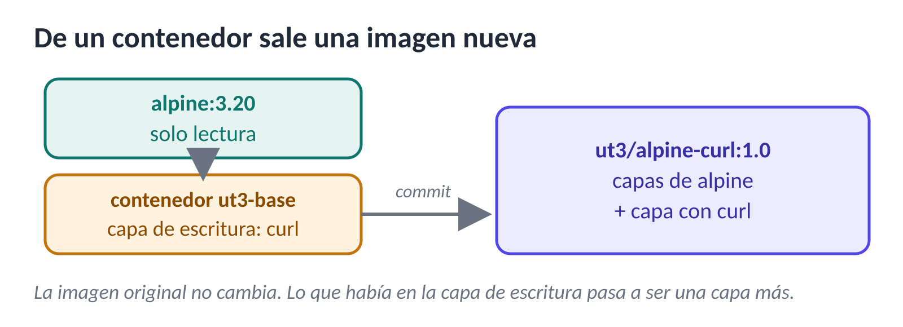
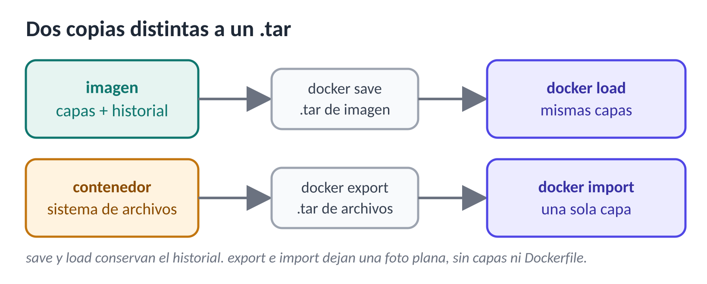
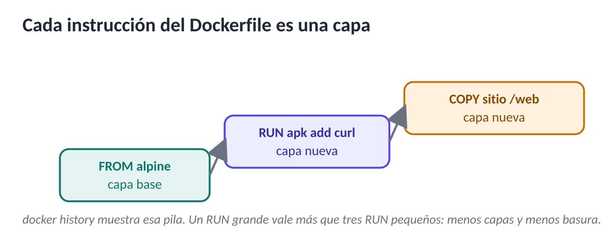
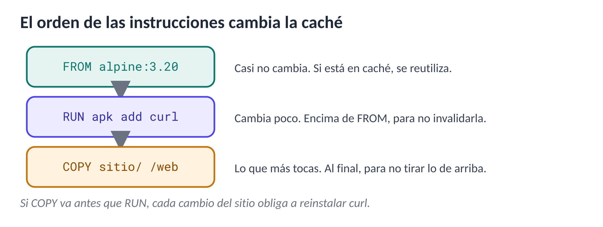
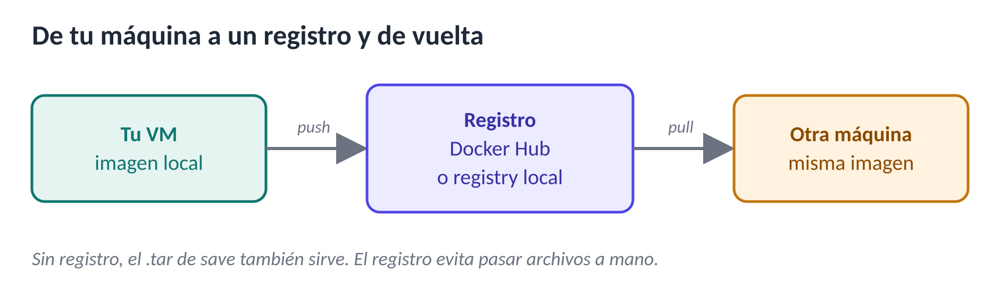

# Cómo usar este dosier {.nobreak}

En la UT1 arrancaste contenedores. En la UT2 los manejaste: ciclo de vida, `inspect`, `exec`, `attach`, `cp` y un Nginx en marcha. Hasta ahora las imágenes las bajabas hechas (`nginx`, `ubuntu`, `alpine`). En esta UT las **gestionas**: listarlas, filtrarlas, borrarlas, copiarlas a un archivo, crearlas a partir de un contenedor y, sobre todo, construirlas con un **Dockerfile**.

Es un dosier para leer con la terminal abierta. Conéctate por SSH a `cont-vm` y escribe cada comando a medida que lo leas. Cuando un apartado te pida **dos terminales**, abre una segunda sesión SSH a la misma VM.

A lo largo del texto encontrarás cuatro tipos de caja:

!!! definicion "Definición"
    Un término que tienes que saber explicar con tus propias palabras.

!!! ejemplo "Ejemplo"
    Un caso concreto, casi siempre con el comando y lo que verás en pantalla.

!!! ojo "Ojo"
    Un error típico, una confusión frecuente o un detalle que conviene tener muy claro.

!!! comprueba "Comprueba"
    Preguntas cortas al final de cada bloque. Si no sabes contestarlas sin mirar, vuelve a leer el bloque.

Cada bloque termina con un apartado **«Míralo en tu máquina»**. Los bloques continúan la numeración de la UT2, que terminó en el bloque 11.

## Qué vas a aprender

Al terminar esta UT deberías ser capaz de:

- **Listar** las imágenes locales y **filtrarlas** por nombre, etiqueta o patrón.
- **Explicar** las columnas de `docker images` en Docker Engine 29 (`DISK USAGE`, `CONTENT SIZE`, `EXTRA`).
- **Buscar** imágenes en Docker Hub con `docker search` y **descargarlas** con `docker pull`.
- **Leer** el historial de capas con `docker history` y datos concretos con `docker image inspect`.
- **Borrar** una imagen con `docker rmi` y **distinguir** borrar una etiqueta de borrar la imagen.
- **Limpiar** imágenes huérfanas con `docker image prune` sin cargarte el disco a ciegas.
- **Crear** una imagen a partir de un contenedor con `docker commit` y **ponerle** más nombres con `docker tag`.
- **Guardar y cargar** una imagen con `docker save` / `docker load` y **distinguirlo** de `export` / `import`.
- **Escribir** un Dockerfile y **construirlo** con `docker build`.
- **Usar** las instrucciones `FROM`, `RUN`, `CMD`, `COPY`, `EXPOSE`, `ENTRYPOINT`, `USER`, `WORKDIR`, `ENV`, `ARG` y `LABEL`.
- **Aprovechar** la caché del build colocando al final lo que más cambia.
- **Reducir** el tamaño de una imagen (base ligera, un solo `RUN`, limpieza de `apt`).
- **Subir** una imagen a un registro (Docker Hub o uno local).

## Índice

| Bloque | Contenido |
|---|---|
| [12](#bloque-12-inventario-listar-buscar-y-descargar) | Inventario: listar, buscar y descargar |
| [13](#bloque-13-borrar-imagenes-y-limpiar-disco) | Borrar imágenes y limpiar disco |
| [14](#bloque-14-de-un-contenedor-a-una-imagen) | De un contenedor a una imagen |
| [15](#bloque-15-dockerfile-y-docker-build) | Dockerfile y `docker build` |
| [16](#bloque-16-instrucciones-del-dockerfile) | Instrucciones del Dockerfile |
| [17](#bloque-17-imagenes-ligeras-y-registros) | Imágenes ligeras y registros |
| Anexos | Glosario, mapa resumen y autoevaluación |

# Bloque 12. Inventario: listar, buscar y descargar

Antes de crear imágenes propias conviene saber **qué hay ya en tu máquina**, **qué se puede bajar** y **de qué está hecha** una imagen. En la UT2 viste que una imagen es una pila de capas de solo lectura. Aquí trabajas esa pila con comandos.

## 12.1 Listar las imágenes locales

El comando es `docker images`. Es un alias de `docker image ls` (y de `docker image list`): las tres hacen lo mismo. En apuntes y en clase usaremos `docker images`, que es el que más se ve.

```bash
docker images
```

En Docker Engine 29 la tabla por defecto ya no es la de «REPOSITORY / TAG / IMAGE ID / CREATED / SIZE». Sale así:

```
IMAGE         ID             DISK USAGE   CONTENT SIZE   EXTRA
alpine:3.20   d9e853e87e55       13.2MB         3.71MB
nginx:1.29    7c2e3a1b9d04        240MB           72MB
```

| Columna | Qué es |
|---|---|
| **IMAGE** | Nombre completo: repositorio y etiqueta juntos (`alpine:3.20`) |
| **ID** | Identificador de la imagen (12 caracteres; el completo es un SHA256) |
| **DISK USAGE** | Lo que ocupa en disco, descomprimida y lista para usarse |
| **CONTENT SIZE** | Tamaño de los blobs comprimidos (lo que viaja, más o menos, en un `pull`) |
| **EXTRA** | `U` si algún contenedor la está usando (*in use*) |

!!! definicion "Definición"
    **Imagen local**: copia de una imagen que Docker ya tiene en tu máquina. Si no está, `docker run` o `docker pull` la buscan en el registro.

!!! ojo "Ojo"
    `DISK USAGE` no se suma a lo bruto entre imágenes que **comparten capas**. Dos imágenes basadas en la misma Alpine no ocupan dos veces la capa base. La columna te dice el tamaño de esa imagen, no el espacio único que añade.

Si te resulta más cómoda la tabla antigua (repositorio y etiqueta separados), Docker sigue dándotela con una plantilla:

```bash
docker images --format 'table {{.Repository}}\t{{.Tag}}\t{{.ID}}\t{{.Size}}'
```

```
REPOSITORY   TAG       IMAGE ID       SIZE
alpine       3.20      d9e853e87e55   13.2MB
```

`.Size` es el `DISK USAGE`. Para scripts, `docker images -q alpine:3.20` lista solo el ID.

!!! ojo "Ojo"
    `docker image` (sin la s) no lista nada: es el **grupo** de subcomandos (`ls`, `rm`, `prune`, `inspect`, `history`…). Si escribes solo `docker image`, Docker te muestra la ayuda. El listado es `docker images` o `docker image ls`.

## 12.2 Filtrar el listado

Sin argumentos, `docker images` enseña **todas** las imágenes con etiqueta. Para acotar:

```bash
docker images alpine:3.20          # esa imagen, esa etiqueta
docker images alpine               # todas las etiquetas de alpine
```

El argumento es un nombre exacto, no un trozo: `docker images alp` no encuentra `alpine`.

Para patrones se usa el filtro `reference`:

```bash
docker images --filter 'reference=alp*:3.*'
```

```
IMAGE         ID             DISK USAGE   CONTENT SIZE   EXTRA
alpine:3.20   d9e853e87e55       13.2MB         3.71MB
```

Otros filtros útiles: `dangling=true` (imágenes sin etiqueta, bloque 13), `before=` y `since=` (creadas antes o después de otra).

## 12.3 Buscar en Docker Hub: `docker search`

`docker images` mira **tu disco**. Para ver qué hay en el registro por defecto:

```bash
docker search nginx
```

```
NAME                              DESCRIPTION                                     STARS     OFFICIAL
nginx                             Official build of Nginx.                        21434     [OK]
nginx/nginx-ingress               NGINX and NGINX Plus Ingress Controllers …      124
```

| Columna | Qué es |
|---|---|
| **NAME** | Nombre en Docker Hub. Las oficiales van sin usuario (`nginx`); las de un usuario o organización, `usuario/nombre` |
| **DESCRIPTION** | Texto corto de la página de la imagen |
| **STARS** | Favoritos en Hub. Sirve de pista, no de garantía |
| **OFFICIAL** | `[OK]` si es imagen oficial de Docker |

Puedes acotar:

```bash
docker search --filter is-official=true --limit 5 nginx
```

!!! ojo "Ojo"
    `docker search` no descarga nada. Antes de usar una imagen nueva, abre su página en Hub (por ejemplo <https://hub.docker.com/_/nginx>) y lee puertos, volúmenes y variables. Las estrellas no sustituyen esa lectura.

## 12.4 Descargar sin arrancar: `docker pull`

`docker run` ya hace `pull` si la imagen no está. A veces quieres **dejarla lista** sin crear un contenedor: un examen, un script, un corte de red.

```bash
docker pull alpine:3.20
```

```
3.20: Pulling from library/alpine
Digest: sha256:d9e853e87e55526f6b2917df91a2115c36dd7c696a35be12163d44e6e2a4b6bc
Status: Image is up to date for alpine:3.20
docker.io/library/alpine:3.20
```

Si ya la tienes, no vuelve a bajar las capas: lo dice con `Image is up to date`. El **digest** (`sha256:…`) identifica el contenido concreto; dos etiquetas distintas pueden apuntar al mismo digest, y la misma etiqueta puede cambiar de digest cuando el autor publica otra versión.

!!! definicion "Definición"
    **Digest**: huella SHA256 del contenido de la imagen. A diferencia de la etiqueta (`3.20`, `latest`), no se reasigna: si el digest coincide, es exactamente la misma imagen.

!!! ojo "Ojo"
    Fija siempre la etiqueta (`alpine:3.20`, `ubuntu:24.04`). `latest` es una etiqueta más, no «la última estable para siempre»: mañana puede ser otra cosa.

## 12.5 De qué está hecha: `history` e `inspect`

`docker history` enseña las **capas** y cuánto añadió cada una:

```bash
docker history alpine:3.20
```

```
IMAGE          CREATED        CREATED BY                                      SIZE      COMMENT
d9e853e87e55   7 months ago   CMD ["/bin/sh"]                                 0B        buildkit.dockerfile.v0
<missing>      7 months ago   ADD alpine-minirootfs-3.20.10-x86_64.tar.gz …   9.44MB    buildkit.dockerfile.v0
```

La capa de `CMD` pesa 0 B: no copia archivos, solo deja un parámetro por defecto. `<missing>` en la columna IMAGE es normal: son capas intermedias que el almacén no lista como imagen aparte. `CREATED BY` es, casi siempre, la instrucción del Dockerfile que la generó.

Para un dato concreto, `docker image inspect` (o `docker inspect`, que también vale con imágenes):

```bash
docker image inspect -f '{{.Architecture}} {{.Os}} {{len .RootFS.Layers}}' alpine:3.20
```

```
amd64 linux 1
```

Alpine 3.20, en `cont-vm`, es una sola capa, Linux, amd64.

## Míralo en tu máquina

```bash
docker images
docker images alpine:3.20
docker images --filter 'reference=*:24.04'
docker images --format 'table {{.Repository}}\t{{.Tag}}\t{{.ID}}\t{{.Size}}'
docker search --filter is-official=true --limit 5 python
docker pull alpine:3.20
docker history alpine:3.20
docker image inspect -f '{{.Id}}' alpine:3.20
```

!!! comprueba "Comprueba"
    1. ¿Qué diferencia hay entre `DISK USAGE` y `CONTENT SIZE`?
    2. ¿Qué significa una `U` en la columna `EXTRA`?
    3. ¿`docker images alp` lista `alpine`? ¿Por qué?
    4. ¿`docker search` descarga la imagen?
    5. ¿Para qué sirve el digest que muestra `docker pull`?

# Bloque 13. Borrar imágenes y limpiar disco

Las imágenes se acumulan. Un `pull` de más, un build que salió mal, una etiqueta que ya no usas: el disco de la VM no es infinito. Borrar tiene reglas, porque una imagen **en uso** no se va.

## 13.1 Borrar una imagen: `docker rmi`

`docker rmi` es el alias de `docker image rm`. Borra **una etiqueta**. Si era la última que apuntaba a ese ID, borra también la imagen.

```bash
docker rmi ubuntu:22.04
```

Puedes usar el ID corto en lugar del nombre. Si varias etiquetas apuntan al mismo ID, borrar una no borra las demás: el ID sigue ahí.

!!! ejemplo "Ejemplo"
    Tienes `ut3/alpine-curl:1.0` y `ut3/alpine-curl:latest` con el **mismo** ID. `docker rmi ut3/alpine-curl:1.0` quita esa etiqueta; `latest` sigue y la imagen no se ha ido. Solo cuando no queda ninguna etiqueta (o usas el ID y no hay contenedores usándola) desaparece del disco.

Si un contenedor (en marcha o parado) se creó con esa imagen, Docker se niega:

```
Error response from daemon: conflict: unable to delete ut3/dang:latest (must be forced)
- container df22f5fdd2e0 is using its referenced image
```

Primero el contenedor (`docker rm`), después la imagen. `-f` en `rmi` fuerza, pero no es el camino habitual en clase: te dejas contenedores huérfanos y no aprendes el orden.

## 13.2 Recuerdo: borrar contenedores

Sin contenedor parado, muchas imágenes no se pueden borrar. Lo viste en la UT2:

```bash
docker rm NOMBRE_O_ID          # tiene que estar parado
docker rm -f NOMBRE_O_ID       # lo para y lo borra
```

Para listar solo los parados: `docker ps -a --filter status=exited`.

## 13.3 Imágenes huérfanas (*dangling*)

Cuando reconstruyes una imagen con el **mismo nombre** (`docker build -t ut3/web .` otra vez), la etiqueta se mueve al ID nuevo. El ID viejo se queda **sin nombre**: `<none>`.

!!! definicion "Definición"
    **Imagen huérfana** (*dangling*): imagen local que ya no tiene ninguna etiqueta. Suele ser el resultado de un build que ha movido el nombre a un ID nuevo. No la usa ningún nombre, pero sigue ocupando disco.

```bash
docker images --filter dangling=true
```

En Engine 29 el nombre sale vacío o como `<none>`; el ID sigue sirviendo para borrarla.

## 13.4 Limpiar con `prune` y ver el disco

```bash
docker image prune
```

Pide confirmación y borra **solo las huérfanas**, no las que tienen etiqueta. `-f` se salta la pregunta. `-a` (`--all`) borra además las imágenes con etiqueta que **no usa ningún contenedor**: más agresivo.

Para ver cuánto hay:

```bash
docker system df
```

Ahí salen imágenes, contenedores, volúmenes y caché de build. Es el mapa antes de limpiar.

!!! definicion "Definición"
    **`docker image prune`**: borra imágenes huérfanas. Con `--all`, borra también las etiquetadas que no está usando ningún contenedor.

## 13.5 Lo que no lanzas a ciegas

En foros verás recetas que vacían la máquina. Funcionan. También te pueden dejar sin las imágenes de clase a cinco minutos de un ejercicio.

```bash
docker rmi $(docker images -q)          # todas las imágenes (falla en las que están en uso)
docker stop $(docker ps -aq)            # para TODOS los contenedores
docker rm $(docker ps -aq)              # borra TODOS los contenedores parados
docker system prune -a                  # contenedores parados, redes, huérfanas y, con -a, imágenes sin contenedor
```

!!! ojo "Ojo"
    `docker system prune -a` no es «ordenar un poco». Es vaciar. En `cont-vm` no lo ejecutes salvo que Dustin lo pida. Para el día a día: `docker rm` del contenedor concreto y `docker rmi` de la imagen concreta, o `docker image prune` si solo quieres huérfanas.

## Míralo en tu máquina

```bash
docker images
docker ps -a --filter status=exited
docker images --filter dangling=true
docker system df
# no hace falta borrar nada si no te sobra disco
```

!!! comprueba "Comprueba"
    1. Tienes dos etiquetas sobre el mismo ID. ¿Qué pasa si haces `docker rmi` de una de ellas?
    2. ¿Por qué `docker rmi nginx` puede fallar aunque no haya ningún contenedor **en marcha**?
    3. ¿Qué es una imagen huérfana y qué comando la lista?
    4. ¿Qué borra `docker image prune` sin `--all`? ¿Y con `--all`?
    5. ¿Cuándo usarías `docker system prune -a`?

# Bloque 14. De un contenedor a una imagen

A veces has dejado un contenedor a tu gusto (un paquete instalado, un archivo de configuración) y quieres **reutilizarlo**. Docker puede congelar esa capa de escritura y convertirla en una imagen nueva. Es el camino rápido. El camino bueno, el que usarás de verdad, es el Dockerfile del bloque 15. Conviene conocer los dos.

## 14.1 `docker commit`

!!! definicion "Definición"
    **`docker commit`**: crea una imagen nueva a partir del estado actual de un contenedor. La capa de escritura pasa a ser una capa de solo lectura de la imagen nueva. El contenedor y la imagen original no se modifican.

```bash
docker commit -a "Alumno" -m "alpine con curl" ut3-base ut3/alpine-curl:1.0
```

| Pieza | Qué es |
|---|---|
| `-a` | Autor (queda en los metadatos) |
| `-m` | Comentario, como el de un commit de Git |
| `ut3-base` | Contenedor de origen (nombre o ID) |
| `ut3/alpine-curl:1.0` | Nombre de la imagen nueva (`[registro/]repositorio:etiqueta`) |

El contenedor puede estar en marcha o parado. Lo que hay en su capa de escritura (archivos nuevos, cambios, borrados) entra en la imagen. Los volúmenes **no**: un archivo que vive en un volumen no forma parte de la capa de escritura.

<figure></figure>

!!! ejemplo "Ejemplo"
    Partimos de Alpine, instalamos `curl` y congelamos:

    ```bash
    docker run -d --name ut3-base alpine:3.20 sleep 600
    docker exec ut3-base sh -c 'apk add --no-cache curl'
    docker commit -a "Alumno" -m "alpine con curl" ut3-base ut3/alpine-curl:1.0
    docker images ut3/alpine-curl
    docker history ut3/alpine-curl:1.0
    ```

    `history` muestra la capa extra encima de Alpine. A partir de ahí:

    ```bash
    docker run --rm ut3/alpine-curl:1.0 curl --version
    ```

!!! ojo "Ojo"
    `commit` no deja receta. Dentro de seis meses no sabrás si instalaste `curl` con `apk` o lo copiaste a mano. Un Dockerfile sí lo deja. Usa `commit` para un apaño o para entender las capas; para algo que vayas a repetir o a entregar, Dockerfile.

## 14.2 Varios nombres, mismo ID: `docker tag`

Una imagen puede tener **varias etiquetas**. No se copia: se le pone otro nombre al mismo ID.

```bash
docker tag ut3/alpine-curl:1.0 ut3/alpine-curl:latest
docker images ut3/alpine-curl
```

Las dos filas muestran el mismo ID y el mismo tamaño. `latest` no es mágica: es una etiqueta que has puesto tú (o el autor en Hub).

Para quitar una etiqueta, `docker rmi` de ese nombre. Mientras quede otra, la imagen sigue.

!!! definicion "Definición"
    **`docker tag`**: añade un nombre (repositorio y etiqueta) a una imagen que ya existe. No duplica las capas.

## 14.3 Copiar una imagen a un archivo: `save` y `load`

Para llevarte una imagen a otra máquina **sin registro**, o para una copia de seguridad:

```bash
docker save -o copia.tar ut3/alpine-curl:1.0
# equivalente: docker save ut3/alpine-curl:1.0 > copia.tar
docker load -i copia.tar
# equivalente: docker load < copia.tar
```

`save` empaqueta las **capas y el historial**. `load` las restaura. Si en destino ya hay capas iguales, se reutilizan.

## 14.4 El otro par: `export` e `import`

`docker export` no guarda una imagen: vuelca el **sistema de archivos de un contenedor** (lo que verías con `ls /` dentro) a un `.tar`. `docker import` crea una imagen a partir de ese `.tar`.

```bash
docker export ut3-base -o fs.tar
docker import fs.tar ut3/desde-export:1.0
docker history ut3/desde-export:1.0     # una sola capa
```

<figure></figure>

| | `save` / `load` | `export` / `import` |
|---|---|---|
| Parte de | Una **imagen** | Un **contenedor** |
| Qué guarda | Capas e historial | Archivos, una foto plana |
| Resultado al cargar | La misma pila de capas | Una imagen de **una sola capa**, sin historial |
| Metadatos (`CMD`, `ENV`…) | Se conservan | Se pierden (se pueden indicar en `import`) |

!!! ojo "Ojo"
    Si tu objetivo es mover una imagen, `save` / `load`. `export` sirve para extraer los archivos de un contenedor (un backup del sistema de archivos, no de la receta).

## Míralo en tu máquina

```bash
docker run -d --name ut3-base alpine:3.20 sleep 600
docker exec ut3-base sh -c 'apk add --no-cache curl'
docker commit -a "Alumno" -m "alpine con curl" ut3-base ut3/alpine-curl:1.0
docker tag ut3/alpine-curl:1.0 ut3/alpine-curl:latest
docker images ut3/alpine-curl
docker history ut3/alpine-curl:1.0
docker save -o /tmp/copia.tar ut3/alpine-curl:1.0
ls -lh /tmp/copia.tar
docker rmi ut3/alpine-curl:latest ut3/alpine-curl:1.0
docker load -i /tmp/copia.tar
docker images ut3/alpine-curl
docker rm -f ut3-base
```

!!! comprueba "Comprueba"
    1. ¿Qué pasa con el contenedor original después de un `docker commit`?
    2. ¿`docker tag` duplica la imagen en disco?
    3. ¿Qué conservas con `save`/`load` que pierdes con `export`/`import`?
    4. Un archivo que está en un volumen, ¿entra en la imagen de `commit`?
    5. ¿Por qué un Dockerfile es mejor que un `commit` si vas a repetir la imagen?

# Bloque 15. Dockerfile y `docker build`

Un Dockerfile es un recetario. Lo escribes una vez, lo versionas en Git, lo compartes, y cualquiera (tú el martes, un compañero, un servidor de integración) obtiene **la misma imagen**. Por eso es el camino normal.

## 15.1 Qué es y cómo se llama

!!! definicion "Definición"
    **Dockerfile**: archivo de texto con instrucciones para construir una imagen. Por convención se llama exactamente `Dockerfile` (con D mayúscula, sin extensión) y vive en el directorio del proyecto.

!!! definicion "Definición"
    **`docker build`**: lee un Dockerfile, ejecuta las instrucciones en orden y guarda el resultado como imagen local. Cada instrucción genera una **capa**.

El directorio que le pasas a `build` (casi siempre `.`) es el **contexto**: los archivos que Docker puede copiar a la imagen. No es «donde está el demonio»; es «qué carpeta le enseñas».

```bash
docker build -t ut3/ubuntu-nano .
```

| Pieza | Qué es |
|---|---|
| `-t ut3/ubuntu-nano` | Nombre y etiqueta de la imagen resultante (`latest` si no pones etiqueta) |
| `.` | Contexto: el directorio actual. Ahí busca `Dockerfile` |

Si el archivo no se llama `Dockerfile`, `-f`:

```bash
docker build -t ut3/ubuntu-nano -f Dockerfile.nano .
```

## 15.2 El primero: Ubuntu con `nano`

Crea un directorio de trabajo (no ensucies `$HOME` a lo bruto) y, dentro, un archivo `Dockerfile`:

```dockerfile
FROM ubuntu:24.04
RUN apt-get update && apt-get install -y nano
CMD ["/bin/bash"]
```

Tres instrucciones, tres ideas:

1. **`FROM`**: de qué imagen partes. Siempre la primera (salvo un `ARG` antes, que verás en el bloque 16).
2. **`RUN`**: comando que se ejecuta **al construir**, no al arrancar. El resultado queda grabado en una capa.
3. **`CMD`**: comando por defecto **al arrancar** un contenedor de esta imagen, si no indicas otro en `docker run`.

```bash
docker build -t ut3/ubuntu-nano .
docker history ut3/ubuntu-nano
docker run --rm -it ut3/ubuntu-nano
# dentro: nano --version   y  exit
```

<figure></figure>

!!! ojo "Ojo"
    `FROM ubuntu:latest` es cómodo y es una trampa. Hoy es 24.04; dentro de un año puede ser 26.04 y tu build cambia sin que lo hayas pedido. En clase y en producción: etiqueta concreta (`ubuntu:24.04`, `alpine:3.20`).

## 15.3 La caché: lo que no cambia no se repite

Docker no ejecuta a ciegas cada instrucción cada vez. Si el Dockerfile, el contexto que usa esa instrucción y las capas de debajo **no han cambiado**, reutiliza la capa: en el log verás `CACHED`.

Por eso el **orden** importa. Lo que cambia a menudo (tu código, tu `index.html`) va **al final**. Lo que cambia poco (instalar paquetes) va **arriba**, justo después de `FROM`.

<figure></figure>

!!! ejemplo "Ejemplo"
    Este Dockerfile instala `curl` y luego copia un archivo:

    ```dockerfile
    FROM alpine:3.20
    RUN apk add --no-cache curl
    COPY hola.txt /hola.txt
    CMD ["cat", "/hola.txt"]
    ```

    Primera vez: descarga Alpine, instala `curl`, copia. Cambias `hola.txt` y vuelves a construir: `FROM` y `RUN` salen `CACHED`; solo se rehace el `COPY`. Si el `COPY` estuviera **antes** del `RUN`, un cambio del archivo obligaría a reinstalar `curl`.

## 15.4 Lo que no quieres dentro: `.dockerignore`

El contexto se manda al demonio. Si en la carpeta hay un `.git`, un `node_modules` o un archivo de secretos, **entra en el contexto** aunque no hagas `COPY` de ellos. `.dockerignore` (misma idea que `.gitignore`) los deja fuera:

```
.git
*.log
secretos/
```

!!! ejemplo "Ejemplo"
    Con `COPY . /app`, un `secretos/clave.txt` acabaría en la imagen. Con `secretos/` en `.dockerignore`, `docker run --rm imagen ls /app` no lo lista.

## Míralo en tu máquina

```bash
mkdir -p ~/ut3-build && cd ~/ut3-build
cat > Dockerfile << 'EOF'
FROM alpine:3.20
RUN apk add --no-cache curl
COPY hola.txt /hola.txt
CMD ["cat", "/hola.txt"]
EOF
echo uno > hola.txt
docker build -t ut3/cache .
docker build -t ut3/cache .          # segunda vez: casi todo CACHED
echo dos > hola.txt
docker build -t ut3/cache .          # el COPY se rehace; el RUN no
docker run --rm ut3/cache            # dos
```

!!! comprueba "Comprueba"
    1. ¿Cuál es la diferencia entre `RUN` y `CMD`?
    2. ¿Qué es el contexto de `docker build`?
    3. ¿Por qué el `COPY` del código se pone al final?
    4. ¿Qué problema hay con `FROM ubuntu:latest`?
    5. ¿Para qué sirve `.dockerignore` si no haces `COPY` de esos archivos?

# Bloque 16. Instrucciones del Dockerfile

Hay más instrucciones. No hace falta memorizar el manual: sí hace falta saber qué hace cada una de las de este bloque y cuándo usarla.

## 16.1 `COPY` y `ADD`

Las dos copian archivos del contexto a la imagen. **Usa `COPY`**, salvo un caso.

| | `COPY` | `ADD` |
|---|---|---|
| Archivo o directorio del contexto | Sí | Sí |
| Descomprime un `.tar` / `.tar.gz` local en el destino | No | **Sí** |
| Descarga una URL | No | Sí (mejor no: un `RUN curl` se entiende más) |

```dockerfile
COPY sitio/ /usr/share/nginx/html/
COPY paquete.tar.gz /copia/
ADD paquete.tar.gz /srv/
```

!!! ejemplo "Ejemplo"
    Con un `paquete.tar.gz` que dentro tiene `t/f.txt`:

    - `ADD paquete.tar.gz /srv/` deja `/srv/t/f.txt` (descomprimido).
    - `COPY paquete.tar.gz /copia/` deja `/copia/paquete.tar.gz` (el archivo tal cual).

!!! ojo "Ojo"
    `ADD` **no** descomprime un `.zip`. Solo archivos tar. El truco de «ADD del zip y ya está la web» no funciona.

## 16.2 `EXPOSE`

```dockerfile
EXPOSE 80
```

Es un **metadato**: documenta que la imagen escucha en el 80. No publica el puerto en el anfitrión. Eso sigue siendo `-p` en `docker run`, como en la UT1 y la UT2. `docker image inspect` lo enseña en `Config.ExposedPorts`; `docker ps` no abre nada por un `EXPOSE` solo.

## 16.3 `CMD` y `ENTRYPOINT`, forma *shell* y forma *exec*

Hay dos escrituras:

```dockerfile
CMD echo hola                 # forma shell: Docker lo convierte en /bin/sh -c "echo hola"
CMD ["echo", "hola"]          # forma exec: ejecuta el binario, sin shell
```

```bash
docker image inspect -f '{{.Config.Cmd}}' ut3/s ut3/e
```

```
[/bin/sh -c echo hola]
[echo hola]
```

!!! definicion "Definición"
    **Forma *exec***: JSON, `["programa", "arg1"]`. Docker ejecuta ese programa como PID 1. **Forma *shell***: una cadena. Docker lanza `/bin/sh -c "…"`. Hace falta si usas redirecciones o variables; para el proceso principal de un servidor, la forma *exec* es la adecuada (señales como `SIGTERM` llegan al proceso de verdad).

`ENTRYPOINT` fija el **programa**; `CMD`, los **argumentos por defecto**. Lo que escribas después de la imagen en `docker run` sustituye a `CMD`, no a `ENTRYPOINT` (salvo `--entrypoint`).

```dockerfile
FROM alpine:3.20
ENTRYPOINT ["cat"]
CMD ["/etc/os-release"]
```

```bash
docker run --rm ut3/cat                 # cat /etc/os-release
docker run --rm ut3/cat /etc/hostname   # cat /etc/hostname
```

Lo viste en la UT2 con `Entrypoint` y `Cmd` de `inspect`. Aquí lo dejas escrito en la imagen.

## 16.4 `USER`, `WORKDIR`, `ENV`

```dockerfile
FROM alpine:3.20
RUN adduser -D dustin
USER dustin
WORKDIR /home/dustin/app
ENV SALUDO=hola
CMD ["sh", "-c", "id; pwd; echo $SALUDO"]
```

| Instrucción | Efecto |
|---|---|
| **`USER`** | Usuario (o UID) con el que corren las instrucciones **siguientes** y el contenedor. Por defecto, `root` |
| **`WORKDIR`** | Directorio de trabajo. Si no existe, lo crea. Afecta a `RUN`, `CMD`, `ENTRYPOINT` y a las copias relativas |
| **`ENV`** | Variable de entorno grabada en la imagen. Disponible en el build y en el contenedor |

```bash
docker run --rm ut3/user
```

```
uid=1000(dustin) gid=1000(dustin)
/home/dustin/app
hola
```

!!! ojo "Ojo"
    Un contenedor de producción no debería ir como `root` si puede evitarse. Crear un usuario y poner `USER` es de las primeras cosas que se miran en una imagen seria.

## 16.5 `ARG` y `LABEL`

`ARG` es un parámetro del **build**, no del contenedor. Se pasa con `--build-arg`. Si no lo pasas, usa el valor por defecto.

```dockerfile
FROM alpine:3.20
ARG VERSION=1.2
RUN echo "Instalando versión $VERSION" > /version
CMD ["cat", "/version"]
```

```bash
docker build -t ut3/arg .
docker run --rm ut3/arg                      # Instalando versión 1.2
docker build --build-arg VERSION=2.0 -t ut3/arg .
docker run --rm ut3/arg                      # Instalando versión 2.0
```

`LABEL` pone metadatos (autor, versión del proyecto, licencia). No cambia el comportamiento.

```dockerfile
LABEL maintainer="alumno@example.com"
```

!!! ojo "Ojo"
    `ARG` no queda en el contenedor como variable de entorno. Si quieres que el programa la vea al arrancar, usa `ENV` (puedes hacer `ENV VERSION=$VERSION` después del `ARG`).

## Míralo en tu máquina

```bash
cd ~/ut3-build
cat > Dockerfile << 'EOF'
FROM alpine:3.20
ENTRYPOINT ["cat"]
CMD ["/etc/os-release"]
EOF
docker build -t ut3/cat .
docker run --rm ut3/cat | head -3
docker run --rm ut3/cat /etc/hostname
```

!!! comprueba "Comprueba"
    1. ¿Cuándo usarías `ADD` en lugar de `COPY`?
    2. ¿`EXPOSE 80` hace que `curl localhost:80` funcione desde la VM?
    3. ¿Qué sustituye `docker run imagen argumento`: el `CMD`, el `ENTRYPOINT`, o los dos?
    4. ¿Qué diferencia hay entre `ARG` y `ENV`?
    5. ¿Por qué la forma *exec* de `CMD` es mejor para un servidor?

# Bloque 17. Imágenes ligeras y registros

Una imagen que pesa 200 MB donde bastaban 15 MB tarda más en bajar, ocupa disco y arrastra paquetes que no necesitas (más superficie de ataque, más actualizaciones). Y una imagen que solo vive en tu VM no le sirve a nadie. Este bloque cierra las dos puntas: **tamaño** y **distribución**.

## 17.1 El tamaño se decide al escribir el Dockerfile

Números reales, medidos en una máquina con Engine 29:

| Imagen | DISK USAGE |
|---|---|
| `alpine:3.20` | 13,2 MB |
| `ubuntu:24.04` | 117 MB |
| `debian:12-slim` | 116 MB |
| `nginx:1.29` | 240 MB |
| `nginx:1.29-alpine` | 94,8 MB |

Y el mismo «Ubuntu con nano», tres recetas:

```dockerfile
# A: dos RUN, sin limpiar. 212 MB
FROM ubuntu:24.04
RUN apt-get update
RUN apt-get install -y nano

# B: un RUN, sin recomendados, listas de apt fuera. 117 MB
FROM ubuntu:24.04
RUN apt-get update && apt-get install -y --no-install-recommends nano \
    && rm -rf /var/lib/apt/lists/*

# C: Alpine. 14,3 MB
FROM alpine:3.20
RUN apk add --no-cache nano
```

De 212 MB a 14,3 MB sin cambiar lo que hace la imagen. Las reglas, en orden:

1. **Base pequeña.** Alpine (`apk`) o una variante `-slim` / `-alpine` de la imagen oficial. Si la aplicación es un binario estático, hay imágenes `scratch` o `distroless` (más adelante en el módulo, si toca).
2. **Un `RUN` para instalar y limpiar.** Cada `RUN` es una capa. Si en una capa descargas las listas de `apt` y en la siguiente las borras, la primera **sigue en la imagen**. Hay que borrar en el **mismo** `RUN`.
3. **`--no-install-recommends`** en `apt-get install`: no arrastra paquetes «recomendados» que no has pedido.
4. **No instales un editor «por si acaso»** en una imagen que va a producción. `nano` en el ejemplo es para ver el tamaño; un Nginx de verdad no lo necesita. Para depurar, `docker exec` y, si hace falta, una imagen aparte.
5. **Orden de caché**, como en el 15.3: dependencias arriba, tu código abajo.

!!! ojo "Ojo"
    Alpine usa `musl` y `apk`, no `glibc` ni `apt`. La mayoría de imágenes oficiales tienen variante `-alpine`. Si un binario solo está compilado para `glibc`, Alpine no es un atajo: o usas Debian/Ubuntu slim, o lo recompilas.

## 17.2 Subir a Docker Hub

Docker Hub es el registro por defecto (UT2). Para **subir** necesitas cuenta en <https://hub.docker.com>, un repositorio creado (público o privado) y sesión en la VM:

```bash
docker login
docker tag ut3/web:1.0 TU_USUARIO/web:1.0
docker push TU_USUARIO/web:1.0
```

El nombre local tiene que ir con **tu usuario** de Hub delante: `TU_USUARIO/web:1.0`. Si la imagen se llama solo `web`, Hub no sabe a qué cuenta empujarla.

Cualquiera (si el repositorio es público) podrá hacer `docker pull TU_USUARIO/web:1.0`. En Dual, si te piden una imagen tuya, este es el camino. No subas secretos: todo lo que copiaste en el Dockerfile viaja con la imagen.

## 17.3 Un registro en local

No siempre hay cuenta de Hub, ni conviene subir lo de clase a internet. La imagen oficial `registry` monta un registro **en tu VM**:

```bash
docker run -d --name ut3-registry -p 5000:5000 registry:2
docker tag ut3/alpine-curl:1.0 localhost:5000/alpine-curl:1.0
docker push localhost:5000/alpine-curl:1.0
docker rmi localhost:5000/alpine-curl:1.0
docker pull localhost:5000/alpine-curl:1.0
```

<figure></figure>

Por defecto, Docker trata `localhost` como registro «inseguro» (HTTP). Si el `push` falla hablando de TLS o de *insecure registry*, en esta VM no hace falta tocar nada: avisa a Dustin antes de editar `/etc/docker/daemon.json`.

Para ver lo que hay en el registro:

```bash
curl -s http://localhost:5000/v2/_catalog
curl -s http://localhost:5000/v2/alpine-curl/tags/list
```

Cuando acabes: `docker rm -f ut3-registry`. Los datos del registro (si no le pusiste un volumen) se van con el contenedor.

!!! definicion "Definición"
    **Registro local**: registro que corre en tu red (o en tu VM) con la imagen `registry`. Sirve para practicar `tag` / `push` / `pull` sin cuenta en Hub y, en una empresa, para no subir imágenes internas a un registro público.

## 17.4 Una web empaquetada, de principio a fin

Junta Dockerfile, `COPY`, `EXPOSE` y una etiqueta. En `~/ut3-build`:

```bash
mkdir -p site
echo '<h1>Mi web en una imagen</h1>' > site/index.html
```

```dockerfile
FROM nginx:1.29-alpine
LABEL maintainer="alumno@example.com"
COPY site/ /usr/share/nginx/html/
EXPOSE 80
```

```bash
docker build -t ut3/web:1.0 .
docker run -d --name ut3-web -p 18080:80 ut3/web:1.0
curl -s http://localhost:18080
docker rm -f ut3-web
```

La página ya no es la de bienvenida de Nginx: es la tuya, **dentro de la imagen**. Cualquier contenedor de `ut3/web:1.0` la trae. Eso no se consigue con `docker cp` al contenedor (UT2): `cp` toca un contenedor; el Dockerfile toca la plantilla.

## Míralo en tu máquina

```bash
docker images --format '{{.Repository}}:{{.Tag}} {{.Size}}' \
    ubuntu:24.04 alpine:3.20 nginx:1.29 nginx:1.29-alpine
# registro local (si el 5000 está libre)
docker run -d --name ut3-registry -p 5000:5000 registry:2
docker tag alpine:3.20 localhost:5000/alpine:3.20
docker push localhost:5000/alpine:3.20
curl -s http://localhost:5000/v2/_catalog
docker rm -f ut3-registry
```

!!! comprueba "Comprueba"
    1. ¿Por qué `RUN apt-get update` y `RUN apt-get install` en dos líneas deja la imagen más gorda aunque borres las listas después?
    2. ¿Qué cambia entre `nginx:1.29` y `nginx:1.29-alpine` además del tamaño?
    3. ¿Por qué `docker push web:1.0` a Docker Hub suele fallar y `docker push usuario/web:1.0` no?
    4. ¿`EXPOSE` y `-p` hacen lo mismo?
    5. Si cambias `site/index.html` y no reconstruyes, ¿un contenedor nuevo de `ut3/web:1.0` enseña la página nueva?

# Glosario

| Término | Definición |
|---|---|
| **`.dockerignore`** | Archivo que deja fuera del contexto de `build` rutas que no quieres mandar al demonio |
| **Caché de build** | Reutilización de capas cuya instrucción y capas de debajo no han cambiado |
| **Contexto** | Directorio que le pasas a `docker build`; de ahí salen los archivos de `COPY` y `ADD` |
| **`CONTENT SIZE`** | Tamaño comprimido del contenido de la imagen, en el listado de Engine 29 |
| **Digest** | Huella SHA256 del contenido; identifica una imagen de forma única |
| **`DISK USAGE`** | Espacio que ocupa la imagen en disco, descomprimida |
| **Dockerfile** | Receta en texto para construir una imagen con `docker build` |
| **Forma *exec*** | Notación JSON (`["prog", "arg"]`) que ejecuta el binario sin `/bin/sh -c` |
| **Forma *shell*** | Instrucción en cadena; Docker la lanza con `/bin/sh -c` |
| **Imagen huérfana** | Imagen local sin etiqueta, casi siempre por un build que movió el nombre a otro ID |
| **Imagen local** | Copia de una imagen ya almacenada en la máquina |
| **`LABEL`** | Metadato clave-valor grabado en la imagen |
| **Registro local** | Registro que corre en tu red, habitualmente con la imagen `registry` |
| **`docker commit`** | Crea una imagen a partir de la capa de escritura de un contenedor |
| **`docker tag`** | Añade un nombre a una imagen existente sin copiar capas |

# Mapa resumen

```text
INVENTARIO
   docker images                      Engine 29: IMAGE, ID, DISK USAGE, CONTENT SIZE, EXTRA (U = en uso)
   docker images alpine:3.20          filtro exacto por nombre:etiqueta
   docker images -f reference='n*:t'  patrón
   docker search [--filter is-official=true] nginx
   docker pull alpine:3.20            digest; up to date si ya está
   docker history IMAGEN              capas y tamaño de cada una
   docker image inspect -f '…'        un campo concreto

BORRAR
   docker rmi NOMBRE_O_ID             quita una etiqueta; la imagen, si era la última
   no borra si un contenedor (parado o no) la usa → primero docker rm
   docker images -f dangling=true     huérfanas
   docker image prune                 huérfanas; --all también las etiquetadas sin contenedor
   docker system df                   qué ocupa
   no lances a ciegas: rmi $(images -q) ni system prune -a

CONTENEDOR → IMAGEN
   docker commit -a autor -m "…" CONT img:etiq
   docker tag img:a img:b             mismo ID, otro nombre
   save -o f.tar IMG  /  load -i f.tar     conserva capas
   export CONT -o f.tar / import f.tar IMG  foto plana, una capa

DOCKERFILE
   FROM imagen:etiqueta
   RUN comando                        al construir; un RUN para instalar y limpiar
   CMD ["prog","arg"]                 por defecto al arrancar (forma exec)
   ENTRYPOINT ["prog"]                programa fijo; CMD son los argumentos
   COPY origen destino                lo normal
   ADD tar.gz destino                 solo si quieres descomprimir un tar
   EXPOSE 80                          metadato; publicar es -p
   USER, WORKDIR, ENV, ARG, LABEL
   docker build -t nombre:etiq [-f archivo] .
   .dockerignore                      fuera del contexto
   caché: lo que más cambia, al final

TAMAÑO Y REGISTRO
   base pequeña (alpine, -slim); un RUN; --no-install-recommends; rm lists
   docker login + tag usuario/img:etiq + push
   registry:2 en localhost:5000 para practicar sin Hub
```

# Autoevaluación

## Preguntas cortas

1. ¿Qué comando lista las imágenes locales? ¿Y cuál busca en Docker Hub sin descargar?
2. ¿Qué indica una `U` en `EXTRA`?
3. ¿Qué diferencia hay entre borrar una etiqueta y borrar la imagen?
4. ¿Por qué `docker rmi nginx` puede fallar con el contenedor ya parado?
5. ¿Qué conservan `save`/`load` que `export`/`import` no conservan?
6. ¿En qué momento se ejecuta un `RUN` y en qué momento un `CMD`?
7. ¿`EXPOSE 80` publica el puerto 80 en el anfitrión?
8. ¿Por qué un `COPY` del código se pone después de instalar paquetes?
9. ¿Qué hay que poner delante del nombre de la imagen para poder hacer `push` a Docker Hub?
10. ¿Por qué `RUN apt-get update` y `RUN apt-get install` en dos instrucciones dejan rastros aunque luego borres `/var/lib/apt/lists`?

## Tipo test

1. `docker images alp`
   a) Lista `alpine` y todo lo que empiece por `alp`  b) No lista `alpine`: el nombre tiene que coincidir entero  c) Hace un `pull` de `alpine`  d) Es un error de sintaxis
2. `docker commit` sobre un contenedor en marcha…
   a) Borra el contenedor  b) Modifica la imagen original  c) Crea una imagen nueva; el contenedor sigue  d) Solo funciona si el contenedor está parado
3. La forma *exec* de `CMD` es…
   a) `CMD echo hola`  b) `CMD ["echo", "hola"]`  c) `CMD echo, hola`  d) `RUN echo hola`
4. `ADD app.zip /src/` …
   a) Descomprime el zip en `/src`  b) Copia el zip tal cual (ADD no descomprime zip)  c) Descarga el zip de Hub  d) Falla siempre
5. `docker image prune` sin `--all` borra…
   a) Todas las imágenes  b) Solo las huérfanas  c) Las que no están en marcha  d) Los contenedores parados
6. Un registro local con `registry:2` sirve para…
   a) Sustituir a Docker Hub en internet  b) Practicar `push`/`pull` en tu red sin cuenta en Hub  c) Compilar Dockerfiles más rápido  d) Publicar puertos automáticamente

## Razona

1. Un compañero hace `docker run -it ubuntu bash`, instala `nginx` con `apt`, sale con `exit` y dice: «ya tengo una imagen de Ubuntu con Nginx». Explica qué tiene realmente y qué tendría que haber hecho para tener una imagen reutilizable.
2. Este Dockerfile tarda un minuto cada vez que cambia `index.html`. Propón el cambio mínimo para que instalar `curl` quede en caché:
   ```dockerfile
   FROM alpine:3.20
   COPY index.html /web/index.html
   RUN apk add --no-cache curl
   ```
3. `docker rmi $(docker images -q)` le ha fallado a media lista y ahora no sabe qué le queda. ¿Qué ha pasado y qué tendría que haber usado para limpiar solo lo que no sirve?
