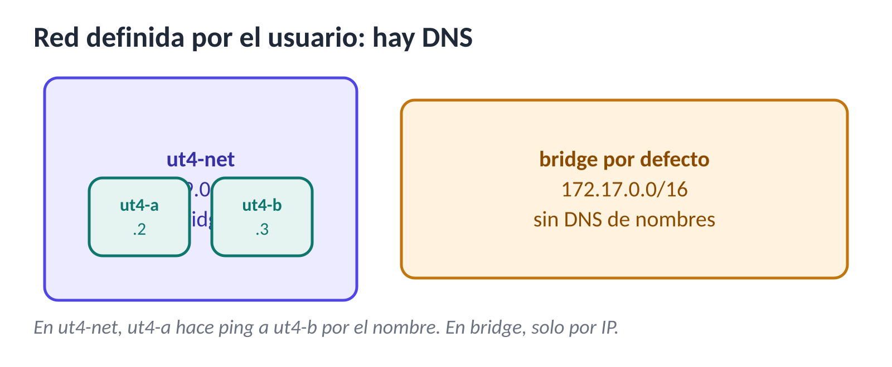
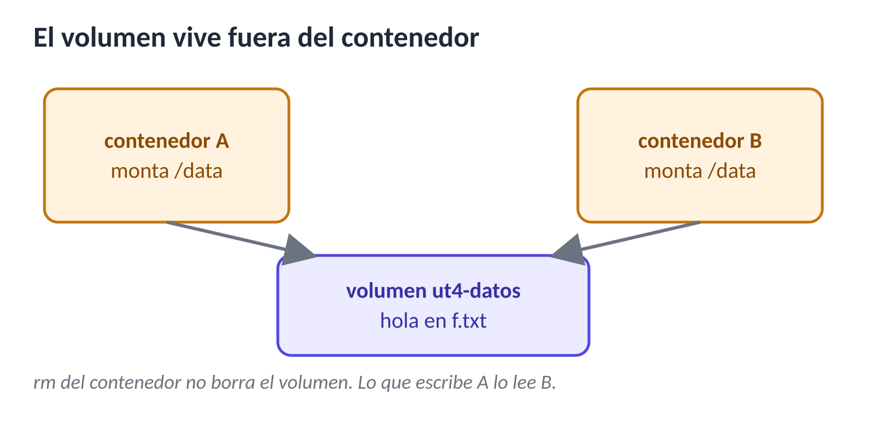
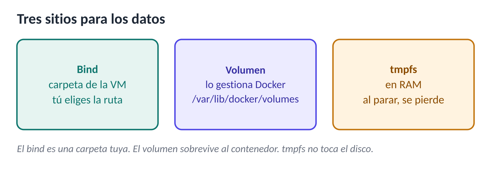

# Cómo usar este dosier {.nobreak}

En la UT3 construiste imágenes. Hasta ahora cada contenedor vivía bastante solo: un Nginx en un puerto, un Alpine en el que hacías `exec`. En esta UT los **conectas entre sí** y les das **sitio donde guardar datos** que no se pierdan al borrar el contenedor.

Es un dosier para leer con la terminal abierta. Conéctate por SSH a `cont-vm` y escribe cada comando a medida que lo leas.

A lo largo del texto encontrarás cuatro tipos de caja:

!!! definicion "Definición"
    Un término que tienes que saber explicar con tus propias palabras.

!!! ejemplo "Ejemplo"
    Un caso concreto, casi siempre con el comando y lo que verás en pantalla.

!!! ojo "Ojo"
    Un error típico, una confusión frecuente o un detalle que conviene tener muy claro.

!!! comprueba "Comprueba"
    Preguntas cortas al final de cada bloque. Si no sabes contestarlas sin mirar, vuelve a leer el bloque.

Cada bloque termina con un apartado **«Míralo en tu máquina»**. Los bloques continúan la numeración de la UT3, que terminó en el bloque 17.

## Qué vas a aprender

Al terminar esta UT deberías ser capaz de:

- **Listar** las redes de Docker y **distinguir** `bridge`, `host` y `none`.
- **Explicar** por qué en la red `bridge` por defecto no hay DNS de nombres y en una red tuya sí.
- **Crear** una red con `docker network create`, con o sin subred CIDR.
- **Conectar y desconectar** un contenedor a una red, con alias y con IP fija.
- **Hacer ping** de un contenedor a otro por el nombre.
- **Montar** una carpeta de la VM en un contenedor (bind) y **distinguirlo** de un volumen.
- **Crear** un volumen, **ver** dónde vive en el disco y **comprobar** que sobrevive a `docker rm`.
- **Usar** `tmpfs` cuando los datos no deben quedar en disco.
- **Hacer** una copia de un volumen a un `.tar`.

## Índice

| Bloque | Contenido |
|---|---|
| [18](#bloque-18-las-redes-que-ya-tienes) | Las redes que ya tienes |
| [19](#bloque-19-crear-una-red-y-conectar-contenedores) | Crear una red y conectar contenedores |
| [20](#bloque-20-bind-una-carpeta-de-la-vm-dentro-del-contenedor) | Bind: una carpeta de la VM dentro del contenedor |
| [21](#bloque-21-volumenes-datos-que-gestiona-docker) | Volúmenes: datos que gestiona Docker |
| [22](#bloque-22-tmpfs-y-copias-de-seguridad) | tmpfs y copias de seguridad |
| Anexos | Glosario, mapa resumen y autoevaluación |

# Bloque 18. Las redes que ya tienes

Un contenedor, por defecto, no está apagado de red: Docker le pone una interfaz y lo cuelga de una red. Si no dices nada, esa red es `bridge`.

## 18.1 Tres redes de serie

```bash
docker network ls
```

```
NETWORK ID     NAME      DRIVER    SCOPE
94992496db99   bridge    bridge    local
6d021556083e   host      host      local
d688b787656c   none      null      local
```

En tu VM pueden salir más (`guardies_default`, `pihole_default`…): las crea Compose. Las tres de serie son estas:

| Nombre | Driver | Qué hace |
|---|---|---|
| **bridge** | bridge | Red por defecto. Cada contenedor tiene IP en `172.17.0.0/16`. NAT hacia fuera. |
| **host** | host | El contenedor usa la pila de red de la VM. No hay IP propia. |
| **none** | null | Sin red. Ni ping a 1.1.1.1. |

!!! definicion "Definición"
    **Red `bridge` por defecto**: red que Docker crea al instalarse (`docker0` en la VM). Si haces `docker run` sin `--network`, el contenedor va aquí.

```bash
docker network inspect bridge --format '{{json .IPAM.Config}}'
```

```
[{"Subnet":"172.17.0.0/16","Gateway":"172.17.0.1"}]
```

## 18.2 En `bridge` no hay DNS de nombres

Dos contenedores en la red por defecto **se ven por IP**, no por el nombre.

```bash
docker run -d --name ut4-x alpine:3.20 sleep 120
docker run -d --name ut4-y alpine:3.20 sleep 120
docker exec ut4-x ping -c 1 ut4-y
```

```
ping: bad address 'ut4-y'
```

La IP sí responde:

```bash
docker inspect -f '{{range .NetworkSettings.Networks}}{{.IPAddress}}{{end}}' ut4-y
docker exec ut4-x ping -c 1 172.17.0.3
```

```
64 bytes from 172.17.0.3: seq=0 ttl=64 time=0.068 ms
```

!!! ojo "Ojo"
    En apuntes antiguos verás «enlázalos con `--link`». Está **obsoleto**. El camino actual es una red definida por el usuario (bloque 19): ahí el nombre del contenedor **sí** resuelve.

## 18.3 `host` y `none`

`--network host`: el proceso usa los puertos de la VM tal cual. `hostname` dentro coincide con el de la VM. No hace falta `-p`. En clase casi no lo usamos: se pierde el aislamiento de red.

`--network none`: no hay interfaz (salvo loopback). Un `ping 1.1.1.1` sale `Network unreachable`. Sirve para un proceso que no debe hablar con nadie.

## Míralo en tu máquina

```bash
docker network ls
docker network inspect bridge --format '{{json .IPAM.Config}}'
docker run -d --name ut4-x alpine:3.20 sleep 60
docker run -d --name ut4-y alpine:3.20 sleep 60
docker exec ut4-x ping -c 1 ut4-y || true
docker inspect -f '{{range .NetworkSettings.Networks}}{{.IPAddress}}{{end}}' ut4-y
docker rm -f ut4-x ut4-y
docker run --rm --network none alpine:3.20 ping -c 1 1.1.1.1 || true
```

!!! comprueba "Comprueba"
    1. Si no pones `--network`, ¿a qué red va el contenedor?
    2. ¿Por qué `ping ut4-y` falla en `bridge` y `ping 172.17.0.3` no?
    3. ¿Qué red usarías para un proceso que no debe tener red?
    4. ¿`--link` es el camino actual para que dos contenedores se encuentren por nombre?

# Bloque 19. Crear una red y conectar contenedores

La red que te interesa en clase (y en Dual) es una **bridge definida por el usuario**. Docker le pone DNS: el nombre del contenedor resuelve a su IP.

## 19.1 `docker network create`

!!! definicion "Definición"
    **Red definida por el usuario**: red que creas tú con `docker network create`. Por defecto es `bridge`. A diferencia de la `bridge` de serie, **tiene DNS interno**: los contenedores se encuentran por el nombre.

```bash
docker network create --subnet 10.89.0.0/24 --gateway 10.89.0.1 ut4-net
docker network inspect ut4-net --format '{{.Driver}} {{(index .IPAM.Config 0).Subnet}}'
```

```
bridge 10.89.0.0/24
```

El formato de la subred es **CIDR** (`10.89.0.0/24`: 256 direcciones, de las que Docker reserva la de red y la de gateway). Si no pones `--subnet`, Docker elige una sola.

```bash
docker run -d --name ut4-a --network ut4-net alpine:3.20 sleep 300
docker run -d --name ut4-b --network ut4-net alpine:3.20 sleep 300
docker exec ut4-a ping -c 2 ut4-b
```

```
PING ut4-b (10.89.0.3): 56 data bytes
64 bytes from 10.89.0.3: seq=0 ttl=64 time=0.055 ms
```

`ut4-a` es `10.89.0.2`, `ut4-b` es `10.89.0.3`. El ping va **por el nombre**.

<figure></figure>

## 19.2 Conectar después de crear: `connect` y `disconnect`

`--network` se indica al **crear** el contenedor. Si ya existe, lo enganchas a otra red (un contenedor puede estar en varias):

```bash
docker network create ut4-net2
docker network connect --alias web ut4-net2 ut4-a
```

`--alias web` hace que, **en esa red**, `web` resuelva a `ut4-a`. Un contenedor nuevo en `ut4-net2` puede hacer `ping web`.

```bash
docker run --rm --network ut4-net2 alpine:3.20 ping -c 1 web
```

```
PING web (172.21.0.2): 56 data bytes
```

Para soltarlo: `docker network disconnect ut4-net2 ut4-a`.

`--network-alias` (al hacer `run`) es lo mismo que `--alias` en `connect`.

## 19.3 IP fija

```bash
docker run -d --name ut4-fijo --network ut4-net --ip 10.89.0.50 alpine:3.20 sleep 60
```

La IP tiene que estar en la subred de esa red. `--ip6` hace lo mismo en IPv6 si la red la tiene. En clase, salvo que el enunciado lo pida, deja que Docker asigne.

!!! ojo "Ojo"
    Publicar un puerto (`-p 8080:80`) sigue siendo cosa del **anfitrión**, como en la UT1. La red interna es para que **los contenedores hablen entre ellos**. Un Nginx que solo tiene que servir a la VM sigue necesitando `-p`.

## Míralo en tu máquina

```bash
docker network create --subnet 10.89.0.0/24 ut4-net
docker run -d --name ut4-a --network ut4-net alpine:3.20 sleep 120
docker run -d --name ut4-b --network ut4-net alpine:3.20 sleep 120
docker exec ut4-a ping -c 2 ut4-b
docker inspect -f '{{.Name}} {{range .NetworkSettings.Networks}}{{.IPAddress}}{{end}}' ut4-a ut4-b
docker rm -f ut4-a ut4-b
docker network rm ut4-net
```

!!! comprueba "Comprueba"
    1. ¿Qué ganas con una red tuya que no tienes en `bridge`?
    2. ¿Un contenedor puede estar en dos redes a la vez?
    3. ¿`--alias web` se ve desde todas las redes o solo desde la de `connect`?
    4. ¿`-p 80:80` y estar en `ut4-net` hacen lo mismo?

# Bloque 20. Bind: una carpeta de la VM dentro del contenedor

El sistema de archivos del contenedor se **borra** con `docker rm` (UT2). Si la web o la base de datos viven ahí, se van. Un **montaje** pone un directorio de fuera dentro del contenedor.

## 20.1 Bind mount

!!! definicion "Definición"
    **Bind mount**: una carpeta (o un archivo) de la VM montada en una ruta del contenedor. La ruta del anfitrión la eliges tú. Lo que se escribe en un lado se ve en el otro.

La ruta de la VM tiene que ser **absoluta**.

```bash
mkdir -p ~/ut4-sitio
echo '<h1>Hola desde la VM</h1>' > ~/ut4-sitio/index.html
docker run -d --name ut4-web -p 18081:80 \
    -v ~/ut4-sitio:/usr/share/nginx/html:ro \
    nginx:1.29-alpine
curl -s http://localhost:18081
```

`:ro` es solo lectura dentro del contenedor: Nginx no puede pisar tus archivos. Sin `:ro`, un proceso del contenedor **sí** puede borrar el `index.html` de tu carpeta.

!!! ojo "Ojo"
    El montaje se indica **al crear** el contenedor (`run` o `create`). No se añade después con un flag a un contenedor ya creado. Si te has equivocado de ruta, `rm` y vuelve a crearlo.

El bind **no se borra** al borrar el contenedor: la carpeta `~/ut4-sitio` sigue en tu `$HOME`. Por eso vale para probar una versión nueva de la imagen sin rehacer los archivos: cambias la imagen, montas la misma carpeta.

## 20.2 Lo que no es un bind

`-v ut4-datos:/data` (sin barra al inicio del origen) **no** es un bind: es un **volumen** (bloque 21). Docker interpreta lo que no empieza por `/` o `./` como nombre de volumen.

```bash
docker run --rm -v ut4-datos:/data alpine:3.20 ls /data
```

Si `ut4-datos` no existe, Docker **crea** un volumen con ese nombre. No es tu carpeta `ut4-datos` del `$HOME`.

## Míralo en tu máquina

```bash
mkdir -p ~/ut4-sitio
echo '<h1>Hola desde la VM</h1>' > ~/ut4-sitio/index.html
docker run -d --name ut4-web -p 18081:80 \
    -v ~/ut4-sitio:/usr/share/nginx/html:ro nginx:1.29-alpine
curl -s http://localhost:18081
echo '<h1>Cambio en caliente</h1>' > ~/ut4-sitio/index.html
curl -s http://localhost:18081
docker rm -f ut4-web
ls ~/ut4-sitio
```

!!! comprueba "Comprueba"
    1. ¿La carpeta de la VM se borra con `docker rm`?
    2. ¿Puedes añadir un bind a un contenedor que ya está creado?
    3. ¿Qué cambia `:ro`?
    4. `-v datos:/data`, ¿es un bind o un volumen? ¿Por qué?

# Bloque 21. Volúmenes: datos que gestiona Docker

Un volumen es el camino **recomendado** para datos persistentes de una aplicación (base de datos, uploads). Docker elige dónde vive en disco. Tú le pones un nombre.

## 21.1 Crear y montar

```bash
docker volume create ut4-datos
docker volume ls
docker volume inspect ut4-datos --format '{{.Mountpoint}}'
```

```
/var/lib/docker/volumes/ut4-datos/_data
```

!!! definicion "Definición"
    **Volumen**: almacén que gestiona Docker. Tiene nombre, vive bajo `/var/lib/docker/volumes/` y se monta en un contenedor con `-v nombre:/ruta` o `--mount`.

```bash
docker run --rm -v ut4-datos:/data alpine:3.20 sh -c 'echo hola > /data/f.txt'
docker run --rm -v ut4-datos:/data alpine:3.20 cat /data/f.txt
```

```
hola
```

El primer contenedor ya no existe. El segundo lee `hola`. El volumen **no** se ha ido.

<figure></figure>

`docker rm` del contenedor no borra volúmenes. `docker volume rm ut4-datos` sí, si ningún contenedor lo tiene montado.

## 21.2 Volumen anónimo

```bash
docker run -d --name ut4-anon -v /data alpine:3.20 sleep 30
docker inspect -f '{{range .Mounts}}{{.Name}} {{.Destination}}{{end}}' ut4-anon
```

Sin nombre a la izquierda, Docker crea un volumen con ID largo. Es fácil de olvidar. En clase, **pon nombre**.

## 21.3 Bind frente a volumen

<figure></figure>

| | Bind | Volumen |
|---|---|---|
| Origen | Una ruta tuya en la VM | Un nombre; Docker elige la ruta |
| Dónde vive | Donde tú digas (`~/ut4-sitio`) | `/var/lib/docker/volumes/…/_data` |
| Quién lo borra | Tú (`rm -rf` de la carpeta) | `docker volume rm` |
| Uso típico | Código que estás editando, un `index.html` de pruebas | Datos de una aplicación (Postgres, uploads) |

!!! ojo "Ojo"
    `docker volume prune` borra los volúmenes que no está usando ningún contenedor. Si acabas de borrar el contenedor de la base de datos, el volumen con los datos **entra** en esa lista. No lo lances a ciegas.

## Míralo en tu máquina

```bash
docker volume create ut4-datos
docker run --rm -v ut4-datos:/data alpine:3.20 sh -c 'echo hola > /data/f.txt'
docker run --rm -v ut4-datos:/data alpine:3.20 cat /data/f.txt
docker volume inspect ut4-datos
docker volume rm ut4-datos
```

!!! comprueba "Comprueba"
    1. ¿`docker rm` del contenedor borra el volumen?
    2. ¿Dónde vive en disco un volumen llamado `ut4-datos`?
    3. ¿Cuándo usarías un bind y cuándo un volumen?
    4. ¿Qué riesgo tiene `docker volume prune` justo después de borrar un Postgres?

# Bloque 22. tmpfs y copias de seguridad

No todo tiene que sobrevivir. Y lo que sí sobrevive conviene poder copiarlo.

## 22.1 tmpfs: en RAM

!!! definicion "Definición"
    **tmpfs**: montaje en memoria. Lo que escribas no va al disco de la VM. Al parar el contenedor, desaparece.

```bash
docker run --rm --tmpfs /scratch alpine:3.20 sh -c 'echo x > /scratch/a && cat /scratch/a && df -t tmpfs'
```

Dentro, `/scratch` aparece como `tmpfs`. Sirve para secretos que no quieres dejar en una capa, o para caché que no importa perder.

No es un bind ni un volumen: no hay carpeta en `/var/lib/docker/volumes` ni en tu `$HOME`.

## 22.2 Copia de un volumen a un `.tar`

Docker no tiene `volume export`. El truco de clase: un contenedor que monta el volumen **y** una carpeta de la VM, y hace `tar`.

```bash
docker volume create ut4-datos
docker run --rm -v ut4-datos:/data alpine:3.20 sh -c 'echo hola > /data/f.txt'
docker run --rm -v ut4-datos:/data -v /tmp:/backup alpine:3.20 \
    tar -c -f /backup/ut4-datos.tar -C /data .
ls -l /tmp/ut4-datos.tar
```

Para restaurar: el mismo esquema, `tar -x` sobre un volumen vacío.

Un bind se copia como cualquier carpeta de la VM (`tar`, `cp`, rsync). No hace falta un contenedor.

## 22.3 Plugins (solo para situarte)

Docker admite **plugins** de volumen (por ejemplo `sshfs`: el volumen vive en otra máquina por SSH). En este módulo no los instalamos. Si en Dual te los encuentras, el comando sigue siendo `-v nombre:/ruta`; cambia el driver.

## Míralo en tu máquina

```bash
docker run --rm --tmpfs /scratch alpine:3.20 sh -c 'echo x > /scratch/a && cat /scratch/a'
docker volume create ut4-datos
docker run --rm -v ut4-datos:/data alpine:3.20 sh -c 'echo hola > /data/f.txt'
docker run --rm -v ut4-datos:/data -v /tmp:/backup alpine:3.20 \
    tar -c -f /backup/ut4-datos.tar -C /data .
ls -l /tmp/ut4-datos.tar
docker volume rm ut4-datos
rm -f /tmp/ut4-datos.tar
```

!!! comprueba "Comprueba"
    1. ¿Un archivo en tmpfs sobrevive a `docker rm`?
    2. ¿Cómo copias un volumen a un archivo si no hay `volume export`?
    3. ¿Un bind se copia igual que un volumen?
    4. ¿`docker volume prune` borra tmpfs?

# Glosario

| Término | Definición |
|---|---|
| **Alias de red** | Nombre extra de un contenedor en una red concreta (`--alias` / `--network-alias`) |
| **Bind mount** | Carpeta o archivo de la VM montado en el contenedor; la ruta la eliges tú |
| **bridge (por defecto)** | Red de serie `172.17.0.0/16`. Sin DNS de nombres entre contenedores |
| **CIDR** | Forma de escribir una subred (`10.89.0.0/24`) |
| **DNS interno** | En una red tuya, el nombre del contenedor resuelve a su IP |
| **Red definida por el usuario** | Red creada con `docker network create`. Por defecto, bridge con DNS |
| **tmpfs** | Montaje en RAM; al parar el contenedor se pierde |
| **Volumen** | Almacén con nombre que gestiona Docker, bajo `/var/lib/docker/volumes` |
| **Volumen anónimo** | Volumen sin nombre, creado con `-v /ruta` a secas |

# Mapa resumen

```text
REDES
   docker network ls                     bridge, host, none (+ las de Compose)
   sin --network  →  bridge por defecto  ping por IP sí; por nombre no
   --network host                        pila de la VM; sin -p
   --network none                        sin red
   docker network create [ --subnet CIDR ] NOMBRE
   --network NOMBRE al crear el contenedor
   docker network connect [--alias X] [--ip A.B.C.D] RED CONT
   docker network disconnect RED CONT
   DNS: el nombre del contenedor (y el alias) resuelven en esa red
   -p sigue siendo publicar en el anfitrión; la red interna es entre contenedores

DATOS
   Bind     -v /ruta/vm:/ruta/cont[:ro]     absoluta; al crear; no se borra con rm
   Volumen  docker volume create NOMBRE
            -v NOMBRE:/ruta                 vive en /var/lib/docker/volumes/NOMBRE/_data
            rm del contenedor NO lo borra; volume rm sí
   tmpfs    --tmpfs /ruta                   RAM; al parar, se pierde
   Copia    contenedor que monta volumen + /backup y tar
   prune    volume prune borra los que no usa ningún contenedor: ojo con las bases de datos
```

# Autoevaluación

## Preguntas cortas

1. ¿A qué red va un `docker run` sin `--network`?
2. ¿Por qué `ping nombre` falla en `bridge` y funciona en una red tuya?
3. ¿`--link` es el camino actual?
4. ¿Un contenedor puede estar en dos redes?
5. ¿El bind se indica al crear o se puede añadir después?
6. `-v datos:/data`, ¿bind o volumen?
7. ¿`docker rm` borra el volumen?
8. ¿Dónde vive en disco el volumen `ut4-datos`?
9. ¿Qué le pasa a un archivo en tmpfs al parar el contenedor?
10. ¿Cómo haces una copia de un volumen a un `.tar`?

## Tipo test

1. En la red `bridge` por defecto, dos contenedores…
   a) Se encuentran por el nombre  b) Se encuentran por IP, no por el nombre  c) No se ven ni por IP  d) Usan la IP de la VM
2. `docker network create ut4-net` crea, por defecto…
   a) Una red host  b) Una red none  c) Una bridge con DNS interno  d) Un volumen
3. `--alias web` en `connect`…
   a) Renombra el contenedor en `docker ps`  b) Hace que, en esa red, `web` resuelva a ese contenedor  c) Publica el puerto 80  d) Crea un bind
4. Un bind `-v ~/sitio:/usr/share/nginx/html:ro`…
   a) Borra `~/sitio` al hacer `docker rm`  b) Deja `~/sitio` en la VM; dentro, Nginx no puede escribir  c) Crea un volumen llamado `sitio`  d) Solo funciona con `:rw`
5. Un volumen anónimo es…
   a) Un bind sin ruta absoluta  b) Un volumen sin nombre, creado con `-v /ruta`  c) tmpfs  d) La red none
6. tmpfs…
   a) Se guarda en `/var/lib/docker/volumes`  b) Vive en RAM y se pierde al parar  c) Es un bind de `/tmp`  d) Sustituye a `-p`

## Razona

1. Tienes un Postgres en un contenedor y los datos en un volumen. Haces `docker rm -f postgres` y luego `docker volume prune`. ¿Qué les ha pasado a los datos? ¿Qué tendrías que haber hecho para no perderlos?
2. Dos contenedores, `web` y `api`, tienen que hablar por el nombre `api`. ¿Los dejas en `bridge`? Escribe los comandos mínimos.
3. Quieres editar `index.html` en tu editor de la VM y ver el cambio en Nginx sin reconstruir la imagen. ¿Bind o volumen? ¿Por qué?
